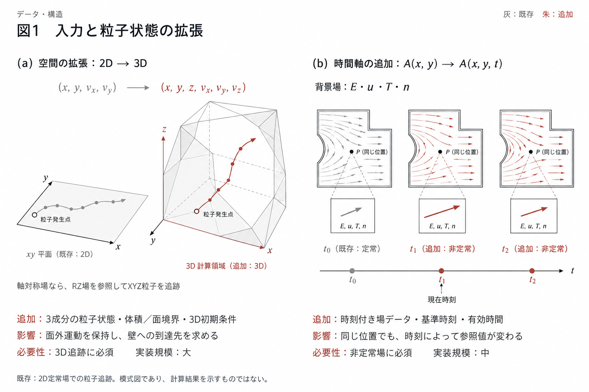
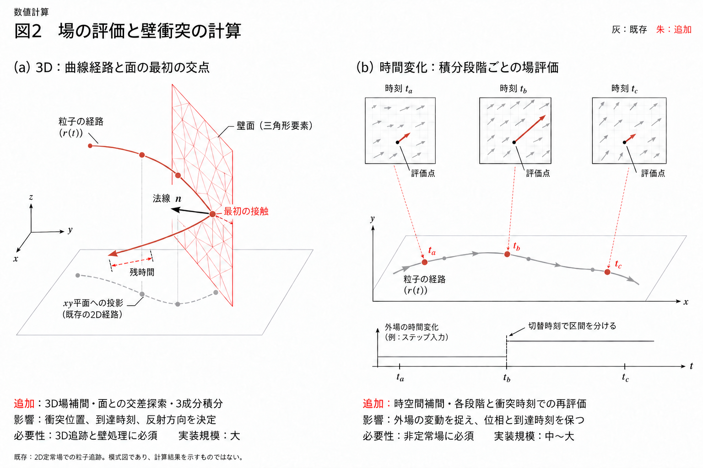
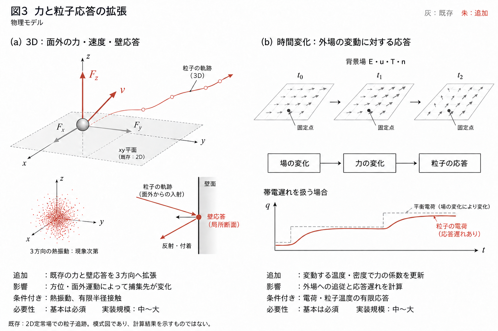
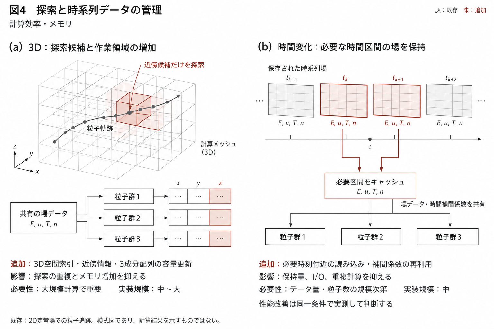

# 3D粒子軌道計算・背景場の時間変化への拡張検討

検討日：2026-10-29

## 前提と対象

**2Dの定常な背景場を参照する粒子軌道計算は完成済み**とし、そこから追加するデータ・処理を整理する。
既存の粒子時間積分、外力式、壁応答、結果保存、並列処理は再利用する。

ここで「分布」は、電場・ガス流速・温度・プラズマ密度など、粒子が参照する**背景場の空間分布**を指す。

- **3D化**：背景場 `A(x,y)` を `A(x,y,z)` へ、粒子の位置・速度を2成分から3成分へ拡張する。
- **背景場の時間変化**：背景場 `A(x,y)` を `A(x,y,t)` へ拡張し、粒子の位置と時刻に応じて参照する。
- 両者は独立した拡張軸である。組み合わせれば3D非定常場を扱えるが、組合せごとの検証が必要となる。
- 定常な背景場でも粒子は時間発展する。粒子濃度の時系列集計と、背景場の非定常化は別の機能である。

対象は、静止形状・固定メッシュ上の外部場を読む一方向連成とする。
背景場そのものを解く流体・プラズマ計算、移動メッシュ、粒子から背景場へのfeedbackは本検討の基本範囲に含めない。

本資料は、利用者指定の「2D定常計算が完成した状態」からの設計上の差分であり、
**現行リポジトリの未実装一覧ではない**。現行0.3.0では、固定topologyの時系列場と線形時間補間などが既に実装されている。
現行能力・適用域は[製品仕様](../../product_specification.md)、実装責務とbacklogは
[実装計画](../../implementation_plan.md)を参照する。本資料はそれらの権威文書を置き換えない。

## 必要性・実装コストの読み方

「役割」欄には、完成済みの2D定常計算へ追加・変更する内容を記載する。

- **必須**：選択した拡張または利用条件を成立させるために必要。
- **現象次第**：熱揺動、有限半径接触、帯電遅れなど、その現象を扱う場合に必要。
- **規模次第**：粒子数、場データ量、探索費用など、実測した計算規模に応じて必要。

実装コストは追加開発・接続・検証を含む相対評価であり、人日・納期の見積もりではない。
各項目は共通部分を持つため、コストを単純加算しない。

| 実装コスト | 評価基準 |
|---|---|
| 小 | 入力や保存情報などの局所変更 |
| 中 | 複数機能の接続変更と、その範囲の検証 |
| 大 | 状態・探索・積分・保存形式などを横断する変更と数値検証 |

## 1. 3Dの粒子軌道計算

| 機能項目 | 役割（追加実装内容） | 計算用途 | 必要性 | 実装コスト |
|---|---|---|---|---|
| 設計：粒子状態の3成分化 | 位置・速度を `(x,y)` から `(x,y,z)` へ変更。初期値、計算配列、結果、再開データを3成分に揃える | 奥行き方向・方位方向を含む運動 | 必須 | 大：状態を扱う各層を変更 |
| 設計：3D形状・場データの入力 | 2Dの領域・線境界に代えて、3D体積・面境界を入力。ベクトル場の3方向成分、境界ID、成分の基底を保持する | 非対称チャンバー、側方排気、局所電極 | 完全3D形状・場を使う場合に必須 | 大 |
| 設計：3D初期粒子の生成 | 入力作成側で体積内・表面上の粒子位置と3方向初速を生成。表面放出は面積に応じて配置する | 体積発生、面放出、斜め入射 | 3Dの初期条件を与えるために必須 | 中 |
| 数値：3Dセル探索・場補間 | `(x,y,z)` から所属セルを探索し、3D要素または格子内で場を補間。有効領域外も判定する | 粒子位置での電場・流速・温度の取得 | 完全3D場を使う場合に必須 | 大 |
| 数値：RZ場を使う3D参照 | XYZ位置から半径を求めて既存RZ場を参照。半径方向の場をXYZへ変換し、軸上の扱いを追加する | 軸対称場で方位運動を含む3D追跡 | 軸対称場を再利用する場合に必須 | 中〜大 |
| 数値：軌道と面の衝突判定 | 軌道と線境界の交差を、軌道と面境界の交差へ変更。最初の衝突時刻・位置・3D法線・同時接触面を求める | 壁到達、角部衝突、排出口通過 | 壁・開口部を扱う場合に必須 | 大 |
| 数値：既存積分器の3成分対応 | 各積分段階で位置・速度・加速度の第3成分も更新。衝突時刻までの再積分と残時間処理も3D化する | 3D軌道の時間積分 | 必須 | 中〜大 |
| 数値：3D用の正解・収束確認 | 3D解析軌道、回転した条件での結果一致、軸通過、平面・円筒等への衝突、時間刻み収束を検証する | 第3成分の欠落や法線誤りの検出 | 必須 | 中 |
| 物理：外力の3方向評価 | 既存の抗力・電気力・重力等から3方向の加速度を計算。2D投影を前提とした力には3D式を用意する | 奥行き方向の移動、旋回、横方向偏向 | 採用する力ごとに必須 | 中〜大 |
| 物理：壁応答の3D化 | 入射速度を3D法線・接線方向に分解し、既存の反射・反発・付着則から3方向の衝突後速度を求める | 反射後の移動先、捕集率 | 対応する壁則を使う場合に必須 | 中 |
| 物理：3D熱揺動の追加 | 位置・速度の相関を保った3方向の確率過程を追加し、壁衝突時の処理も対応させる | 微小粒子の拡散・付着 | Brownian運動を扱う場合に必須（現象次第） | 大 |
| 物理：3D有限半径接触 | 点と面の交差に加え、球と面・辺・頂点との最初の接触を求める | 狭隙通過、粒径による捕集差 | 粒径を接触判定に含める場合に必須（現象次第） | 大 |
| 効率化：3D探索索引 | 3Dの境界・セルを索引化し、軌道近傍の候補だけを探索。直前セルの情報も再利用する | 大規模形状・場での探索時間削減 | 実用規模で重要（規模次第） | 中〜大 |
| 効率化：3D配列・並列処理の容量調整 | 既存の粒子並列処理を3成分配列へ接続し、状態・作業領域・通信・出力のメモリ量を再計算する | 多数粒子の3D計算 | 正しい容量計画は必須。効率化は粒子数・データ量次第 | 中 |

### 3D化で区別する点

- **完全3D場を入力する方式**と、**RZ場を参照してXYZ粒子を積分する方式**は用途に応じた選択肢である。後者では、場を3D格子へ複製する必要はない。
- RZ方式の壁衝突では、3D経路をRZへ写像した経路と断面境界の最初の交点を求め、法線をXYZへ戻す。
- 温度・密度などのスカラー場は3成分化せず、参照位置を3D化する。電場・流速などのベクトル場は必要な3成分と基底を扱う。
- 方位運動や3D熱揺動の追加は、2D計算結果の回転表示とは異なる。熱揺動・壁則・力モデルの対応を組合せごとに確認する。

## 2. 背景分布が時間変化する条件での粒子軌道計算

粒子を進める時間積分器は既存のものを利用し、主に「参照する場の時刻」との接続を追加する。

| 機能項目 | 役割（追加実装内容） | 計算用途 | 必要性 | 実装コスト |
|---|---|---|---|---|
| 設計：時刻付き場データの入力 | 1組の定常場を、時刻列 `t[k]` と場データ `A[k,…]` に拡張。各場の単位・基準時刻・有効時間範囲を保持する | 時間変化する電場・流速・温度等の入力 | 必須 | 中 |
| 設計：場と粒子の時計の統一 | 粒子の開始時刻・放出時刻を背景場の絶対時刻へ対応させる。周期場では周期と位相も定義する | パルス開始との同期、異なる位相での投入 | 必須。周期・位相は周期場を使う場合 | 中 |
| 設計：非定常計算の再開情報 | 再開時の絶対時刻、場データの同一性、時間補間方式、周期位相を保存・確認する | 中断前と同じ条件での計算再開 | 再開機能を提供する場合に必須 | 小〜中 |
| 数値：時間方向の場補間 | 評価時刻を挟むsnapshotのprimitive場を時空間補間し、その値から力・帯電率を計算する。時間範囲外を拒否し、外挿・端点固定しない | 保存時刻の間を移動する粒子への場評価 | 時系列場データを使う場合に必須 | 中 |
| 数値：積分途中の時刻での場評価 | 各積分段階の位置・時刻で場を再評価する。ステップ開始時の場を全段階に使う処理を置き換える | 変動場に対する軌道の振幅・位相の計算 | 必須 | 中 |
| 数値：衝突処理と場時刻の整合 | 衝突時刻までの再積分ではその区間の場を参照し、反射後は衝突時刻から残時間を進める | パルス中の衝突、反射後の再加速 | 壁を扱う場合に必須 | 中〜大 |
| 数値：時間刻みの選定基準追加 | 外場の周期・立上り時間を刻み基準に追加。線形補間場ではrequired fieldの時刻節点の和集合でmacro区間を分割し、軌道刻みと入力場の保存間隔を独立に確認する | 高速変動の取りこぼし、位相誤差の抑制 | 必須 | 中 |
| 数値：パルス・不連続切替の処理 | 切替時刻と切替前後の値を定義し、切替を跨ぐ区間を分けて積分する。急変を通常の線形補間でならさない | 電圧ON/OFF、流量切替、矩形波 | 不連続入力を扱う場合に必須 | 中〜大 |
| 数値：過渡軌道の検証 | 時間変動する一様場等の解析解を使い、振幅・位相・到達時刻、補間誤差、再開一致を検証する | 非定常化による計算誤りの検出 | 必須 | 中 |
| 物理：力の係数・適用域の時刻更新 | 定数として保持していた流速・温度・密度等を各積分段階で取得し、抗力係数・緩和時間・適用条件を更新する | ガス条件やプラズマ条件が変わる輸送 | 時間変化する量に依存する力で必須 | 中 |
| 物理：粒子電荷・温度の有限応答 | 必要な状態変数と変化率を追加し、運動と同時に積分する。背景場の変化に対する応答遅れを計算する | 帯電遅れ、加熱・冷却遅れ | 応答遅れを扱う場合に必須（現象次第） | 中〜大 |
| 物理：熱揺動強度の時間更新 | 温度や抗力が変わる場合に、確率過程の係数を更新する規則と精度確認を追加する | 温度・密度変動中のBrownian輸送 | Brownian運動と変動条件を併用する場合に必須（現象次第） | 大 |
| 効率化：時系列場の読み込み管理 | 必要な時間区間のデータを保持・再利用し、大容量の場合は順次読み込む | 長時間・高時間解像度の入力 | データ量が大きい場合に重要（規模次第） | 中 |
| 効率化：時刻探索・補間係数の再利用 | 同じ評価時刻で共通する時刻区間の探索と時間補間係数を粒子間で再利用。場データも既存process間で共有する | 多数粒子での非定常場参照の高速化 | 多数粒子で重要（規模次第） | 中 |

### 時間変化への対応で区別する点

- 最初の範囲は、固定形状・固定メッシュ上の非定常外部場を読む計算とする。背景場の時間変化だけを理由に移動メッシュや二方向連成を追加しない。
- 現行の線形時間補間では、計算に必要な全required fieldの時刻節点の和集合でmacro区間を分割する。不連続なON/OFF切替は別の入力意味論であり、現行対応とは区別する。
- 電場・流速・温度・密度などのprimitive場を時空間補間し、その値から各積分段階の力・帯電率を評価する。非線形な力を各snapshotで計算してから線形補間する方式とは区別する。
- 入力snapshotが粗く、場の高速変動が失われている場合、粒子側の時間刻みだけを細かくしても補えない。
- 粒子電荷・粒子温度の追加状態は、有限応答を表すモデルを選ぶ場合に限る。各物理モデルの適用域を時刻依存で確認する。
- 周期延長、不連続切替、時系列場の逐次読み込みは、その利用条件が必要な場合の拡張案である。現行の時間依存場は固定topology・線形時間補間・全snapshot常駐であり、それらの機能を対応済みとは扱わない。
- 出力時刻を増やすことと、数値積分の時間解像度を上げることは別である。出力要求を理由に全粒子のproduction stepを分割しない。

## 3. 区分ごとのイメージ図

図は模式図であり、実際の計算結果・実測値・性能保証を示さない。
灰色は既存部分、朱色は追加する状態・処理・評価を示す。各図の(a)は3D化、(b)は背景場の時間変化である。
図中の「場の3成分対応」はベクトル場に対する表現であり、スカラー場の扱いは第1節の注記に従う。

### 図1：データ・構造

粒子状態、参照する座標、形状・場の入力、時刻付き場データをまとめる。

### 図2：数値計算

3Dの場補間・最初の壁接触と、各積分段階の位置・時刻で場を評価する処理をまとめる。

### 図3：物理モデル

3方向の力・速度・壁応答と、変動する場に対する力の更新・有限応答をまとめる。

### 図4：計算効率・メモリ

3D探索と配列容量、時系列場のキャッシュ・共有による保持量と重複計算の抑制をまとめる。

## 参照する所有文書

- [製品仕様](../../product_specification.md)：製品の範囲、非目標、対応する座標・物理・場。
- [アーキテクチャ](../../architecture_proposal.md)：各moduleの責務と依存方向。
- [実装計画](../../implementation_plan.md)：既存の実装範囲、P17を含む将来項目と完了条件。
- [技術調査](../../technical_research.md)：方程式、数値手法、物理モデルの適用域。
