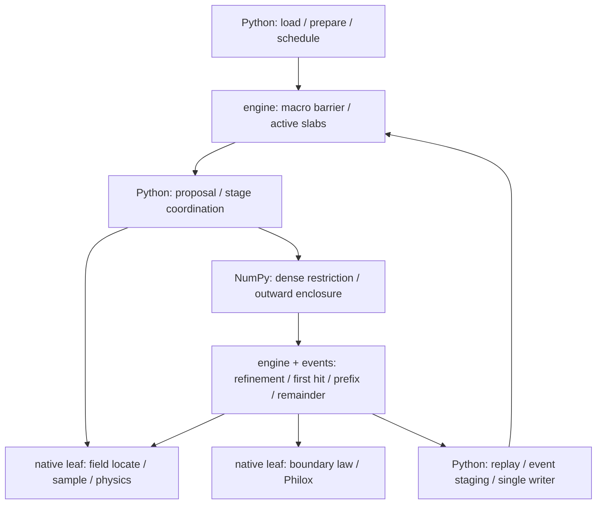
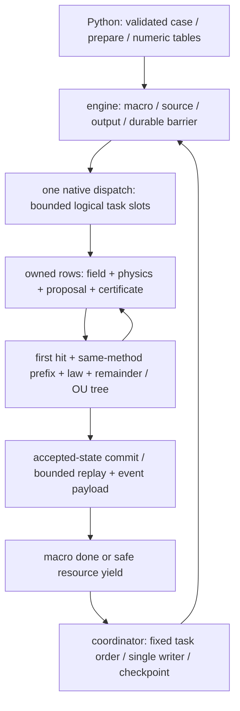

# CPU実行・性能設計：P14-P closeoutと0.3.0改良

2026-10-12の利用者指示で追加JIT化を停止し、既存数値engineによる同一runのprocess並列を先行する。
従前のnative chain/team案と不採用計測は履歴として保持し、現在の工程と所有境界はimplementation plan第21.4節が所有する。
thread pool/Numba maskは復活させず、共有配列・永続worker・親single writer・macro barrierを公開whole-runで評価する。
この方針変更自体は速度・memory・0.3.0公開の認定ではない。

公開済み0.2.0のrelease sourceはsingle-thread compiled engineとして固定する。現行開発sourceはprocess配分・共有memoryを改良したv62である。第1～8節は履歴と完了済みの判断を保持し、
第9節は2026-10-10のコード・保存profile・一次技術資料に基づく0.3.0設計と、その後の実装指示による
native owner移行の証拠を所有する。第9.13節は保存v47、第9.14節は保存v48、第9.15節は保存v49、
第9.16節は保存v50、第9.17節は保存v51、第9.18節はstage所有変更のv52と保存v53を区別する。
現行v62の資格・残件はimplementation plan第21.4節で扱い、現行revision一覧はresult format文書が所有する。
保存v54/v55の観測は第9.19/9.20節、保存v56の完全base-leaf継続基盤・終端配列の所有整理とR59試作は第9.21/9.22節、保存v57のregular field改善は第9.23節、保存v58のscalar丸めowner改善は第9.24節、保存v59の出力所有整理は第9.25節、保存v60/v61は第9.26節へ保持する。現行process並列sourceの品質・性能・配布状態は第9.27節が所有する。
v62のcoordinator・memory所有改良、全標準品質、主八用途164結果と別scopeの時間場20結果、Windows/Linuxの公開前local gate・wheel/clean installを完了した。package versionは公開前の0.3.0で、tag・publish・pushとremote CIは実施していない。残る正式公開工程と条件付きの用途拡大はimplementation plan第21.4節へ集約する。
v48のBrownian絶対終端時計は数値方針変更として識別し、OU/RNG/積分式を維持する。

## 1. 結論

P14-Pは複数thread機能を不採用として完了した。P14-P closeout時点の製品runtimeは
`deterministic_particle_engine_v27` / `compiled_cpu_tile_v6` /
`resident_soa_serial_slab_v5` のsingle-thread compiled engine一つである。P15-F完了時点のrevisionは
engine v28 / compiled tile v10 / physics catalog v8 / physics runtime v7であり、後続model追加も同じruntime layout v5と
単一直列実行原理を維持する。
case schema v2は`resources.memory_limit_mb`だけを持ち、旧`resources.threads`を未知keyとして拒否する。
result schema v1、物理式、first-event意味論、RNG key、bounded-memory方針は変更していない。

独立caseの同時実行はsolver外のprocess並列で行う。solver内部にはouter pool、Numba thread mask、
multiprocessing backend、自動tuner、experimental parallel flagを残さない。

## 2. 判断の根拠

P14のouter worker-waveは一部の大規模regular caseだけで改善したが、主用途を含むevent-heavy caseでは遅化し、
worker数に比例するscratchも増えた。

| P14履歴workload | 1 worker | 20 workers | speedup |
|---|---:|---:|---:|
| regular 100k | 0.783874 s | 0.417049 s | 1.8796x |
| regular 1M | 7.534041 s | 1.570727 s | 4.7965x |
| P1 cross-cell 10k | 0.747215 s | 0.636655 s | 1.1737x |
| Q1 cross-cell 10k | 0.894859 s | 0.779968 s | 1.1473x |
| exact event 10k × 20 hit | 33.509603 s | 37.728221 s | 0.8882x |

P14-Pではouter poolを削除し、thread数非依存slab、再利用workspace、stackless boundary BVH、row-target
flat SoA event wavefront、compiled boundary/Philox、direct columnar replay、bounded event/failure stagingへ
置換した。その上で一回だけprofile根拠のfocused correctionを行った。

regular 1M、4 macro-stepの同一machine warm実測は次だった。

| active threads | simulate |
|---:|---:|
| 1 | 9.32 s |
| 2 | 10.09 s |
| 4 | 10.10 s |

4-thread speedupは0.923xで、事前gateの2.0xを満たさない。新1-threadもP14のv20履歴値7.534 sより
約23.7%遅く、許容した10% regressionを超えた。一方、1M行のfield locator microkernelは
1/2/4 threadで0.03360/0.01686/0.00897 s、約3.75xだったため、thread team自体の故障ではない。

profileでは約9.42 sのうち、proposal約8.15 s、curved-path enclosure約4.17 s、RK4 step約3.98 sを占めた。
これらは入れ子のcumulative timeであり、加算してexclusiveな時間比にはしない。
field locator等の並列leafより、Python/NumPyでのstage調停、配列操作、upper-bound bookkeepingが支配した。
参考モデルとして4.17/9.42を並列化可能な比率と仮定しても、enclosureだけの4-thread上限は約1.50xで、
2.0x gateには届かない。この仮定はexclusive profileに基づく予測ではない。P14-Pでは追加の融合kernelや
第二schedulerを積まずに終了した。将来のownerを保つ粗粒度実行の再検討は第9節の別work packageで扱う。

## 3. 維持する成果

並列化の採否と無関係に、次は直列runtimeの有用な構造として維持する。

- resident SoA stateとmemory-limit由来のbounded slab
- field/physics/integratorの再利用workspaceと`*_into` leaf
- row別target timeによるrelease、hit prefix、残時間の統一
- exact/curved/axis/residualのflat SoA wavefront
- stackless boundary BVHとbounded candidate arena
- compiled boundary responseとparticle-ID/physical-ordinal基準のPhilox
- direct columnar frame/probe replayと同期single-owner writer
- event/failureのbounded stagingとstable physical-key order

これらは10^4～10^6粒子へのmemory scaling、Python object増殖の抑制、数値責務の明確化に寄与する。

## 4. 削除したもの

- `resources.threads`とthread-bearing case schema v1
- runtime thread mask、thread-team context、threading-layer manifest
- parallel acceptance driver `tests/performance/p14p_parallel.py`
- thread identityだけを検査するverification/scenario
- thread数別memory branch、worker別scratch、outer executor、future wave
- multithreading採用を示す現行文書とCLI例

履歴P12/P14の測定値は方式を再採用する根拠ではなく、不採用判断を再現する証拠としてだけ残す。

## 5. 現行runtimeと測定

`tests/performance/p14_matrix.py`は直列専用の外部harnessである。各観測を独立process・private Numba cacheで実行し、
`NUMBA_NUM_THREADS=1`を固定する。10k/100k/1M、regular/P1/Q1、initial/cross-cell、event量、output量、cold/warmを
測り、三公開API、科学payload digest、memory plan、revision、result shapeを検査する。thread scalingや
thread manifestは測らない。

P14-Pの測定artifactは履歴証拠であり、現行製品の受入harnessではない。保存済みartifactの値を再構成したり、
存在しないv20 payload digestを捏造しない。

直列化後のv27について、同じregular 1M・4 macro-stepを独立process、各1回warm-upで3回測定したsimulate時間は
10.249/10.273/10.100 s、median 10.249 sだった。v26の1-thread観測9.32 sより約10.0%、v20履歴値
7.534 sより約36.0%遅い。これはmultithreadingを復活させる理由ではない。P14-Uの別1M profileではself-timeが
events 28.7%、fields 26.8%、engine 11.8%、integrators 11.7%、runtime/dependency 11.7%へ分散し、単一ownerの
限定変更でend-to-end改善を説明できなかった。代表用途1M median `simulate`は`none` 550.43 s、sample 533.95 sで、
当該machineの製品制約として記録し、production変更は行わない。

## 6. 再検討条件

P14-Uのprofileはこの再検討条件を満たさなかった。今後の代表用途profileで、直列runtimeでは製品目標を満たせず、かつcompiled owner内の限定変更で
end-to-end改善を説明できる場合だけ、新しいwork packageとして再検討する。その時も先に利用case、対象phase、
科学identity、memory上限、削除条件を定める。次は再導入しない。

- case設定によるthread mask
- Python worker poolとNumba内部parallelの併存
- model/layout別kernel生成framework
- parallel/serial二つのproduction engine
- benchmarkにだけ効く巨大融合kernel

case sweepのprocess並列、cluster scheduler、GPUはsolver coreと別の実行層であり、このcloseoutを変更しない。

## 7. P14-P完了時点の次工程（履歴）

順序は次で固定する。

```text
P14-P serial convergence（完了）
  -> P14-U representative accuracy/utility/performance（完了）
  -> T03 analysis/visualization（完了）
  -> P14-R local release audit（完了、remote workflow初回成功は未完了）
  -> P15 stationary continuous charge（完了）
  -> P15-D finite-relative-drift continuous charge（完了）
  -> P15-E finite-speed Epstein revision
```

P14-Uは並列方式の選定ではなく、完成した単一直列runtimeを表面発生、非一様場、複数力、材料壁、多数stepで
評価して完了した。固定mesh上の時間収束、固定aspectの2D mesh収束、event failure、peak memory、出力量を同時に測った。
10k/100k/1Mのnone/sampleは各3 fresh process、1M profileは別の非計時runとし、mode間core／mode内probe payloadとevent workを
一致させる。profileが単一のproduction ownerを支配要因として示した場合だけ責務内の限定変更を検討し、
`runtime_or_dependency`が最大の場合や費用が複数ownerへ分散する場合は並列runtime再導入の根拠にしない。

## 8. M3-C2A closeoutと条件付き性能work package

上記P14-P/P14-U値と、M3-C2A closeout時のengine v39 / compiled tile v20 / proposal v10 / runtime v21 /
event v16 / memory plan v14は履歴である。完全な現行algorithm rosterは
[`implementation_plan.md`](../../implementation_plan.md)と実行manifestをauthorityとする。M3-C2A common-P1 Case-P 100 nm finalは20 us、32+32独立seed、各287粒子、30 ms、
121 frameで完了した。登録済み83区分R-Z/fate gateは最大empirical TV `0.010670731707317093`、同時上限
`0.13119968456545308 < 0.15`で`PASS`した。終端gateはevent 0のため境界parityには情報を持たない。元Case-P `auxq`どおりの
二電流same-form結果であり、後続three-current、species-resolved物理、pathwise RNG、普遍的COMSOL同等性、boundary parityは認定しない。
比較は引き続き外部V&Vである。final candidate計時は4外部processが重なったため
`NON_AUTHORITATIVE_EXTERNAL_WORKLOAD_OVERLAP`であり、性能判断やCOMSOLとの速度比には使わない。

受理済みstep、Brownian tree depth、geometry tolerance、30 ms、全力場条件を変えないcandidate seed `319032`、`319047`、
`319063`の287粒子owner discoveryは完了した。各fresh childのwarm-up後に非profile計時と別`cProfile`を行い、すべてのrerunで
受理済み科学payload・work・case identity・revisionが完全一致した。3 seedの支配ownerは`integrators`、自己時間比は
42.58--42.86%、非profile public end-to-end wall medianは45.4668 sだった。ただし`integrators`は事前登録済みbounded ownerでなく、
automatic decisionは`owner_discovery_consistent=false`、`optimization_authorized=false`である。したがって本体変更はなく、
この結果を後付けで既存25% gateの合格へ読み替えない。authorityは
[`../evidence/m3c2/caseP_100nm_owner_profile_v1/`](../evidence/m3c2/caseP_100nm_owner_profile_v1/README.md)である。

完了したdiscoveryは三公開APIを通し、次を同時に記録した。

- macro root、OU leaf、accepted piece、candidate query、refinement、wall/axis/restart数
- field locate/sample、physics coefficient、OU/RNG/charge、event broad/localize、boundary、writerの時間比
- solver-owned memory plan、process peak RSS、artifact bytes、writer throughput
- 受理済み121-frame scheduleを固定した科学payload、RNG/event identity。slab独立性は既存P14/P20受入れを参照し、
  この287粒子profileでは再主張しない

M3-C2Aの終了状態と再開条件は[`../../implementation_plan.md`](../../implementation_plan.md)のcloseout authorityが所有する。
状態は`CLOSED_ACCEPTED_WITH_LIMITATIONS`であり、10,000粒子確認、100,000/1,000,000粒子scale、外部process並列は
benchmark完了条件でも自動的な次工程でもない。

製品利用者が対象hardware、粒子数、30 msの物理条件、output mode、許容wall time、peak RSSを明示した場合だけ、独立した
`accepted-workload performance` work packageを開始する。最初のworkloadは同じaccepted-accuracy設定の10,000粒子一件に固定する。
元table 287行を順番どおりcycleし、先頭287行、粒子ID、RNG addressing、revision、step、tree depth、toleranceを不変にする。
jitter、再標本化、model weight変更、accuracy変更は混ぜない。

低オーバーヘッド計測は外部harnessから`_proposal_chord_deviation_bounds`、`_proposal_event_bounds`、
`count_curved_event_candidates`、`locate_curved_first_event_batch`の四境界だけを一つのcurved-event処理鎖として計時する。
timerをproductionへ追加せず、計時overheadをend-to-endの1%未満とする。この鎖が非profile wall timeの25%以上を説明する場合だけ、
外向きenclosure、endpoint、candidate ordering、RNG/event意味を変えない一変更を一度評価する。同条件の3反復で科学payload・work identity、
wall/process CPU、peak RSSを比較し、改善が`max(5%, 3 MAD)`を超えなければrevertして終了する。通過しても次ownerへ移らない。

100,000/1,000,000粒子、no-output対121 frame、外部1/2/4 process並列は、最初の10,000粒子work packageから自動続行しない。
それぞれを要求するSLAがある時だけ別work packageを開く。solver内部thread pool、Numba parallel mask、serial/parallel二engine、
model別kernel framework、autotuner、benchmark専用巨大融合kernelは再導入しない。

### 受理済みCase-P chord follow-up（完了）

利用者の明示指示により、製品scale認定とは分離した一回限りのbounded maintenanceを実施した。owner discoveryで既に
12,000 batch / 3,444,000 accepted pieceに現れていた`curved_chord_deviation_bounds`だけを対象に、Pythonのrow×axis loopを
serial compiled batchへ置換し、event側の重複式とscalar helperを同じ変更で削除した。新しいtimer、設定、runtime、event経路、
threadingは追加していない。

同じaccepted seed 3件の非profile public end-to-end wall中央値は45.4668 sから39.8801 sへ12.29%短縮した。全seedで科学payload、
algorithm revision、1,500 macro / 3,444,000 OU leaf / accepted piece / candidate queryが完全一致し、failure/event/refinementも不変だった。
5%と3 baseline MADの大きい方を超えたため変更を保持し、このfollow-upは終了する。authorityは
[`../evidence/m3c2/caseP_100nm_chord_optimization_v1/`](../evidence/m3c2/caseP_100nm_chord_optimization_v1/README.md)である。

これは287粒子accepted workloadの実装効率改善であり、10,000粒子以上の製品throughput、portable speedup、正式COMSOL速度比を
認定しない。したがって上記SLA-backed 10,000粒子work packageを暗黙に開始せず、次owner、broad-phase再設計、内部並列へも
自動的に進まない。

## 9. 0.3.0：計算処理鎖の再構成と粗粒度CPU並列化の設計案

第9.1～9.12節は追加JIT停止前の設計案、第9.13～9.25節は各sourceの実装・採否履歴として保持する。
native chain→yield/slots→native teamの順序は現行の先行条件ではない。現行計画はimplementation plan第21.4節、
既存数値bodyによる現行process並列の採否状態は第9.27節、保存v60/v61の採否は第9.26節が所有する。

### 9.1 判断と対象

利用者の明示依頼により、過去方式の再導入ではなく、Python/JIT境界、scratchの寿命、task ownershipを
作り直す検討を開始した。現在の採用順序は**代表complete-chainとworking setの実証 → 必要なnative制御の組成と全recipe展開 → 粗粒度並列化**である。
leafの`parallel=True`だけを増やす案は採用候補の中心にしない。科学的適用域、dt、tree depth、許容誤差を
緩めた時間短縮は、この実装改善とは別の数値method変更として扱う。

対象はregular/P1/Q1、static/fixed-topology linear-time field、XY/RZ、fixed/continuous charge、
RK4/exponential midpoint/OU、point/finite radius、wall/axis/periodic、出力とresumeを持つ現行engineである。
最初の開発縦切りをregularに限定しても、製品0.3.0をregularだけの別engineにしない。
COMSOLは同じ入力意味を確認する外部adapter/V&Vであり、compiled coreへ移さない。

本節のコード位置はrelease後のHEAD `717f8a95b82d8ad5885c6393ef931c9099c7aede`で調査した。
solver treeは`v0.2.0`と同一、engine v46 / compiled tile v21 / proposal v10 / event v22である。
27 sourceのaggregate SHA-256は`9d078a4d948ae0bd961932cd68e0b58c45b6df5331b001e0fe6fd42410fbb583`。
集計方式とrelease profileとのLF正規化対応は
[`frozen_source_verification.json`](../../reviews/v0_2_release_performance_2026_10_10/frozen_source_verification.json)を参照する。
実環境はPython 3.12.13 / Numba 0.67.0 / NumPy 2.5.3 / h5py 3.16.0。
技術調査のために依存version、production source、case、保存済み測定値を変更していない。

### 9.2 現行実行経路と、維持する良い構造



| owner・コード位置 | 現在の処理 | 0.3.0で解消する費用・制約 |
|---|---|---|
| [`engine.py`](../src/chamber_particles/engine.py) `run_simulation:1033`, `_advance_active_slabs:1626`, `_advance_particle_slab:1686` | macroごとにactive slabを順番に進め、replay、event/failure flush、checkpointを調停 | 小さなnative呼出しの間へPython/NumPy処理が戻る。slabごとにevent/failure bufferを確保する |
| 同 `_StageDynamics:593`, `_evaluate_stage:730`, `_prepare:3620` | 一stageで一回locateし、全primitive/forceで共有。4組のfield/physics workspaceをcursorで回す | Python dataclassとmutable cursorをそのままthread共有できない。certificate workspaceとwriterも共有可能なscratchではない |
| [`integrators.py`](../src/chamber_particles/integrators.py) `rk4_step:1458` | 4 stageの連成RK4とendpoint評価。proposalのdense path、support/applicability/statusを保持 | stage gather、評価object、配列演算とcopyが残る。endpoint評価を「余分な5回目」として削除しない |
| 同 `_lerp_controls:1068`, `_restrict_cubic_controls:1073`, `_position_derivative_controls:1128`, `_enclose_rk4_dense_subinterval:1226` | de Casteljau制限、補償差、微分control、外向きbound、charge符号制約 | `stack/concatenate/repeat`、fancy index、一時配列、短い軸のreduceを繰り返す。最優先の融合対象 |
| [`fields.py`](../src/chamber_particles/fields.py) `sample_batch:471`, `_locate_field_rows:1230`, `prepare_required_fields:1447` | stage共通locator、accepted-cell hint、supported-containing BVH、primitive共有 | prepareで固定できるcell幾何を探索中にも検査。探索自体は既にnativeなのでJIT未使用とは評価しない |
| [`physics/runtime.py`](../src/chamber_particles/physics/runtime.py) `evaluate_batch:566` | 全選択force/chargeを同じcompiled passで評価 | 物理式は既に融合済み。新たなforce別kernel群やmodel factoryは不要。stageとの受け渡しをまとめる |
| [`events.py`](../src/chamber_particles/events.py) `locate_curved_first_event_batch:1096` | bounded候補、first hit、refinement情報をbatchで返す | proposal/enclosure/localizationをPythonが調停。count/fillの同一query再走査は、寿命が保証できる範囲で再利用候補 |
| [`stochastic.py`](../src/chamber_particles/stochastic.py) `joint_ou_covariance:34`, `joint_ou_increment:66`, `split_joint_ou_increment_half:199` | NumPyのjoint OU、条件付き分割と短時間安定式。現時点でこのfileに`@njit`はない | RNG leafは既にnativeだが、OU係数・tree split・row gatherはnative処理鎖に未接続 |
| engine `_advance_brownian_root_wave:2345`, `_advance_brownian_tree_node:2554` | 固定base leafとadaptive DFS、root continuation、壁後restartを管理 | Python leaf loop/generatorを数値stack/cursorへ移す。root lifetimeを壊す単純な粒子並列loopは不可 |
| [`cpu.py`](../src/chamber_particles/cpu.py) `plan_cpu_memory:1750` | resident SoA、最大65,536行のbounded slab、named memory plan | memory ceiling由来のslab幅はcacheに適したtile幅とは別。現在の全slab scratchをworker数だけ複製しない |
| [`output.py`](../src/chamber_particles/output.py) `ResultWriter`, `read_boundary_events:1608` | 一writer、durable epoch、全体canonical sortを持つreader | workerからHDF5を呼ばせない。scientific orderと物理storage順を混同しない |

resident SoA、active index、field共通locate、compiled physics、stackless BVH、accepted-only hint commit、
row-target event状態、direct replay、Philox、single writerは再利用する。fileが長いことを理由に
責務のない細分化をせず、上表の具体的な寿命と呼出し境界を変更する。

### 9.3 現行v46の測定根拠

authorityは[`completion_summary.json`](../../reviews/v0_2_release_performance_2026_10_10/completion_summary.json)と
そこにhash固定されたP14/B03/P14-U raw reportである。99件の非profile観測を含む同一machineの測定であり、
本検討で新しい高速化実測を行ったものではない。

| workload | warm `simulate`中央値 | 用途 |
|---|---:|---|
| P14 regular 10k / 100k / 1M | 0.4171 / 4.5831 / 45.9027 s | 基本throughput。public end-to-endは0.4302 / 4.6200 / 46.2887 s |
| P14 P1 initial / cross-cell 10k | 0.7214 / 0.9420 s | 初期探索とcell移動 |
| P14 Q1 initial / cross-cell 10k | 0.8447 / 1.1073 s | 非構造Q1の矩形格子での探索 |
| B03 XY fixed 20k | 5.4814 s | OUの基本処理 |
| B03 RZ fixed / coupled / axis restart 20k | 9.5664 / 9.6196 / 13.1156 s | 座標変換、連成charge、axis/restart |
| P14-U 10k / 100k / 1M、output none | 10.3192 / 119.911 / 1230.868 s | 非一様場、表面発生、材料壁、refinementを結合した用途 |
| P14-U 1M、sample | 1237.568 s | 32 ID×4時刻のprobeを追加した用途 |

P14-Uの別profileはpublic `simulate` 1253.1271 s。owner self合計1251.4323 sを分母にすると、
integrators 42.83%、runtime/dependency 22.18%、physics 11.34%、fields 9.39%、events 7.41%、
engine 5.17%、geometry 1.62%である。native leaf内部の時間がPython callerへ計上されるため、
これを「すべてPython overhead」とは解釈しない。非profile中央値へself秒数を直接差し引かない。

| profileの具体箇所 | self time | 呼出し数 | 意味 |
|---|---:|---:|---|
| NumPy ufunc reduce | 229.528 s | 1,683,269 | 多数のreduceと関連配列処理を融合する根拠 |
| `_lerp_controls` | 184.955 s | 195,888 | dense control制限の処理鎖が最優先 |
| physics `evaluate_batch` | 124.769 s | 7,730 | native physicsを含む。Python wrapperだけの時間ではない |
| field `_locate_field_rows` | 106.821 s | 7,730 | native locatorを含む。全件を並列化できる費用と仮定しない |
| `_outward_bezier_control_bounds` | 89.364 s | 12,675 | 外向き丸めを維持したinto化が必要 |
| `_position_derivative_controls` | 85.107 s | 4,225 | TwoDiff、tiny step、微分controlを含む |

上表のself値は重複しないが、`_enclose_rk4_dense_subinterval`のcumulative 601.986 sには上表の一部が
既に含まれる。RK4 proposal 1,546回にstage評価7,730回は4 stage＋endpointの5回で整合する。
P14-U 1Mの44,886,148 accepted pieces、67,751,214 candidate queries、22,865,066 refinements、
最大depth40もbaselineとして保持する。これらを減らす変更は「演算・実行順だけの最適化」と区別する。

旧v20/P14-Pの秒数をv46との差からregression倍率にしない。model、enclosure、event revisionが異なる。
B03、finite radius、thermal wallにもP14-Uの時間比を流用しない。
P14のQ1計時はaffine矩形格子であり、warped Q1の性能は未測定である。後者のlocator正しさは既存verificationを使い、
必要な用途の性能行を新matrixで別に固定する。
P14-U sample差約0.54%は全HDF5 I/O費の分離計測ではなく、writer self 0.0275%もその上界ではない。

### 9.4 数値基盤：小配列演算をowner内のnative into処理へ置換

この基盤の接続は第9.13～9.17節へsource別に記録済みである。数値owner・容量境界の実装完了と
性能採用は別であり、v51の全八用途のwarm採用gateとcold/RSS改善は未達だった。
次の採否試作は第9.5/9.11節とimplementation plan第21.4節が所有し、部分intoの追加自体を次の成功条件にしない。

`integrators.py`に、既存dense pathを入力し、workspaceのbound/status列へ書く一つのcompiled enclosure処理を置く。
row×coordinateのloop内でcubic/quadratic restriction、position derivative、charge bound、finite検査を合成し、
Pythonに各controlの中間配列を返さない。ownerはintegratorsのまま、geometry/eventをimportしない。
既存`*_into`と同様に有効row countと出力viewの寿命を明示し、accepted proposalが参照するcontrolをscratch再利用で壊さない。

特に`(1-w)*L + w*R`、TwoDiffの演算順、128 eps/subnormal padding、各`nextafter`、
root-end特殊処理、signed zero、NaN/overflow/status、chargeの非正/非負制約を保持する。
`L+w*(R-L)`への式変形、FMAの追加、paddingの省略、reciprocalへの置換を同じ変更へ混ぜない。
短いcontrol軸のreduceをscalar loopへ移す時も、NaN伝播と境界丸めを独立に検証する。

続いて同じ所有原則で、RZ signed/canonical変換、OU covariance/increment/split、stage gather/scatterを
allocation-freeなnumeric routineへ移す。採用済みleafをcompositionから呼び、同じ式を別fileへ複製しない。
native scalar化ではdivide/overflow/domain failureを既存のrow statusへ返し、一粒子の異常で全taskを
暗黙abortしない。`error_model`、NaN/min/maxの扱いも既存NumPyの意味に合わせて検証する。
Numbaはnopython loopを効率化でき、Pythonでのvectorized記法をそのまま保つ必要はない。
`nogil`はnopythonでのみ成立するため、dataclassやwriterを丸ごと`@njit`へ渡す案にはしない。
[Numba performance tips](https://numba.readthedocs.io/en/stable/user/performance-tips.html)、
[JIT・nogil](https://numba.readthedocs.io/en/stable/user/jit.html)。

第一変更の採用は、profile一関数の倍率でなく、P14-U whole `simulate`とpublic end-to-endの非profile測定で判定する。
geometry ownerだけを完全に除いてもこのprofileの上限は約1.016倍なので、BVHの総作り直しを先行させない。

### 9.5 根本変更：Python制御とnative計算を分ける



Pythonへ残すのは入力のvalidation/prepare、全体schedule、macro barrier、例外の整形、writer/checkpointである。
native taskは**独占した粒子集合を既定macro endへ進める処理鎖**とし、field leafごとにteamを起動しない。
計算中のhot pathへPython callback、Python list/dict queue、HDF5、loggingを入れない。
全runを巨大kernel一個にする必要はなく、library teamは再利用し、dispatchはbounded wave単位にする。

module ownershipは変更しない。fieldsはnumeric locator/sampler、physicsはnumeric model係数/力、
integratorsはnumeric proposal/dense/enclosureと同methodのprefix評価、eventsはhit局在・残時間work判定、
boundariesはwall law、stochastic/rngはOU/乱数を所有する。engineはprefixと応答の組成、commit、継続を所有し、
**具体的なcompiled stage組成free function**を持つ。
integratorのnumeric advanceへnative関数と固定numeric contextを渡す案を最初に検証する。
integratorsからengine/fields/eventsを逆importしない。利用者登録、model別kernel registry、汎用DIを追加しない。
「callback除去」はPythonへの復帰除去であり、owner間のnative関数呼出しまで禁止するものではない。

prepare済みcontextは配列、scalar tag、固定tupleへ限定する。model flags、field layout/time mode、boundary rulesは
検証済みの閉じたcatalogから一度変換する。任意case値をclosure/global定数に焼き込み、force組合せごとに
無制限にsignatureを生成しない。dtype/contiguity、NaN/status規約、入出力aliasを固定し、コンパイル時間と
生成signature数も測る。numeric tablesはowner factsの表現であって、第二のvalidation/schema体系ではない。

| nativeへ渡す領域 | 数値内容・ownership |
|---|---|
| prepared read-only | layout/time/model/law tag、axes/nodes/connectivity/support、field values/time knots、BVH、physics属性/係数、boundary/periodic tables。既存ownerが一度投影し全slotで共有 |
| resident mutable | 固定ID対応のx/v/Z、active/lifecycle/terminal time、accepted hint、physical ordinal、exact origin/contact。dispatchで所有したrowだけ更新 |
| task-slot scratch | row selectors、stage rates/trial states、proposal/dense banks、support/applicability DFS、row targets/refinement、OU/root banks、event/query arenas。有効countとcapacity、参照終了地点を明示 |
| handoff/replay | event/failure列、candidate CSR、要求時刻のaccepted state、整数work統計。引渡し中bankと計算中bankの同時生存を計画 |

小さいslab容量のworking-set比較は第9.18節で完了・不採用とし、v55の全区間dense fact再利用は第9.20節で採用した。
次の試作範囲と判断順はimplementation plan第21.4節が所有する。実solverのcontext/workspace・型/cache・team制約を
先に照合し、既存tile arraysとcompiled leavesで代表native callerを組成する。科学設定・source/lockを固定し、
速度のためにdt/depth/outputや支持・境界規則を変えない。全処理鎖の測定と全制御のnative化は区別する。
いきなり全物理をrow-localに書き直したり、巨大なalways-inline関数へ展開したりせず、残るhost復帰・copy・
型特殊化の実測支配箇所を置換する。全recipe・teamへの展開は代表処理鎖のwhole-run判定後とする。
support/applicabilityのglobal/local certifierもnumeric処理へ接続してから、Python callback除去の完了とする。

同じnumeric処理鎖の1 workerと複数workerを使い、別serial engineや未対応modelのPython粒子fallbackを製品に残さない。
開発中の小さい縦切りは未実装recipeを拒否して検証し、全現行recipeが接続されるまで0.3.0として公開しない。
採用時に置換したPython hot loop、scratch/cursor、旧test/config/docを同じ変更で撤去する。

### 9.6 task、scratch、yieldとBrownianの寿命

resident state、ID対応、accepted-cell hintは一つのownerを持つ。同じ粒子に二つのtaskを同時dispatchしない。
field、geometry、physics constants、boundary tablesはread-only共有する。proposal、stage、certificate、
event candidates、OU tree、replay stagingは**logical task slotが独占**する。slot IDとOS thread IDを同一視せず、
`i % thread_count`でscratch ownerを推定しない。Numba公式もこの種の共有更新・所有推定のraceを指摘している。
[Numba parallel safety](https://numba.readthedocs.io/en/stable/user/parallel.html)。

slotのworkspaceはprepare/dispatch準備時に一度確保し、容量内で再利用する。RK4のstage rateは次stageが
同じprovider slotを上書きする前にcaller-owned列へ保持し、返却viewの最後の読取り地点を固定する。
accepted proposal/dense viewが生きている間は、そのbankを上書きしない。
stage/certificate workspaceをworker間で共有しない。v52ではstage cursorを削除済みであり、
一組のbankをlogical ownerが独占する。workerごとの全粒子配列や65,536行scratchの複製も行わない。

taskはmacro完了またはcapacity/有限work quantumでcoordinatorへ戻る。resource yieldは物理splitではない。
安全地点はaccepted pieceのstate、cell hint、replay、response、event ordinal、payloadを一回commitした後、
次pieceを提案する前とする。mid-batchならnext-row cursorを保存し、同じpiece/eventを再実行しない。
相互参照する未受理proposalはfreezeされたbankとして保持する。
Numba実行中はsignal処理がPythonへ戻るまで遅れるため、finite quantumとmacro barrierの戻り時間も測る。
run全体を一回JITにする長時間区間を作らず、単一queryの最悪時間はquantumだけで保証できないことも記録する。
[Numba signal handling](https://numba.readthedocs.io/en/stable/reference/pysupported.html)。

| continuation | yieldを越えて残す事実 |
|---|---|
| exact | current t/x/v/Z、resident exact origin、row target/residual DFS/depth/interactions、departure/contact |
| curved deterministic | 同上に加えroot interval、immutable proposal/dense controls、event refinement/certify-departure状態 |
| Brownian | root ID/absolute target/duration/start charge/係数、base-leaf cursorと生成済みleaf番号、adaptive level/index、consume/split待ち/右子restoreのphase、消費済みrow/query prefix、両右子条件付き増分とvalid/row map、root-continuing、pending restart bankのowner/count、stochastic event restart count、guard restart count |

Brownianはwall/axis後のcurrent実装と同じrestart意味を維持する。旧rootに属する呼出し・tree/proposalの参照を
完全にunwind/解放してからpending root bankへ移る。wall/axis後の旧tailを物理的に進めない。
native DFSでは未使用leaf計算をskipできるが、旧bankの生きたviewを新rootで上書きしてはいけない。
現行base cursorはincrement生成時に次leafへ進み、consumerは別のleaf番号を使う。DFSもclear subsetをcommitしてから
refine subsetを返すため、cursor/DFS controlだけの保存では再開を保証できない。最初の再開実証はbase-leaf consumerの
返却境界で閉じ、続いてaccepted piece後のphase/cursorを使う途中再開へ進む。前者だけで高負荷leafのtailや応答時間を保証しない。
yield時に係数を再freezeしたり、tailを独立再抽選したり、chargeをleafごとに
freezeし直したりしない。固定base depth、conditional parent/child増分の代数remainder、short-time series、
PSD拒否、physical ordinalとguard countの区別も維持する。finite Hermite treeを連続exact first passageへ格上げしない。

macro grid、field time knot、source discontinuity、release時刻、要求frame時刻、durable cadenceは現行の意味を維持する。
個別releaseはそのrowのproposal startだけを変え、全体macro gridやmacro RNG ordinalを分割しない。
macro端のindexed grid・補償積・`fsum`を維持し、`t += dt`の累積へ置換しない。
保存時刻やresource yieldを積分stepの分割点にしない。checkpointはtask scratchをdrainしたmacro/epoch barrierで行い、
並列化だけを理由に未完taskの新checkpoint形式を追加しない。RZ axisはmaterial wallと別の幾何eventとして維持する。

### 9.7 memoryと出力：全体予算を先に決める

新memory planは次を同時に満たす一つの計画にする。

```text
shared prepared facts + resident SoA + source/active/output facts
  + K × bounded task-slot scratch
  + bounded handoff/reorder/replay + writer reserve + safety margin <= solver array budget
```

Wはstartupで固定したnative teamの設定上限、Kは確保するlogical slot数でK>=W。総scratch予算を先に決め、
Kとslot行容量Bをその予算内で選ぶ。各slotの行比例reserveに加え、candidate容量Cに依存するquery/CSR/stagingの
固定分、tree最大depth、response/certificate/replayを計上する。現行single-slab planのfixed componentを
共有入力と取り違えず、同時liveな全slotへ割り当て直す。
coordinatorへyieldしたcontinuationもKに数え、schedulerの待ち行列へ容量外workspaceを積まない。
Kを増やすほどBを小さくする必要がある。prepareはK>=Wの範囲でK/Bを予算へfitし、最小容量でも収まらなければ
明示resource errorとする。callerがsolver外でより小さいstartup Wのprocessを起動する選択と、run内のteam変更は分ける。
ready task数やactive row数を減らしてもteam上限や確保済みslot容量は減らない。旧thread maskで自動worker縮小を実装しない。

v46 P14-Uのnamed slab容量はgeneral 2048、certificate 1352、event work 1176、dense 176、release 272、
event staging 624、failure 52 B/row、計5700 B/rowで、65,536行なら373,555,200 Bである。
これはcapacity会計であり、同時live bytesの厳密値、DRAM traffic、cache missの測定値ではない。
新layoutでは共存するbank、tree最大到達depth、candidate CSR、empty-slot reserve、prepare transientも再会計する。
output none/sampleの1M process peak RSS約1.282/1.286 GBに対しplannerは約0.925 GBだった。
solver-owned array budgetとPython/JIT/HDF5を含むprocess RSSを同じ保証として扱わない。

event outputの順序には現行契約上の区別がある。`engine._flush_boundary_event_buffer:9338`は同期wave内を
`(time_s, particle_id, event_ordinal)`でsortするが、storageはslab/wave順で全体time順ではない。
`ResultView.iter_boundary_event_batches`はstorage順、`read_boundary_events`は全体canonical sortを行う。
0.3.0のauthorityはcanonical scientific arraysであり、旧HDF5 byte列や旧wave区切りの再現ではない。

task payloadはowned数値列とcandidate CSRをbounded handoffへ渡す。単一writerは固定task ID/flush sequence順で
受け取り、完了順任せにしない。早く終わったtaskだけをsortしても未完taskの早いeventを含められないため、
それを全体time順と呼ばない。全macro eventをRAMへ集める新global mergeは追加せず、既存reader sortを維持する。
handoff上限に達したら新dispatchを止め、最も早い未drain taskの実行枠を残すbackpressureでdeadlockを防ぐ。
event rowと全candidate CSRの容量はstate/response/ordinalのcommit前に予約する。既存payloadで満杯なら、
未commitのhit/response/proposalを保持してyield→drainし、同じpayloadを一度だけcommitする。
candidate容量不足はrow batch縮小で必ず進行する範囲だけresource yieldとする。単一不可分query/eventが
slot最大arenaに収まらない場合は、総予算内の容量再計画または現行同様の明示resource errorとし、
無限に同じqueryを再dispatchしない。候補truncateやphysics refinementによる回避を行わない。
active task数を減らすだけでは不可分queryのarena容量を増やせない。初期handoff案はwriter受領完了までslotを保持し、
追加payload copyを抑える。受領待ちslotもKと同時live予算へ数え、完了通知より前にbankを再利用しない。
candidate streamingを将来選ぶなら、BVH cursor・全incident集合・earliest判定の継続状態を別途設計する。
writer完了前にpayload bankをresetしない。

h5pyは別dataset/fileのAPI呼出しでもglobal lockを持つ。並列worker writerを増やす根拠はない。
async writer/pipelineはI/Oの独立計測で支配性が確認された場合だけ後続評価する。
[h5py threading](https://docs.h5py.org/en/stable/threads.html)。

### 9.8 並列方式・tile幅・hardware

最初はcoarse compiled chainを**1 workerで測定**する。そこでPython復帰、temporary allocation、memory trafficが
十分減ることを確認してから、一つのnative teamでlogical slotsを実行する。leaf内はserial compiledとし、
outer Python pool＋inner parallel、nested team、force別team、solver内部process backendを重ねない。
ただしthreading layer・process startup・同時simulate・配布の成立性は全recipeへの展開前に調査する。
1 slotの処理鎖を完成してから初めてteamの制約を知り、制御基盤を作り直す順序にはしない。
候補schedulerの適合性調査と、製品teamの実装・scaling認定は区別する。

Numba `prange`のdefaultはstatic分配で、処理量が不均等なevent/refinement用途に適するとは限らない。
locked 0.67.0公式documentでは`prange`のdynamic chunksizeの効果にTBBが必要である。local環境に`tbb` Python packageは見つからなかったが、
これはTBB shared libraryの利用不能を証明する調査ではない。実際に選択されたthreading layerは候補prototypeで記録する。
[Numba 0.67.0 scheduling](https://numba.readthedocs.io/en/0.67.0/user/parallel.html#scheduling)、
[threading layers](https://numba.readthedocs.io/en/0.67.0/user/threading-layer.html)。
保存小型probeのWindows `threadsafe→omp`は既定static設定でのslot実行・flush identityの観測であり、dynamic schedulerの受入ではない。
static ompで有限quantumのslotをroundごとに再分配する候補と、利用可能なTBBのdynamic分配を区別して比較する。
同じquantumでもquery/refinement費は不均等であり、再dispatchがbackendのwork stealingやtail解消を保証するとは扱わない。

初期比較は512 / 2048 / 8192 rows程度の有限tile候補、W=1/2/4、次に8/all-coreとする。
tileをmemory上限まで大きくするだけの設計、20 workerが常に最速という設定にはしない。
regularの静的分配とevent/Brownianのdynamic bounded slotsを比較し、同じ行処理を使う。
まずcontiguous resident rowsでlocalityを保ち、必要ならhome tile＋限定stealを比較する。
field cell順にresident IDを恒久並べ替える変更は初期案に含めない。
oneTBBのaffinity/static partitionはcache再利用と負荷平衡に異なる性質を持つので、library名だけで採否を決めない。
[oneTBB partitioner](https://uxlfoundation.github.io/oneTBB/main/tbb_userguide/Partitioner_Summary.html)、
[cache affinity](https://uxlfoundation.github.io/oneTBB/main/tbb_userguide/Bandwidth_and_Cache_Affinity_os.html)。

対象machineのCore Ultra 7 265KFは8P＋12E、20 threadである。P/Eは等速workerでもNUMA nodeでもない。
logical CPU番号を決め打ちせず、外部harnessでcore/cache/NUMA topologyを記録し、P-onlyとall-coreを比較する。
実行中clock、帯域、LLC miss、remote access、worker tail/idleは保存baselineで未測定のため、
現状をbandwidth-bound/NUMA-boundと断定しない。multi-nodeでなければNUMA向けfield複製を追加しない。
[Intel仕様](https://www.intel.com/content/www/us/en/products/sku/241062/intel-core-ultra-7-processor-265kf-30m-cache-up-to-5-50-ghz/specifications.html)、
[Windows CPU情報](https://learn.microsoft.com/en-us/windows/win32/api/winnt/ns-winnt-system_cpu_set_information)、
[VTune memory analysis](https://www.intel.com/content/www/us/en/docs/vtune-profiler/user-guide/2025-4/memory-access-analysis.html)。

公開thread設定の復活は採用gate通過後のschema/API判断とする。測定ではisolated processのstartup policyを固定する。
Numbaのprocess team上限とthread maskをrun内で切り替える旧contextへ戻さない。採用する場合、同一processの同時simulate、
library teamのglobal state、設定不能時のerrorとmemory計画の整合を実装前に固定する。per-run team分離が必要なのに
Numbaで満たせなければ、次節のnative候補へ進む根拠の一つとする。

### 9.9 技術選定と移行の出口

| 技術 | このcodeでの判断 | 採用に必要な確認 |
|---|---|---|
| Numba nopython＋粗粒度native chain | 第一候補。既存Numba leafと意味ownerを活用できる | dataclass/callback除去、固定numeric context、全recipe、allocation/compile/cache費、dynamic scheduler、strict mathをwhole runで確認 |
| Cython＋OpenMP | Numbaの型/編成/配布制約が具体的に残る場合の候補 | typed memoryviewと`nogil`、dynamic/guided scheduling、Windows/Linux compiler/runtime/wheel、例外とstatus、同じowner式への全面収束 |
| C++＋pybind11＋OpenMPまたはoneTBB | task/continuation/メモリの明示管理をNumbaで達成できない場合の候補 | coarse array ABI、GILを離した間にPython objectへ触れない、buffer lifetime、FP/build portability、保守費とclean installを含む優位 |
| Python free-threading | 0.3.0の主方針にしない | 現在の3.12制約とextension対応を別途再適格化。配列一時領域やh5py lock、演算量を解決する手段にはならない |
| GPU / JAX / CuPyへの全面置換 | 後順位 | 不均等なBVH/refinement/tree、float64/outward rounding、transfer/output/compile費を含む用途全体の優位が必要 |
| solver外のcase/seed process並列 | 独立run throughputとして別評価 | 共有不可データ/JIT/RAM/I/O費を含む実測。単一runのlatency改善と区別 |

CythonはOpenMPのstatic/dynamic/guidedを提供するが、Python呼出しを残したまま自動的に高速になるものではない。
C++もGIL releaseはnative計算境界で明示する必要がある。
[Cython parallelism](https://cython.readthedocs.io/en/stable/src/userguide/parallelism.html)、
[pybind11 GIL](https://pybind11.readthedocs.io/en/stable/advanced/misc.html)。
free-threaded Pythonは3.13以降の別buildで、extensionがGILを有効化し直す場合がある。
NumPy共有mutable配列のraceにも独自の所有規則が必要である。
[Python free-threading](https://docs.python.org/3/howto/free-threading-python.html)、
[NumPy thread safety](https://numpy.org/doc/stable/reference/thread_safety.html)。

Numba/Cython/C++を三つの製品backendとして残さない。まず同じ代表処理鎖のbounded prototypeで言語・schedulerを一つ選び、
選んだ実装へ収束する。Numbaでend-to-end gateを満たせるならnative build系を増やさない。
逆にNumbaの型制約を回避するobject mode、per-particle Python callback、巨大factoryを積むくらいなら、
全ownerを保つnative移行のcostを明示して選び直す。microkernel倍率だけでC++への全面移行を決めない。

2026-10-11のv55再監査でもNumbaを直ちに置換する根拠は得ていない。次の採否試作は現行sourceを基準にし、
初期検査・wall準備だけの局所組成を繰り返さず、支配費用を説明できる代表処理鎖へ絞る。
第9.20節のnested NamedTuple捕捉はcold JITで失敗したが、全Numba方式の不成立を示さない。次は実solverの
`_NumericStageContext`とnested mutable workspaceを同じ境界へ渡し、既存stage ownerを呼ぶserial/prangeの成立性を確認する。
StructRefは最小境界表現の候補に限定する。experimentalなmutable構造であり、readonly要素の禁止をproxy全体の
不変性とみなさない。shared prepared arraysとmutableなaccepted hint/resident、slot-exclusive workspaceを分ける。
保存proofはimportable ownerで別process cache hitを示したが、catalog長の違いで二つのconcrete signatureを持つ。
実context/workspaceの別process cache、runtime値差替え、alias/寿命、冷起動・wrapper費/RSSは未確認である。
[Numba 0.67.0 StructRef文書source](https://raw.githubusercontent.com/numba/numba/0.67.0/docs/source/extending/high-level.rst)、
[nested tupleの公式issue](https://github.com/numba/numba/issues/10139)、
[0.67.0 cache制約](https://numba.readthedocs.io/en/0.67.0/developer/caching.html)。
実contextを渡すためにobject mode、private pointer、広範なflattening framework、巨大factoryが必要となる場合、
またはcache/cold・不均等taskの分配・要求される同時run資源分離が事前条件を満たせない場合は、全recipe展開を止めて
本節のCython/C++候補を同じ代表処理鎖で比較する。一process一active simulateのguardは将来のpolicy候補であり未実装である。
未達時の方針変更は次の原因と対応を照合して選ぶ。これらは診断後の条件付き候補であり、実測済みの原因ではない。

| 確認された支配費用・障害 | 次に検討する変更 | 避ける積み重ね |
|---|---|---|
| host復帰・gather・短命配列・failure object | 既存ownerを呼ぶnative制御、借用view/既存bank、引渡し時のhost表現へ集約 | 小caller/context/workspaceをphaseごとに追加し、whole runを測らない |
| native stage/enclosure/field・geometry探索 | 同じ式・演算順のまま重複評価を除去し、read-only prepared factsとquery identityの範囲内で再利用 | native self timeをPython費用とみなし、driver融合だけで解決すると仮定する |
| compile/library・specialization・IR/code容量 | 型/layout・mutable/readonly境界をownerごとに確認し、不要特殊化と過剰inlineを整理 | signature/cache数だけで原因を断定し、巨大always-inline関数やfactoryで型制約を回避する |
| 不均等taskのtail/idle、team・同時simulate・配布の具体的障害 | 有限quantumと独占slotの分配を比較し、Numbaで成立しない要件だけを既存native候補で再評価 | 旧outer pool/thread maskの復活、複数backend、言語変更だけによる速度保証 |
| memory traffic・cache miss・帯域が支配 | 同時live容量、contiguous ownershipとtile local working setを見直す | 実node/remote access未確認のNUMA配置、全field/stateのworker別複製 |

採否に使うsourceと条件は第9.11節、実装依存順と同時削除のownerはimplementation plan第21.4節が所有する。
試作が未達なら理由・source・receiptを外部証跡へ保存し、追加経路をproductionから撤去する。

### 9.10 field・geometry・Brownianの効率化候補を数値変更と分ける

prepare済みstatic P1のedge/determinant/Jacobian検査の固定部分はread-only配列へ保持できる可能性がある。
まず同じ演算で作った値の再利用を試し、point依存roundoff/reference uncertainty/support検査を残す。
inverse matrixの乗算へ算術を変える案は別変更であり、warped Q1のpoint依存Jacobianを固定値に置換しない。

既存のstrict-interior accepted hint → supported BVH → exact provisional fallbackを維持する。
共有辺、overlap、mask、outsideではcanonical cell IDとsupport semanticsを変えない。
adjacency cacheを追加する場合もstrict-interior以外は既存locatorへ戻す。時系列のsnapshot/knot/time supportも同じ判定を使う。
regular軸を一律に等間隔と仮定するlocatorや、近隣cellへのclampを追加しない。

event candidate count/fillの再利用は、query box、contact radius、departure exclusions、proposal revision、refinement nodeが
同一の間だけとする。count結果を次のrefinementへ流用して候補を失わない。finite radius、同時hit、periodic／axisを
chord近似へ置換する案は実行最適化として採用しない。

Brownian base cursorは現在、leafごとにroot全行のincrementを計算してからactive行を選ぶ。
終了・wall restart済みrootの比率がprofileで支配的と確認できた場合には、そのrootの不要評価を省く候補も検討する。
immutable root-row対応、base/adaptiveの両右子bank、absolute target、global leaf cursorとRNG keyを保持し、
同じroot内で終了rowが復活しないことを確認する。根拠なしに全rowをactive順へ詰め直したり、条件付き増分を再抽選しない。

### 9.11 正しさと性能の受入条件

比較軸を二つに分ける。

1. **v46 → 新numeric処理**：まずcanonical final/event/failure/probe/frame、RNG、workのexact identityを要求する。
   `fastmath=False`だけでNumPy/Numba/libmのbitwise一致は証明できない。移植で避けられない差がある場合は、
   実行最適化として黙認せずnumerical revisionを分け、既存analytic oracle、時間/mesh収束、support/applicability/enclosure、
   Brownian精度profileを再適格化する。精度判定を有利に再設定しない。
2. **新処理内の1/2/4/8 worker、tile/完了順/output/resume**：同じ算術を使うcanonical scientific payloadとRNG addressingの
   bitwise identityを必須にする。浮動reduceの順序をthread依存にしない。cross-OS/libmのbitwise保証を追加したことにはしない。

Philox整数が同じでもnormal drawのBox–Mullerでlog/sqrt/trigの実装が変わればfloat drawは変わり得る。
stage order、accepted-only commit、prefix/remainder、field hint、physical ordinal、Brownian root bankの一致を
既存verification/scenarioで確認する。新しい巨大contract suiteやproduction timer subsystemを作らない。
必要なcompiler allocation/parallel diagnosticsとprofileは外部harnessだけに置く。
fastmath/reassociation/FMA/SVMLへの無条件変更は採用しない。SIMDは独立粒子laneの同じ演算順で検討する。
NumPyとnative間の浮動小数点差の注意は[Numba floating-point semantics](https://numba.readthedocs.io/en/stable/reference/fpsemantics.html)も参照する。

baselineとcandidateは同じcase/seed/dt/depth/tolerance/output、machine/load、lock、CPU policyで比較し、
各3反復の非profilemedian/MADとraw値、load/prepare/JIT/simulate/write/open、process CPU/peak RSS、
named array capacity、artifact bytesを残す。cold fresh cache、warm in-process、warm disk cacheを区別する。
Numba cacheは他fileの変更を自動検出できない場合があり、case値をglobalへ焼き込まない。qualificationではprivate cacheから
owner横断変更を再compileする。
[Numba cache limitations](https://numba.readthedocs.io/en/stable/developer/caching.html)。

小slabのworking-set比較は第9.18節で完了・不採用であり、新しい原因根拠なしに再試行しない。
次の代表complete-chain試作は現行sourceを基準とし、先に支配費用と型・容量・team制約を確認する。
shared prepared/resident、scratch、gather、一時proposal/query、handoff/replayの同時live予算を先に固定し、
新bufferをphaseごとに足した所有配列の合計だけで効率化を認定しない。
cold/cache/warmの既存区分でwhole-runを判定し、cold/RSSの寄与調査には型特殊化数と、必要に応じIR/生成code容量・LLVM pass時間を使う。
Numba IRのinliningは主に型推論のためであり、関数の巨大化自体を高速化策にしない。
[Numba inlining](https://numba.readthedocs.io/en/stable/developer/inlining.html)、
[LLVM pass timings](https://numba.readthedocs.io/en/stable/developer/llvm_timings.html)。
NRTのallocation/free数、solver-owned容量、current/peak working setとprivate commitは異なる指標として測る。
型・cache・allocatorの寄与説明と、whole-run速度・process memoryの採用判定を分ける。
用途別のcold/process-memory予算と許容する交換条件も結果を見る前に固定し、未達後に基準を緩めない。
診断計測と非profile時間計測を分け、新timer subsystemや第二validatorは作らない。

現行lockはNumba 0.67.0 / llvmlite 0.49.0で、installed toolにもLLVM pass timings、NRT statsとJIT profiling設定が存在する。
これらの診断設定は外部の独立processだけで用い、採否用processへ残さない。NRT statsはallocation/freeの**回数**であり、
byte量やcompiler/library/全processのRSSを表さない。JIT symbolを観測できるnative profileでも、
symbol解決・inlineと測定対象を確認し、Python/native混在stackの帰属を無条件に信用しない。
Numbaのprofilingはdebug情報を既定で有効にし得てcompiled memoryを増やすため、そのRSSを非profile採否値と混ぜない。
[Numba runtime statistics](https://numba.readthedocs.io/en/stable/developer/numba-runtime.html)、
[profiling / debug settings](https://numba.readthedocs.io/en/stable/reference/envvars.html)、
[Intel Python/JIT profiling considerations](https://www.intel.com/content/www/us/en/docs/vtune-profiler/user-guide/2026-0/python-code-analysis.html)。
保存v54～v59の第9.19～9.25節は記録した別projectのCPU負荷下の開発観測であり、その観測を現行process scalingへ付け替えない。第9.26節はprocess候補の独立した事前条件と実行記録を所有する。

初期の**提案gate**は次とする。利用者SLAの保証ではなく、実装着手前に代表matrixとともに固定する。

| gate | 判定案 |
|---|---|
| numeric into変更 | 対象whole runの短縮が`max(5%, 3×baseline MAD / baseline median)`を超え、identityとmemoryを満たす |
| coarse chain 1 worker | 同じv46 whole runに対する正の短縮を要求。代表各familyの遅化10%超を放置しない |
| parallel追加価値 | representative P14-UとB03双方で、同じ新処理の1→4 worker speedup 2.0x以上を第一目標とする。regularだけの達成は不足 |
| 製品としての改善 | parallel比だけでなくv46→candidate public end-to-end改善を確認。小Nで遅化する場合は同じnumeric kernelの固定閾値による1 worker dispatchを検証 |
| memory・配布 | 全slotを含むarray plan適合、RSSの説明、Windows/Linux strict-math gateとwheel/clean install/三API smokeを通す |

小Nの閾値をruntime autotunerにしない。例えば287粒子、2k、10k、20k、100k、1Mを用途に応じて選び、
粒子数×全modelの総直積を作らない。開発中は10k/20kのwhole-chainで絞り、release gateで既存1M用途を確認する。
M3-C2A 10kの用途別SLA認定は第8節の独立条件を保持し、0.3 synthetic scale試験から自動認定しない。

性能モデルは`T = Tserial + Tcompute/W_effective + Tmemory + Tschedule + Tmerge/write`を参考にする。
P14-U integrators比42.83%だけを理想4-wayにして他の費用が不変なら全体約1.47倍、
同部分が完全に無料でも約1.75倍に留まる。これはprofile比を使った説明モデルで速度予測ではない。
したがってlocal融合だけで終了せず、Python/JIT境界・scratch交通・イベント継続を一緒に整理する必要がある。
「0.3で何倍」との保証はprototype/whole matrix測定後に対象用途・hardware・accuracy付きで記録する。

### 9.12 実装順と設計完了判定

実装work packageの順序とownerは[`implementation_plan.md`](../../implementation_plan.md)第21節が所有する。
本検討の結論は、Numbaを第一候補とするowner保持のnative処理鎖を作り、全scratchをbounded logical slotsへ移し、
一つのnative schedulerで並列化する案である。Cython/C++は具体的な型・scheduler・配布障害とwhole-run測定を比較して選ぶ。
S30-BとS30-C/Dの数値owner移行を第9.13節の開発sourceで実装した。全イベント処理鎖のnative化、
bounded slotsとnative team、0.3.0の用途保証・releaseは未完了である。公開済み0.2.0のv46 receiptは保持する。
後続の絶対終端時計、local physics、指数/exact、FDTの実装は第9.14節で記録する。

### 9.13 native owner移行の実装証拠

本節はv47時点の保存記録である。後段の既存frame欠落の修正とcurrent sourceの記録は第9.14節を参照する。

2026-10-10の実装指示による最初の移行対象はS30-BとS30-C/Dの数値ownerである。
公開済み0.2.0のv46をbaselineとし、開発sourceをengine v47 / compiled tile v22 /
physics runtime v23 / runtime layout v7 / memory plan v17へ更新した。package version、uv.lock、
case/data/result/checkpoint schema、物理model・RK4・指数・OU・RNG・field・eventの数値revisionは維持する。
特定modelだけの第二engineや旧fallbackは追加せず、置換した数値body・generator・再帰処理を削除した。

実装した処理は次のとおり。

- fieldsのlayout/catalogとphysics選択・primitive offset・適用域規則をprepare時に数値投影する。
  canonical配列をreadonlyで共有し、実stageの位置・時刻のlocate、補間、連成physicsをnative stageで組成する。
- RK4の四stageと第五のendpointを一つのnative callへ統合する。accepted-only hint、coupled charge、
  stage失敗の最初のownerを保持する。dense restriction、TwoDiff、derivative、outward enclosureも一つの数値ownerへ移す。
- 全物理familyのglobal continuous applicabilityとcharge invariantをprepare済みcontextからnativeで評価する。
  local physics certificate、指数/exactのhost調停、全first-hit/prefix/law/remainderの組成は残る。
- P1/Q1の静的metric/statusとcell boxをprepareで保持し、point依存Q1 Jacobianは実点で評価する。
  local field rangeは固定64候補を一回収集し、全候補数が容量を超えれば証明不能とする。
  候補をtruncateして有効なboundと扱わない。`range_available`は候補と時間rangeの可用性であり、連続support証明ではない。
- OU covariance、increment、conditional split、composeをstrict serial intoへ移し、RNG整数keyとnormal bodyを共有する。
  Brownian base leaf generatorとadaptive再帰を固定容量の数値cursor/DFSへ置換し、二つのpending bankを再利用する。
  旧rootの生きた継続状態を完全にunwindしてからbankを交換する。resource yieldとnative event処理鎖はまだ実装していない。
- RZ stage/vector/interval変換の数値ownerを共有し、regular field/domainの固定関係をprepareで一度判定する。
  active indexのin-place stable compactから未使用keep maskを除去する。

numeric context、workspace、capacityのreceiptは
[`native_owner_2026_10_10`](../evidence/native_owner_2026_10_10/)へ保存する。
最終sourceの27ファイルhashを測定前後で確認する。初期fusionだけの測定sourceと後続のglobal/range/DFSまで含む
最終sourceを混同しない。以下の測定表は最終sourceのreceiptだけを用いる。

#### memoryの変更と限界

native組成のworkspaceはslabごとに一度確保する。RK4 workは209 B/row、global certificate workは18 B/row、
各stageのhint/statusは9 B/row、RZ stageはさらに40 B/rowで、四stageを保持する。
local field rangeのworkspaceはlayoutありで`(522+16*C)*N`、layoutなしで`10*N` Bである。
Cはsampled primitiveの総成分数。固定522 B/rowは既存certificate reserve 544 B/rowへ収め、
packed上下限16*C B/rowをstage compositionへ追加計上する。stage不要のballisticではnative stage/global/RK4を確保しない。

静的cell metric/statusは73 B/cell、padded cell boundsは32 B/cellで、BVH/catalog metadataとともにprepared field bytesへ含める。
readonly canonical viewやfield出力の列viewを重複計上しない。strided入力を正規化する必要がある時はそのcopyを一度計上する。
active indexは9から8 B/particleへ減る。Brownianのbase cursorは`33*N*(D+1)+8` B、
H=A-D>0のadaptive DFSは`41*N*(H+1)+24*H+32` B、H=0はcontrolの32 Bのみである。
pending bankは各`72*N+8` Bで、初回inputを借用しrestartが必要になった時だけもう一つのowned bankを確保する。
planは到達可能depthから既存の保守的`128*N*(A+4)` Bを維持し、観測されたrefine率では減らさない。
これらはsolver-owned array capacityであり、JITコード・compiler・HDF5・allocatorを含むprocess RSSの削減保証ではない。

#### 検証、同一case測定と残工程

測定条件とraw観測値は[`input_and_environment.json`](../evidence/native_owner_2026_10_10/input_and_environment.json)、
source/lock hashは[`tested_source.json`](../evidence/native_owner_2026_10_10/tested_source.json)をauthorityとする。
NUMBA_NUM_THREADS=1、Windows 11、Core Ultra 7 265KF、同じcanonical input、各10,000粒子、
各familyを32粒子でwarm-up後に同一processで3反復する。baselineとcandidateはprivate fresh cacheを分ける。
end-to-endはload_case→simulate→open_resultで、digest読込みとprofile時間を含めない。
初回warm-upはfresh cacheだが、後続familyは既にcompile済みのprocessを共有するため、各行を独立cold JIT時間とは呼ばない。

最終sourceの標準gateはRuff format/lint、Pyrefly、三つのimport contract、CC<16、lock checkがPASSし、
fresh private cacheでverification/scenario **875件がPASS（514.23 s）**した。
[`quality.json`](../evidence/native_owner_2026_10_10/quality.json)とraw stdoutを保持する。
`pytest`/`lint-imports`のWindows entrypoint実行がapp controlに拒否されるため、通常のPython module entrypointを使った。
policyを変更したり別の品質runnerを作ったりしていない。

最終sourceのwarm public中央値は次のとおり。全18観測でfinal/release/boundary/failure/lifecycleのcanonical digest、
P14-Uのprobe digest、input YAML、work/countsがv46と一致した。frame identityの追加検証は後段の限定caseを使う。
このmatrixの全6用途は第9.11節の初期numeric gateの5%短縮を超えた。単一machine、10k、固定6用途の観測であり、
任意model・粒子数、portable SLA、parallel gateを認定した結果ではない。

| 10,000粒子の用途 | v46 public中央値 s | v47 public中央値 s | 短縮 | 倍率 |
|---|---:|---:|---:|---:|
| P14-U regular、output none | 10.457 | 7.739 | 26.00% | 1.351x |
| P14-U regular、sample probe | 10.443 | 7.798 | 25.33% | 1.339x |
| B02 XY fixed drag | 2.271 | 1.693 | 25.44% | 1.341x |
| B03 RZ fixed drag | 4.231 | 3.646 | 13.82% | 1.160x |
| B03 RZ effective drag / continuous charge / gravity | 4.296 | 3.553 | 17.30% | 1.209x |
| B03 RZ axis restart | 5.823 | 4.791 | 17.73% | 1.215x |

各3反復のraw値、両者のMAD、科学hash、counts、named capacityは
[`comparison.json`](../evidence/native_owner_2026_10_10/comparison.json)、
[`baseline_v46.json`](../evidence/native_owner_2026_10_10/baseline_v46.json)、
[`candidate_v47.json`](../evidence/native_owner_2026_10_10/candidate_v47.json)を参照する。
最終sourceのfile-map hashは`4648aeabde98fe47d52297510eefa0259c2079d686613efd5da59fbfe8925d0a`で測定中に変化しなかった。
baselineはGit HEAD `717f8a95b82d8ad5885c6393ef931c9099c7aede`の現行solverを独立snapshotにしたもので、
`old_code`の旧package・環境を使っていない。baselineの同じfile-map規則によるhashは
[`baseline_source.json`](../evidence/native_owner_2026_10_10/baseline_source.json)へ保存する。

process peak RSSは固定family順の累積high-water markで、baseline約575.6–576.2 MBに対しcandidate約768.3–835.3 MBだった。
per-case isolated peakではない。配列planはP14-U約128.77→132.98 MB、B02約41.51→42.10 MB、
B03約55.46→57.85 MBで、新しい同時live workspaceを明示計上した。RSS増加はplan増分より大きく、
JIT/allocator等の原因内訳はまだ測定していない。first familyのfresh-cache 32粒子warm-upも24.94→49.23 sへ増えた。
**cold起動とRSSの改善は未達**であり、warm速度の改善と交換条件になっている。
依存削除・compiler allocation・signature/cache費の分析と小N/cold/isolated RSSはS30-E/Fで再評価する。

同じP14-U output-noneをwarm-up後に外部cProfileでも測った。
[`profile_baseline.json`](../evidence/native_owner_2026_10_10/profile_baseline.json)と
[`profile_candidate.json`](../evidence/native_owner_2026_10_10/profile_candidate.json)では、観測call数が928,163→700,201へ減り、
dense subinterval wrapperのcumulative時間は4.916→1.338 sだった。五回のfield/physics host呼出しは
一つのnative RK4呼出し内へ移り、native内のfield/physics時間はそのcallerのself時間へ計上される。
owner別self時間の見かけだけで物理演算が消えたとは判断しない。profile時間はintrusiveであり上表の速度倍率へ使わない。
curved event queryのself時間は約0.81 sでほぼ残り、イベント処理鎖のnative組成を続ける根拠になる。

再測定は保存した[`s30_measure.py`](../evidence/native_owner_2026_10_10/s30_measure.py)を使い、
空の測定directoryにv46 snapshotから`prepare`で同一caseを一度生成し、baseline/candidateを別process・別nameで
`measure --rows 10000 --repeats 3`する。`--source`でそのsourceの`src`とtest builderを明示選択する。
[`s30_receipt.py`](../evidence/native_owner_2026_10_10/s30_receipt.py)はsource/input hashと比較だけを保存し、
[`s30_profile.py`](../evidence/native_owner_2026_10_10/s30_profile.py)は外部profileだけを行う。
通常quality gateを包むrunnerやproduction計測frameworkは追加しない。

Brownian adaptiveの追加差分では、XY specularの192 events / 7410 refinements、RZ axis/specularの
64 wall events / 5830 refinements、各5非dyadic framesが旧再帰/OU bodyとbitwise一致した。
RZ実ノイズ/restitutionのframeなし130 eventsも一致した。ただし同じcaseで最終0.46 sのframeを要求すると、
4 active粒子のframeが欠落し、replayをfail-closedで拒否する。公開済みv46の全sourceでも再現する既存問題であり、
frameなしのPASSを元のframe設定へ拡張しない。欠落IDと最後wall後の`start+(end-start)`の1 ULP不足が一致する。
直接root traceは未取得なので、原因調査の制約と絶対targetを時間authorityとして保持する修正候補を
[`replay_issue_analysis.json`](../evidence/native_owner_2026_10_10/replay_issue_analysis.json)へ記録する。
frameのisclose/clamp、resident値の無条件補充、追加のRNG rootでこの問題を隠さない。
時間/path意味が変わる修正は別の数値revisionとqualificationを伴う工程にする。

S30-C/Dの残工程はlocal physics certificateとexact/指数/Brownianのproposal→first hit→prefix→law→remainderのnative組成である。
続いてS30-Eでresource yieldを跨ぐ継続state、総予算内のlogical slots、一つのnative team、single writerとbackpressureを実装する。
本sourceには複数CPUでの単一run並列化はなく、CPU数に応じたspeedup、NUMA分散、0.3.0のrelease完了を主張しない。
S30-Fには上記replay問題の解消、scale/Windows/Linux/clean-install/wheel/用途別保証が残る。

### 9.14 絶対終端時計と数値ownerの後続実装

第9.13節のv47を基盤に、R30-01とR30-02～04の数値owner接続を進めた。
開発sourceはengine v48 / compiled tile v23 / physics runtime v24 / runtime layout v8 / memory plan v18である。
package versionとuv.lock、公開三API、case/data/result/checkpoint schemaは維持する。
Brownian tree policyは`conditional_boundary_refinement_absolute_target_v2`へ変更する。これは時計の数値修正であり、
nativeへの移植だけとは扱わない。公開済みv46と保存v47の資格・否定的観測は、そのsourceの記録として保持する。

#### 数値処理の接続と削除

- rootのguardで短縮しなかったdurationから絶対終端を再構成せず、要求macro終端を保持する。
  guardで短縮したrootはresolved `start+duration`を保持し、base/adaptiveの最後のdyadic nodeと残時間queueへ接続する。
  OU duration、conditional tree、RNG addressingの式は維持する。charge elapsedと最終Hermite/replayの時計を整合し、
  frame clamp、近似時刻比較、residentからの無条件補充、追加noise rootは使わない。
- 局所適用域、global/local加速度包絡をphysicsの一つのstrict native bodyへ集約する。
  engineはprepared contextとfields所有のpacked上下限を渡し、旧dict/gatherによる数値組成を削除する。
  `available=False`、不成立、非有限・適用域外の区別と最初のfailure、outward丸めを維持する。
  RZのsigned velocity boxのcanonical変換もcoordinatesの一つのintoへ接続する。
- 指数法のstart、半step predictor、実midpoint、full advance、endpointを一つのnative呼出しへ統合する。
  affine exponential chargeとlinear/quadratic exact advanceは同じintegrator ownerへ集約する。
  prepared factsが選ぶ実際のexact経路にworkspaceを合わせ、configured exponentialでも定加速度ならexact workだけを確保する。
  RK4は固定capacityのstage workとlogical countを渡し、縮小batchのC/A layout違いによる余分なspecializationを避ける。
- Brownianのrelaxation係数sampleとFDTをnativeで組成する。OU deterministic meanは一度のinto評価のrow statusを使い、
  batch例外後のPython row再試行と正常rowの再計算を削除する。root guard、base loop、DFS driver、proposal/event制御は残る。

scratchのbyte authorityは[`result_format_v3.md`](result_format_v3.md)のmemory plan v18と各runのmanifestである。
advance workは実経路によりRK4 209、exact 65、relaxation 169 B/row、global certificateは34、FDTは9 B/rowである。
local certificateはbound/verdict 18 B/rowと、RZの場合だけcanonical boxes 64 B/rowを持つ。
prepared acceleration bound contextは既存readonly配列を借用し、新たなresident copyを持たない。
同時live配列を一つのslab budgetへ含め、host controllerへ返すcopyはその寿命に必要なものに限定する。
この会計はprocess RSSやcompiler peakの削減保証ではない。

#### 品質と実行同一性

固定sourceは[`tested_source.json`](../evidence/native_owner_continuation_2026_10_10/tested_source.json)の27ファイルmapで識別する。
lock、Ruff format/lint、Pyrefly、三つのimport contract、CC<16がPASSし、fresh private cacheによる
verification/scenarioは**894件PASS、646.10 s**だった。
[`quality.json`](../evidence/native_owner_continuation_2026_10_10/quality.json)とraw stdoutを保持する。
Windowsのgenerated entrypoint制限には第9.13節と同じ通常Python module entrypointを用いた。

physical bound/certificateの限定差分は34比較でraw値・status差が0、integratorの限定差分も4096 affine rows、
257 rowsの指数/predictorと四つのstage failure条件、1024 rowsのquadratic四条件とlinearでraw返却配列が一致した。
baseline、fixture、再現driver、最終source/lockの前後hashと適用scopeは
[`physics_differential.json`](../evidence/native_owner_continuation_2026_10_10/physics_differential.json)と
[`integrator_differential.json`](../evidence/native_owner_continuation_2026_10_10/integrator_differential.json)が所有する。
これらは数値bodyの実行差分であり、独立accuracy oracle、全modelの網羅、native provider/event/RNG/output全体の証明ではない。
後者は既存analytic・公開scenario、native再利用bankの回帰と、以下のwhole-run比較で評価する。

絶対終端の最小回帰は実noiseのRZ restitution、base=max、RZ/XY specular、非格子release・continuous charge、
frame/probeとcheckpoint/resumeを含む。元のRZ restitution入力での明示ID traceは
[`root_clock.json`](../evidence/native_owner_continuation_2026_10_10/root_clock.json)へ保存する。
ID 32/56/61/63の12 rootsと22の最終dyadic nodesを追跡し、元入力の130 boundary eventsとfailure 0、
最終frame時刻0.46 s、frameとfinalの四列のraw byte一致を確認した。intrusive traceの時間を性能値には使わない。
有限depthのHermite pathの精度scopeは維持し、連続OUのexact first-passageやzero miss probabilityを追加認定しない。

#### 同一caseの時間とメモリ

測定は他の重い計算から分離し、v46とv48で同じcanonical入力、seed、dt、depth、出力、lockを使う。
Windows 11 / Core Ultra 7 265KF / NUMBA_NUM_THREADS=1で、6 family各10,000粒子を32粒子でwarm-up後に3反復する。
public時間はload_case→simulate→open_resultで、digest読込みとprofile時間を除く。
別にP14-Uとcontinuous-charge Brownianを各source・各family独立process/fresh cacheで測り、import前後、cold32、
warm10kのworking set・peak RSS・private commitを保存する。disk cache bytesをRSSの原因内訳に読み替えない。

v46を同じmachineで再測定した比較結果は次のとおり。全18観測でfinal/release/boundary/failure/lifecycleのcanonical digest、
P14-U probe、case YAML、work/countsが一致し、第9.11節の初期numeric gateの5%を超えた。
この固定matrixではclock policy変更によるpayload差は観測されなかった。clock修正全体の旧版bitwise保証には拡張しない。

| 10,000粒子の用途 | v46 public中央値 s | v48 public中央値 s | 短縮 | 倍率 |
|---|---:|---:|---:|---:|
| P14-U regular、output none | 10.586 | 7.695 | 27.31% | 1.376x |
| P14-U regular、sample probe | 10.479 | 7.704 | 26.48% | 1.360x |
| B02 XY fixed drag | 2.307 | 1.521 | 34.06% | 1.517x |
| B03 RZ fixed drag | 4.301 | 3.470 | 19.33% | 1.240x |
| B03 RZ effective drag / continuous charge / gravity | 4.479 | 3.506 | 21.71% | 1.277x |
| B03 RZ axis restart | 6.015 | 4.927 | 18.09% | 1.221x |

各3観測のraw値・MAD・payload/work/counts・named capacityは
[`comparison.json`](../evidence/native_owner_continuation_2026_10_10/comparison.json)、
[`baseline_v46.json`](../evidence/native_owner_continuation_2026_10_10/baseline_v46.json)、
[`candidate_v48.json`](../evidence/native_owner_continuation_2026_10_10/candidate_v48.json)に保持する。
これはv46から今回までの累積実装の比較であり、第9.13節の別時点v47中央値との差から今回だけのspeedupを算出しない。
最終source file-map hashは`4f163295927cc3adeec2b1c855d541ebe36c62877ab9d5eb08b52fe4590b4452`で、測定前後に不変だった。
baselineは同じGit HEADの現行solver snapshotであり、`old_code`のpackageや環境は使っていない。

固定順6 familyの累積peak RSSはv46約575.9 MB、v48約744.9～962.7 MBで増えた。
solver array planはP14-U約128.77→133.36 MB、B02約41.51→44.29 MB、B03約55.46→60.04 MBで、
RSS増分はarray plan増分を大きく超える。first familyのfresh-cache 32粒子simulateも25.17→48.92 sで、
後続familyは同じcompiled processを共有する。このmatrixをper-case isolated cold/RSSとして扱わない。
**warm時間は改善したが、cold起動とRSS削減は未達**であり、0.3.0のmemory/配布gateは閉じていない。
保存cacheのtuple長、layout、process dispatcher fingerprintの分類は
[`cache_inventory.json`](../evidence/native_owner_continuation_2026_10_10/cache_inventory.json)へ保持する。
cache fileの数・bytesはresident code/LLVM/allocatorの内訳を証明しない。

独立processの追加測定でも、warm時間の改善とcold/RSSの増加を確認した。
raw phaseごとのworking set・private commit・CPU時間、case/source/driver hashは
[`isolated_comparison.json`](../evidence/native_owner_continuation_2026_10_10/isolated_comparison.json)と参照する四receiptに保持する。
MBは10^6 bytes、warm peakはその一familyのcold32と3回のwarm10kを含むprocess high-water markである。
各cold32は一観測であり、分布やportable起動時間の保証ではない。

| 独立family | v46 cold32 public s | v48 cold32 public s | v46 warm10k peak RSS MB | v48 warm10k peak RSS MB |
|---|---:|---:|---:|---:|
| P14-U regular、output none | 26.284 | 47.918 | 576.4 | 746.8 |
| B03 RZ continuous charge / gravity | 23.347 | 53.713 | 478.8 | 724.2 |

import時間はP14-Uが0.591→0.667 s、B03が0.673→0.690 sで、追加費用は主にcold simulateのphaseで観測された。
これはcompiler/JIT・prepare・library・allocatorの各寄与を分離した結果ではない。
現在のarray planやcache file容量だけでRSS増分を説明し切れず、R30-05の原因別寄与とcold/memory改善は残る。
測定driverは[`s30_measure.py`](../evidence/native_owner_continuation_2026_10_10/s30_measure.py)、
[`r30_isolated_measure.py`](../evidence/native_owner_continuation_2026_10_10/r30_isolated_measure.py)、
hash/比較の再現は[`r30_receipt.py`](../evidence/native_owner_continuation_2026_10_10/r30_receipt.py)に保持する。
通常quality gateを包む独自runnerやproduction timer subsystemは追加していない。

同じP14-Uをwarm-up後に外部cProfileで確認した。観測call数は928,228→664,631へ減り、
RK4 advance callerのself時間はv48で約3.61 sだった。この値にはnative内のfield/physicsも含まれる。
dense enclosure wrapperのcumulative時間は約4.89→1.38 s、curved event locatorのself時間は約0.81→0.82 sで、
event処理の費用は残る。call数・profile時間はintrusiveであり、上表の非profile速度やparallel speedupの代替にはしない。
[`profile_baseline.json`](../evidence/native_owner_continuation_2026_10_10/profile_baseline.json)、
[`profile_candidate.json`](../evidence/native_owner_continuation_2026_10_10/profile_candidate.json)、
再現driver [`s30_profile.py`](../evidence/native_owner_continuation_2026_10_10/s30_profile.py)に保存する。

#### 残る処理と公開状態

proposal→first hit→同method prefix→law→remainder→accepted commitの共通native制御、Brownian guard/base/DFS driver、
resource yieldとbounded slots、一つのnative CPU teamは未完了である。現在はsingle-thread productionであり、
複数CPUのspeedupやNUMA分散を認定しない。R30-03/04→06→07→08の依存とownerは
[`implementation_plan.md`](../../implementation_plan.md)第21.4節に集約する。
本節のWindows回帰・10k観測はLinux、100k/1M、用途別精度、wheel/clean install、0.3.0正式公開の資格を代替しない。

### 9.15 曲線eventの数値投影と再利用continuation

#### 実装した範囲と数値authority

v49は`particle_engine_v49` / `compiled_cpu_tile_v24` /
`resident_soa_native_continuation_serial_slab_v9` / `solver_owned_memory_plan_v19`である。
physics runtime v24、OU/conditional split、Brownian絶対target clock v2、積分式、tolerance、RNG keyはv48から維持する。
package versionは0.2.0であり、第9.14節のv48測定は履歴として保持する。

- `StepProposal`を固定numeric projectionへ投影し、dense sampleとsame-method prefixを再利用scratchへ評価する。
  Hermite restriction/enclosureも元rootを参照する一つの数値bodyへ接続し、旧wrapperの一時gather/演算を置換した。
  `into`の返却viewは次の再利用まで有効で、保持するrestricted proposalは必要なroot/output配列を所有する。
- curved event queryはresolved tolerance、control、finite radius、endpoint containment、broad countを一度prepareし、
  capacity prefixだけをnative投影する。各prefixで同じpathを再prepareする旧count/locator経路を削除した。
  first-hit locatorの数値公式とincident facet集合は維持する。
- curved continuationはslab容量で一度確保し、初期化・stable row選択・left-first split・acceptをnativeで行う。
  各粒子のtarget、refinement/interaction、failureを保持し、旧NumPy mask/gatherとcurved failure queueを置換した。
  physical state、accepted field hint、failureのcommitは共通数値bodyへ集約した。
- requested-time replayは再利用sample/prefix/selectorへ評価し、同期scatter後に再利用する。
  RZ基底変換は既存coordinate ownerを呼ぶ。出力時刻によるproduction step分割、resident state/hint更新は行わない。

engineが唯一のcomposition ownerであり、integratorsはgeometry/event/lawをimportしない。
query入力と元proposal rootは処理中immutableで、borrowingとresident commitの寿命を分ける。
exact specialization、または`event_paths=False`（例：壁なしCartesian XY）ではcurved workspaceを確保しない。
壁がないRZでもaxis処理にはevent workspaceが必要である。

#### 容量と未完了の実行制御

curved eventの追加reserveは232 B/rowで、selector42、prepared保持70、input gather88、finite enclosureの一時重複32を含む。
これとは別に、要求frame/probeがある場合だけ171 B/rowを`slab_proposal_replay_work`へ計上する。
内訳はsample59、prefix80、selector/time32である。既存stack・Brownian bankと最大depth会計を維持し、
総予算からslab幅を解決する。solver array planはcompiler/library/allocatorを含むprocess RSS保証ではない。

proposal生成・query generator・hit prefix・law・remainderを組成するhost driver、Brownian guard/base/DFS/restartのhost制御は残る。
途中resource yield、複数logical slotと単一writerのbackpressure、一つのnative CPU teamは未実装である。
R30-06に必要なstateと安全な停止点、private candidate/query arenaのK倍会計は
[`implementation_plan.md`](../../implementation_plan.md)第21.5節へ集約した。
本実装はsingle-threadであり、CPU数に応じたspeedup、NUMA分散、0.3.0完成の認定には使わない。

#### 品質と数値検証

27本のproduction source map SHA-256は
`68e8a9af3ff944649cb0f07f58aeb19f6cebb47f12bbad3043742a8d4ec47a15`である。
[`tested_source.json`](../evidence/native_event_continuation_2026_10_10/tested_source.json)と
[`quality.json`](../evidence/native_event_continuation_2026_10_10/quality.json)へraw logとsource/lock照合を保持する。
lock、Ruff format/lint、Pyrefly、3 import contracts、CC < 16のgateが合格し、
全verification/scenarioは**902 PASS / 337.21 s**だった。
初回のfresh-cache runは901 PASSと1件の古いfault injection失敗だった。
replayが`state_at_rows`から再利用`state_at_times_into`へ移ったため注入先を更新し、
productionの数値異常拒否と`_SUCCESS`不発行を維持して全suiteを同じprivate cacheで再実行した。
その初回logも保存し、fresh coldの品質時間と再実行時間を混同しない。

元rootのHermite restriction/enclosureと同method samplingは、257 shuffled row、非dyadic時刻、
大きい時間origin、RK4/Hermite/linear/quadratic/relaxationを含む**72項目のbyte一致**を確認した。
[`prefix_differential/receipt.json`](../evidence/native_event_continuation_2026_10_10/prefix_differential/receipt.json)は
owner差分の実測hashと、後日の最終source照合を区別する。この比較だけで全runの精度や性能を認証しない。

prepared curved queryはprefix分割の有無でfinite contact、center-only opening、incident facets、hit time/budgetを維持した。
新しい513粒子公開scenarioは速度0～64 m/s、非格子release、異なる反射回数とrow-local失敗を混在させ、
6 MBと64 MBの非同一slab幅でcanonical結果をbyte一致させた。静止・低速rowは解析反射軌道へ一致し、
意図的に小さいrefinement上限で失敗する高速rowが他粒子へ漏れないことを確認した。
既存のcorner/finite contact、Brownian wall/axis/clock、support/applicability、output/resume検証も全suiteに含む。

#### 同一入力のv48→v49測定

Windows / Core Ultra 7 265KF、Python 3.12.13、NumPy 2.5.3、Numba 0.67.0、同じlockとsingle-threadで測定した。
固定した実際のYAML/HDF5、改良前sourceと共通test helperはzipへ保存し、source・input・driver hashを結合した。
baselineとcandidateを順次実行し、各process内で32粒子warm-up後に10kの三公開APIを各3回測定した。
measurement中の27 source mapと使用helperは前後で不変で、**全18比較でcanonical payload、probe、case hash、
event work、件数が一致**した。matrixのraw receiptは
[`comparison.json`](../evidence/native_event_continuation_2026_10_10/comparison.json)、
[`baseline_v48.json`](../evidence/native_event_continuation_2026_10_10/baseline_v48.json)、
[`candidate_v49.json`](../evidence/native_event_continuation_2026_10_10/candidate_v49.json)に保持する。

| 10k用途 / 3回のpublic中央値 | v48 s | v49 s | 短縮 |
|---|---:|---:|---:|
| P14-U regular、output none | 7.481 | 7.357 | 1.66% |
| P14-U regular、sample probe | 7.514 | 7.365 | 1.98% |
| B02 XY fixed drag | 1.487 | 0.772 | 48.06% |
| B03 RZ fixed drag | 3.440 | 2.521 | 26.71% |
| B03 RZ effective drag / continuous charge / gravity | 3.489 | 2.595 | 25.63% |
| B03 RZ axis restart | 4.744 | 3.364 | 29.11% |

四Brownian familyのwarm短縮は第9.11節の5%または3 baseline MADの大きい方を超えた。
P14-Uの約2%は同基準へ届かず、一般RK4の有意な高速化として認定しない。
v46からの過去の短縮を上表へ加算せず、今回のnative接続によるwhole-run効果と残るhost制御を区別する。
四Brownian性能caseのwall event・frame・probeは0である。このmatrixだけでactive-wall継続や出力再評価の
identity・速度を保証しない。それらの数値回帰は902件の別suiteで検証したが、境界高負荷の性能資格は残る。

solver array planはP14-U output noneで133.36→135.97 MB、sampleで133.37→137.90 MB、
B02は44.29 MBで不変、B03は60.04→62.65 MBだった。固定順6 familyのprocess累積peak RSSは
v48の約746～964 MBからv49の約769～1,027 MBへ増えた。後続familyは同じcompiled processを共有するので、
この数値をfamily独立のpeakやRSS寄与分析と呼ばない。array planの増分だけでRSS増分を説明しない。
driver、入力archive、再現手順は
[`evidence README`](../evidence/native_event_continuation_2026_10_10/README.md)へ保持する。

v48 isolated cacheのread-only調査では、各familyの主要advance/stage bodyは既に単一entryであり、
以前のprocess/layout重複だけで現在のcold/RSS増加を説明できなかった。
Numbaのlibrary link/reoptimizeと保存object/shared bitcode、dispatcherが保持するlibraryの機構は確認したが、
各機構のRSS寄与量は未測定である。
[`cache_readonly_analysis.json`](../evidence/native_event_continuation_2026_10_10/cache_readonly_analysis.json)は
disk cache bytesとresident memoryを区別し、field複製やlibraryの手動解放を根拠なしに導入しない。

fresh-cacheの独立processでも二familyを各sourceで順次測定した。
各cold32とwarm10k三観測の科学payload・case/content hash・event work・件数は一致した。
raw phase、process CPU、working set/private commit、source/lock/driver hashは
[`isolated_comparison.json`](../evidence/native_event_continuation_2026_10_10/isolated_comparison.json)と
参照する四receiptに保持する。MBは10^6 bytes、warm peakはその一familyのcoldと三warm runを含むhigh-water markである。

| 独立family | v48 cold32 public s | v49 cold32 public s | v48 warm10k peak RSS MB | v49 warm10k peak RSS MB |
|---|---:|---:|---:|---:|
| P14-U regular、output none | 46.248 | 47.679 | 746.8 | 768.6 |
| B03 RZ continuous charge / gravity | 49.262 | 51.423 | 722.3 | 750.1 |

各coldは一観測であり、portable起動時間や統計的なcold差を認定しない。
同条件の独立processでも**warm Brownianは短縮したが、coldとRSS削減は未達**だった。
追加array reserveは会計済みで、process増分のcompiler/library/allocator別寄与とその削減はR30-05に残る。
host制御→resource yield/slots→native team→最終qualificationの依存順を維持し、
このWindows観測をCPU scaling、active-wall全用途、Linux、100k/1M、wheel/clean install、0.3.0正式公開へ昇格しない。

六familyで未観測だったactive-wall/frameについて、全suiteの513粒子mixed公開caseをraw byteで固定し、
別のfresh-cache processでv48/v49を順次追加比較した。速度・release・refinement上限はテストと同じで変更していない。
2,861境界event、136 row-local failure、5 frame / 1,712 frame row、5,115 accepted piece、6,646 query、1,395 refinementが
両sourceで一致し、cold一回とwarm三回のfinal/event/failure/series/probe/**全frame**を含むpayloadもbyte一致した。
[`mixed_boundary/comparison.json`](../evidence/native_event_continuation_2026_10_10/mixed_boundary/comparison.json)へ
実際の入力・driver・raw receiptを保持する。

public中央値は0.313→0.291 s（7.04%短縮）だったが、baseline MADからの基準12.47%へ届かず、
境界高負荷の有意な速度改善とは認定しない。coldは45.269→50.091 s、process peak RSSは699.5→761.9 MBで増えた。
小型caseの数値・frame・failure継続の一致を確認した追加観測であり、一般的scalingやactive-wall全用途の保証ではない。
境界prefix/law/continuationのhost組成を取り除く工程と、cold/RSS改善、resource yield/slots、native teamの効果を
閉じてから0.3.0を適格化する。

### 9.16 固定curved locator arenaとexact残時間の再利用

保存v50 sourceは`particle_engine_v50` / `compiled_cpu_tile_v25` /
`resident_soa_native_continuation_serial_slab_v10` / `solver_owned_memory_plan_v20`である。
physics runtime v24、integrator/proposal、tolerance、RNG key、Brownian tree clock v2を維持し、
event v23の静止finite exact修正だけを別の数値変更として識別する。package versionは0.2.0である。
source map SHA-256は`2c7a37b0012944f073352ab87a2e8619ec61438b62893435ef5132acd816ace6`。
第9.15節とv49の証跡は保持し、このv50の証跡は
[`native_event_arenas_2026_10_11`](../evidence/native_event_arenas_2026_10_11/README.md)へ固定する。

#### 単一本体とborrowed結果

curved locatorはpoint→finite→topology arbitration→完全CSR packを一つのstrict native `into`で呼ぶ。
geometry/BVHはread-only numeric projection、queryは一度prepareしたimmutable projectionを使う。
slab/candidate容量のarenaをprepare時に確保し、host便利wrapperも同一本体へ委譲する。
capacity/range不足は書込みと局在処理前に返し、前のborrowed結果を破壊しない。
geometry既存CSR fillのfacet ID順を維持し、first-hit/finite/cornerの数値kernelを再実装しない。
engineは一prefixのhit再評価、応答、CSR転記を消費してから同じarenaを再利用する。

exact queryはmetrics、radius bounds、broad countを一度prepareし、prefixをnative投影する。
旧count→同じ入力の再prepareを削除した。current t/x/v/Z、acceleration、departure、depth/interaction/target stackと
stable row selectorはslab workspaceへ移し、reset/seed/一round一pop/split/contact-set復元をnative化した。
旧left-first midpointの演算順とrelease/post-law originを保ち、accepted stateをoriginへ不用意に上書きしない。
exact locatorの結果/CSRは依然prefixごとに確保する。query generator、hit-prefix/law/commitのhost制御も残る。

#### 容量会計

Nはslab row capacity、Cはcandidate capacityである。curved arenaは`100N + 24C + 16` bytesを所有し、
point/surface混在時は追加`84N + 8C` bytesを持つ。従来のcandidate scratch四列/五列を三列/四列へ減らした。
disabled arenaは二つのoffset原点16 bytesのみで、全runの`geometry_query_scratch`へ明示計上する。
curved controlは既存query/gather/transient/selectorの232 B/rowとresult arena100 B/rowの計332 B/rowである。
depth stackは24×(max_refinements+1) B/row、optional shadowの保守reserveは96 B/rowで別計上する。
exactは継続112、prepared106、入力gather73、radius transient32の計323 B/rowで、同じdepth/shadow規則を使う。
prefix viewとgeometry借用はowned payloadとして重複計上せず、同時liveのproposal reserveは維持する。
要求frame/probe時だけの171 B/row replayとBrownian最大depth bankも維持する。
slot-private arenaをK slotへ移す時はK倍し、R30-06のwriter/backpressureと総予算で計画する。

#### 静止finite exactの数値修正

新しい1025粒子の混在公開scenarioは、半径0/.05/.1、静止/低速/高速、非格子release、x周期境界とy反射を含む。
旧v49もvalid stationary exact rowの`ready=False`を有限半径passでFAILUREへ上書きしていた。
これは「交差探索不要」と「無効path」の混同であり、event v23は先行point passの検証済みCLEAR/FAILURE/AXISを保持する。
入力のfinite/positive interval検査、初期finite clearance/contact、導出overflowの失敗を緩和しない。
static finite、moving wall、finite入力からの導出overflow、RZ axisを独立期待値で検証し、
混在公開caseで低速解析軌道、他rowのbudget failure、slab/frame on/offのcanonical identityを確認する。
AST/raw auditはcurved五kernelとexact四十四kernelの不変と、finite exact一kernelの明示修正を区別する。

#### 最終sourceの品質

同じ27-file source mapとlockで、Ruff format/lint、Pyrefly、三つのimport契約、CC<16 gateを合格した。
verification/scenarioは**905件合格、331.53 s**であり、解析・収束・有限接触・axis・periodic・Brownian clock、
slab/output/resume identityを含む。raw logと実行sourceは
[`quality.json`](../evidence/native_event_arenas_2026_10_11/quality.json)へ結合する。
初回fresh-cache全体検査は892件合格・13件失敗で、旧revision名と旧容量会計の期待値が残っていた。
物理参照値とtoleranceを変えずにその期待値を更新し、全体を同じprivate cacheで再実行した。
初回logを保持し、最終331.53 sをfresh cold-JITの品質時間や起動資格と呼ばない。
Windowsがconsole launcherを拒否したため、同じinstalled packageのPython entry pointでimport-linter/pytestを実行した。

#### 同一10k入力のv49→v50観測

Windows / Core Ultra 7 265KF / Python 3.12.13 / NumPy 2.5.3 / Numba 0.67.0、同じlock、single-threadで
各sourceを順次測定した。32-row warm-up後に固定10k入力を3回実行し、三公開APIの時間を測る。
全18比較でcanonical payload、probe、case hash、件数、event workが一致した。
measurement中のproduction sourceと使用helperは不変で、測定時helperと最終テストtreeは別archiveで保持する。

| 10k用途 / public中央値 | v49 s | v50 s | 観測短縮 |
|---|---:|---:|---:|
| P14-U regular / none | 7.380 | 7.277 | 1.40% |
| P14-U regular / sample | 7.410 | 7.235 | 2.36% |
| B02 XY fixed drag | 0.798 | 0.799 | -0.15% |
| B03 RZ fixed drag | 2.536 | 2.535 | 0.05% |
| B03 RZ continuous charge / gravity | 2.567 | 2.556 | 0.41% |
| B03 RZ axis restart | 3.342 | 3.328 | 0.42% |

全用途が5%または3 baseline MADの大きい方へ届かず、whole-runの有意な高速化として認定しない。
旧v48→v49のBrownian短縮をこの表へ加算しない。四Brownian familyはwall/frame/probe 0であり、
このmatrixを境界高負荷性能の認定に使わない。
solver-owned array planはP14 noneで135.97→127.66 MB、sampleで137.90→129.59 MBへ減った。
B02は44.29 MBで実質不変、B03は62.65→63.77 MBへ増えた。
同じfixed family orderのprocess累積peak RSSは約780～1,033→827～1,083 MBへ増え、
P14最初のcold32の`simulate`は47.862→55.038 sだった。load/openはこのwarm-up時間に含まず、
他familyのcold32は既にcompile済みbodyを共有する。
array planをprocess RSS削減へ読み替えず、cold32一観測を起動SLAや寄与分析にしない。

#### 混在境界の独立process測定

曲線513粒子とexact 1025粒子を固定し、各source/familyで新しいprivate cacheと独立processを使った。
各cold一回・warm三回のfinal/event/failure/series/probeと全frame payload、input/content hash、件数が一致した。
曲線は2,861 boundary event、136 row-local failure（budget 102、indeterminate event 34）、
5 frame/1,712 frame row、5,115 accepted piece、
6,646 query、1,395 refinementである。exactは1,568 boundary event（wall 410、periodic 1,158）、
204 budget failure、4 frame/2,871 frame row、954 residual splitである。
exactの`event_refinement`はnullなので、仕事量はtiming receiptのnull比較だけに頼らず、
各run manifestの`boundary_interactions`、failure/lifecycle countsも読取り比較した。
両familyの全八組でそれらも一致し、raw manifestをzipで保存した。

| 独立用途 / public中央値 | v49 s | v50 s | 観測短縮 | 採用gate |
|---|---:|---:|---:|---|
| mixed curved / 513 | 0.29894 | 0.29595 | 1.00% | 未達（5%） |
| mixed exact / 1025 | 0.13399 | 0.14414 | -7.58% | 未達（5%） |

| 独立用途 | v49→v50 cold public s | array plan MB | process peak RSS MB |
|---|---:|---:|---:|
| mixed curved / 513 | 50.373→57.726 | 13.508→12.386 | 761.569→818.807 |
| mixed exact / 1025 | 15.584→16.929 | 14.216→14.588 | 385.417→403.182 |

MBは10^6 bytes。process peakは同一familyのcoldとwarm三回を含み、array capacityと異なる。
curvedの固定candidate容量は減ったが、exactの明示continuation reserveは増えた。
小型exactは今回の三観測で遅化しており、native配列へ移したこと自体を速度改善と認定しない。
両familyともcold/RSS削減は未達で、compiler・allocator等の寄与をこの計測だけで断定しない。
[`mixed_comparison.json`](../evidence/native_event_arenas_2026_10_11/mixed_comparison.json)と
[`mixed_work_identity.json`](../evidence/native_event_arenas_2026_10_11/mixed_work_identity.json)がraw receiptへ結合する。
この段階は継続stateとarenaをnative callerへ組成するための所有・容量境界を完成したものであり、
0.3.0の性能採用gateは未達である。残るhost調停の除去とcold/RSS改善を同一caseで再評価する。

全処理鎖のnative controller、Brownian driver、resource yield/slots、CPU teamとthread API、
OS/規模/用途別の最終qualification、wheel/clean installと0.3.0正式公開は未完了である。
実装順と安全な停止点は[`implementation_plan.md`](../../implementation_plan.md)第21.7/21.5節へ集約する。

### 9.17 exact queryの固定arena・境界応答bank・phase commit

保存sourceは`particle_engine_v51` / `compiled_cpu_tile_v26` /
`resident_soa_native_continuation_serial_slab_v11` / `solver_owned_memory_plan_v21`である。
source map SHA-256は`3a8e812114474e56a6d32646a11cf893d25348131def92954d9f319d1ff4c437`。
physics runtime v24、event v23、proposal、tolerance、RNG、Brownian tree clock v2を維持する。
package versionは0.2.0であり、複数CPU teamと0.3.0正式公開は未完了である。
第9.16節のv50を変更前に固定し、証跡は
[`native_exact_boundary_buffers_2026_10_11`](../evidence/native_exact_boundary_buffers_2026_10_11/README.md)へ保持する。

#### 数値ownerの再利用と寿命

exact locatorの結果/CSRをprepare時の固定arenaへ移し、curvedと同じ`EventGeometry` / `EventArena`を使う。
便利なallocating wrapperは同じnative `into`へ委譲し、旧allocating本体を削除した。
row/rangeと完全候補集合の容量を書込み前に判定し、失敗時に前の借用結果を破壊しない。
exactのpoint CSRとfinite arbitration用scratchの寿命を分離し、既存point/finite/topology数値bodyの演算順を保つ。
engineは一prefixのhit再評価・law・event CSR転記を同期消費してからarenaを再利用する。

exactのfailure/split/clear/axis/wallをnative stable scanで別のphase列へ選択する。
clearはaccepted endpointだけをresident stateへcommitし、exact originを上書きしない。
axisは同method prefixを評価してr=+0と既存座標ownerのfoldを適用し、originとrequested-time replayのjumpを更新する。
axisとperiodic transferは物理wallのRNG ordinalを進めない。
replayの検索・exact-time右連続overlayはtyped array carrierを受ける同一native bodyへ移した。

exact、curved、surface departureの三consumerは、facetがある場合だけ一度確保する44N bytesの
`BoundaryResponseBatch`を共有する。入力検証のownerと既存boundary law kernelを維持し、結果prefixを次のlawまでに消費する。
境界ruleとresponseのnumeric carrierはNamedTupleで、validation wrapperとnative `into`を別runtimeへ分岐させない。
既存boundary law 21 kernel、exact 6 / curved 5 event kernelはv50とAST・raw sourceが一致する。
この静的監査は数値試験やwhole-run identityの代替ではない。

#### 容量と残るhost境界

Nはslab row capacity、Cは候補容量である。exact arenaは`124N + 32C + 24` bytes、
point/surface混在時は84N bytesを追加する。curvedは`100N + 24C + 16`、混在時は`84N + 8C`追加である。
無効arenaは16 bytesだけを持つ。exact継続とphase列は160N、prepared query106N、入力gather73N、
radius transient32N、result arena124Nで、base controlは495 B/rowとなる。
material facetがある場合だけresponse44 B/rowを加え、exact539 B/row、curved376 B/rowとなる。
RZ axisだけのcaseにresponse容量を加算しない。
depth stack24×(max_refinements+1) B/row、optional shadow reserve96 B/row、必要時のreplay171 B/rowは別会計を維持する。
exact候補scratchは4C列+24 bytes、curvedは3C/4C列+16 bytesである。
bankの再利用による所有と同時live容量を計上し、array planをprocess RSSの削減へ読み替えない。

exact endpointのprefix再評価は配列確保が残り、proposal failureのhost list、wall/periodicのcommit wrapper、
query generatorとenclosure/stage callbackも残る。query→same-method hit prefix→law→wall/periodic commit→replayの
全処理鎖を一つのnative callerへ組成したとは主張しない。
Brownian root guard/base leaf/DFS/restart driver、資源yield/複数slot、単一native CPU team、用途/OS/規模別の
最終qualificationとwheel/clean install/0.3.0公開は、R30-04/06/07/08の残件である。

#### 凍結sourceの品質

同じ27-file source mapとlockで、Ruff format/lint、Pyrefly（0 errors）、三つのimport契約、CC<16を合格した。
verification/scenarioは**907件合格、455.97 s**である。固定arenaのprefix再利用・容量不足時の非書込み、
boundary responseの解析値、periodic移送がphysical wall RNG ordinalを進めない公開回帰を含む。
有限接触、axis、charge/force/Brownian、tile/output/resume identityの既存回帰も合格した。
全体時間はprivate cacheで先行target試験後に測ったため、fresh cold-JIT資格ではない。
target初回は既存125件合格、新RNG testのcanonical入力上書きが1件失敗した。
修正入力を別HDF5へ書き、canonical `data_path`で参照するfixtureへ修正して個別1件と全体907件を合格した。
物理参照値とtoleranceを緩和しておらず、初回logとfinal source/test bindingを保持する。
raw logと実行sourceは[`quality.json`](../evidence/native_exact_boundary_buffers_2026_10_11/quality.json)へ結合する。

#### 同一10k入力のv50→v51観測

同じWindows / Core Ultra 7 265KF / Python 3.12.13 / NumPy 2.5.3 / Numba 0.67.0、同じlock、
serial productionでsourceを順次測った。sourceごとにfresh private cache、同じ六family順、32-row warm-up後に
固定10k caseを三回実行し、`load_case`→`simulate`→`open_result`の時間を測る。
全18比較で科学payload、probe、input hash、件数とevent workが一致した。
測定中のsourceとhelperは不変で、両sourceの使用helperは同一hashである。
final quality test treeと測定helperのtreeを別archiveで保持する。

| 10k用途 / public中央値 | v50 s | v51 s | 観測短縮 |
|---|---:|---:|---:|
| P14-U regular / none | 7.304 | 7.260 | 0.60% |
| P14-U regular / sample | 7.262 | 7.229 | 0.45% |
| B02 XY fixed drag | 0.793 | 0.768 | 3.08% |
| B03 RZ fixed drag | 2.535 | 2.517 | 0.71% |
| B03 RZ continuous charge / gravity | 2.575 | 2.544 | 1.21% |
| B03 RZ axis restart | 3.411 | 3.331 | 2.34% |

全六用途の採用基準はmax(5%, 3 baseline MAD/median)=5%であり、すべて未達である。
四Brownian familyはwall/frame/probe 0なので、境界高負荷性能の保証へ拡張しない。
solver-owned array planはP14 noneで127.659→128.154 MB、sampleで129.587→130.082 MBへ増えた。
これは44 B×10kのresponse bankとその安全reserveを計上した増分である。
B02は44.287 MB、B03は63.772 MBで不変だった。
同じfamily順の累積process peak RSSは約823.7～1,082.4→833.5～1,112.7 MBへ増えた。
最初のP14 cold32 `simulate`は54.485→53.772 sで、load/open/importを含まない単一warm-up観測である。
他familyはcompile済みbodyを共有する。この観測からcold/RSSの改善や起動SLAを認定しない。

#### 混在境界の独立process観測

第9.16節のcurved513 / exact1025の入力をbyteで固定し、各source/familyの新しいprivate cacheと独立processで
cold一回、warm三回を順次測った。cold publicはimport終了後の三公開APIの時間である。
final/event/failure/series/probeと全frame payload、入力/content hashが全八組で一致した。
curvedは2,861 boundary event、136 failure（budget102、indeterminate34）、5 frame/1,712 frame row、
5,115 accepted piece、6,646 query、1,395 refinement（最大depth3）を維持した。
exactは1,568 event（wall410、periodic1,158）、204 budget failure、4 frame/2,871 frame row、954 residual splitを維持した。
exactの`event_refinement`はnullなので、そのnull一致に頼らず、全runの`boundary_interactions`、failure/lifecycle件数、
durable cadenceもmanifestから比較した。六10k用途の全18組も同じmanifest項目が一致した。
[`work_identity.json`](../evidence/native_exact_boundary_buffers_2026_10_11/work_identity.json)と
`run_manifests.zip`へ原値・hashを保持する。

| 独立用途 / public中央値 | v50 s | v51 s | 観測短縮 | 採用基準 |
|---|---:|---:|---:|---|
| mixed curved / 513 | 0.29132 | 0.30586 | -4.99% | 未達（5%） |
| mixed exact / 1025 | 0.13761 | 0.13261 | 3.64% | 未達（21.14%） |

| 独立用途 | cold public s | array plan MB | process peak RSS MB |
|---|---:|---:|---:|
| mixed curved / 513 | 56.982→57.899 | 12.386→12.412 | 813.314→846.201 |
| mixed exact / 1025 | 17.185→25.652 | 14.588→13.658 | 404.697→524.038 |

MBは10^6 bytes。exactの配列計画は約6.38%減ったが、coldとprocess RSSは大きく増えた。
peak RSSは同familyのcold+warm三回を含むhigh-waterであり、solver-owned容量やJITの寄与に分解していない。
exactのwarm基準はbaseline MAD=0.0096982 sによって21.14%となり、3.64%短縮を有意なwhole-run改善と認定しない。
curvedの約5%遅化も保持し、好都合な観測だけを採用しない。
[`mixed_comparison.json`](../evidence/native_exact_boundary_buffers_2026_10_11/mixed_comparison.json)と
[`matrix_comparison.json`](../evidence/native_exact_boundary_buffers_2026_10_11/matrix_comparison.json)がraw receiptへ結合する。

この段階はexact query、境界response、phase/clear/axis commitを既存native数値ownerへ接続する工程を閉じた。
全八用途のwarm採用gateとcold/RSS改善は未達である。次は第9.5/9.11節の代表complete-chainとworking-set試作で採否を先に判断する。
その判断に沿い、R30-03ではendpoint/prefix、wall/periodic commitとquery/remainder制御を単一native callerへ組成し、
R30-05ではcompiler/library、prepare transient、array/allocatorの寄与を測定で分離して削減する。
同じ入力・仕事量で再評価し、部分kernelのnative化をCPU scalingの証拠にしない。
実装順と安全なyield点は[`implementation_plan.md`](../../implementation_plan.md)第21.7/21.5節が所有する。
full native driver、Brownian driver、yield/slots、CPU team、最終用途資格・配布・0.3.0公開は未完了である。

### 9.18 v53のstage所有簡素化とbounded clearance置換

保存v53 sourceはengine v53 / compiled tile v28 / geometry v8 / runtime layout v12 / memory plan v22である。
中間v52では保存v51からfield/physics/native stageのbankを四組から一組へ統合し、cursorとslot引数を削除した。
次評価前にstageの必要値を積分器の保持配列へ消費し、Brownian root係数とproposalの所有寿命を維持する。
数式・stage時刻・評価順・RNG・event・schemaとlockを変えず、production三fileの合計は25行減った。
容量の正確な定義は[`result_format_v3.md`](result_format_v3.md)のmemory-plan契約が所有する。
一bankの構成上の容量は四bankの25%になるが、general scratch reserveの2,048 B/rowは維持した。
静的stage容量、solver-owned array plan、process RSSを区別し、総メモリが75%減るとは主張しない。
独立allocation auditではslab容量10kを維持してstage所有配列だけを数え、P14で7,280,000→1,820,000 bytes、
RZで8,240,000→2,060,000 bytes（ともに75%減）を確認した。prepared全体やprocess RSSの削減率ではない。

#### 中間v52：同一六用途と独立processの観測

同じWindows / Core Ultra 7 265KF、Python 3.12.13 / NumPy 2.5.3 / Numba 0.67.0とlockで、
固定10k入力を各source・用途で三回測った。public時間は`load_case`→`simulate`→`open_result`である。
六family順と32-row warm-upを固定したmatrixでは、全18組で科学payload、probe、入力hash、件数と仕事量が一致した。
全六用途の採用基準max(5%, 3 baseline MAD/median)=5%を満たしていない。

| 10k用途 / public中央値 | v51 s | v52 s | 観測短縮 |
|---|---:|---:|---:|
| P14-U regular / none | 7.3241 | 7.3274 | -0.04% |
| P14-U regular / sample | 7.3392 | 7.3536 | -0.20% |
| B02 XY fixed drag | 0.8107 | 0.7935 | 2.12% |
| B03 RZ fixed drag | 2.5727 | 2.5315 | 1.60% |
| B03 RZ continuous charge / gravity | 2.5683 | 2.5653 | 0.11% |
| B03 RZ axis restart | 3.3748 | 3.3543 | 0.61% |

P14 noneとB03 continuous charge/gravityは、各source・用途のfresh private cacheと独立processでも
cold32一回・warm10k三回を順次測った。全8組で同じ科学identityを保持した。
cold publicはimport後の32-row三公開API、peak RSSは同processのcold+warm三回を含むhigh-waterである。
MBは10^6 bytesであり、array planやJITの寄与へ分解していない。

| 独立用途 | warm public中央値 s | cold32 public s | process peak RSS MB |
|---|---:|---:|---:|
| P14-U regular / none | 7.2959→7.3028 | 54.904→53.298 | 822.768→816.742 |
| B03 RZ continuous charge / gravity | 2.5632→3.6300 | 59.380→70.173 | 831.943→786.555 |

独立B03のwarm publicは約41.62%遅く、候補のraw三回は3.4270 / 3.6300 / 5.9155 sである。
process CPU中央値も2.53125→2.796875 s（約10.49%増）だった。大きなwall-time変動とmatrixとの相違は未解決で、
観測を捨てたり全差分を環境雑音と断定したりしない。RSSの低下だけでcold/warmの採用gateを合格にしない。
source、同一helper、raw receipt、MAD、array plan/current・peak RSS/private commitは
[`comparison.json`](../evidence/single_stage_workspace_2026_10_11/comparison.json)へ結合する。

#### 採否と残る検証

外部harnessだけでslab上限65,536 / 8,192 / 2,048 / 512を比較し、regular10kと混在exact1025/curved513の
科学payload・仕事量一致を確認した。regularのpublic中央値は上限65,536で7.4182 s、512で8.9833 s（約21.1%遅化）だった。
粒子数以上の上限では実slab幅が変わらないため、小N用途の時間差をworking-set効果と認定しない。
容量変更は不採用とし、production上限65,536と公開設定を維持する。

uv lock、Ruff format/lint、import契約3件、CC<16は合格した。PyreflyはWindows App Controlの4551で実行を拒否され未検証である。
中間v52のverification/scenario全体は`NUMBA_NUM_THREADS=1`・private `s33_qc`で907件合格（565.26 s）した。
source bindingとraw logは同じ証跡へ保持する。保存v51の907件・455.97 sとは別の実行で、cold-JITの速度資格ではない。
中間v52のstage変更は所有状態を減らす工程であり、この測定から速度改善、マルチコア効果や0.3.0資格・公開の完了を主張しない。
clearanceの外部候補の評価とv53への置換は以下へ分ける。処理全体のnative組成、Brownian driver、yield/slots/teamと
最終用途資格は残る。実装範囲と削除条件は計画第21.8/21.4節が所有する。

#### v53：既存clearance kernelの一つのcompiled callerへの組成

geometryの既存count/fill・canonical sort・clearance kernelを一つのcompiled callerへ組成した。
全queryのAABB有限性を距離評価前に検査し、元の候補順、point/finite・contact可否のpredicate、
toleranceと例外優先を維持する。全wave CSRとreach/AABB一時配列を`counts[N]`、`candidate[K_max]`、
一行のlower/upper/offsetへ置換し、最大候補数の行までを完全に保持する。返却valid配列は維持する。
新しいpersistent bank、借用event CSRの流用、model別fallbackや第二engineを追加しない。
geometryは93行増、stage三fileは25行減で、production四fileの合計は保存v51から68行増である。

直接one-passの候補はtinyな受理geometryと後続queryのoverflowで例外優先や候補順を変えたため不採用にした。
当時のsourceを元SHAと完全一致で復元し、却下候補として証跡へ保持する。初回速度観測を採用後の値へ流用しない。
periodic compiled probeも17件のhost error、status4件・byte6件の不一致で不採用とし、製品へ残さない。
安全な組成候補では解析的期待値と例外優先を含む83比較が一致し、binding不変を確認した。

固定mixed exact1025/curved513を各source・familyのfresh private cacheと独立processでcold一回・warm三回測った。
全8組で科学payload、全frame/probe、入力・canonical hashと件数が一致した。curvedのevent workも一致した。
exactのevent-work集計はnullのため、null一致を仕事量測定の代替にしない。
変更前はv52、変更後はrevision更新前の安全な外部候補であり、最終v53の資格へ付け替えない。

| 安全な外部候補の用途 | warm public中央値 s | 観測短縮 / 基準 | cold public s | process peak RSS MB |
|---|---:|---|---:|---:|
| mixed exact / 1025 | 0.138717→0.105762 | 23.76% / 5%（達成） | 26.341→27.112 | 522.478→527.376 |
| mixed curved / 513 | 0.340822→0.306349 | 10.11% / 8.66%（達成） | 58.935→58.545 | 832.913→832.053 |

基準はmax(5%,3 baseline MAD/median)で、両用途のwarm gateを満たしたため既存clearanceを置換する。
exactのcold増とpeak RSS約0.94%増、curvedのpeak RSS約0.10%減も保持する。
query一時配列の削減を一律のRSS改善やmemory SLAへ読み替えない。中間v52のB03をcache利用で再測定すると
public中央値2.734765→2.764883 s（約1.10%遅化）、CPU中央値は両者2.734375 sだった。
先のfresh-process B03約41.62%遅化と変動の原因は未解決であり、この再測定で打ち消さない。
候補・数値oracle・raw receiptは同じ[`evidence`](../evidence/single_stage_workspace_2026_10_11/)へ保持する。

最終v53のsource hashは`baa07110165e8f16adf1c8c2c2bd6bf9782c525f7454152c4a3818092a4663f3`である。
同じ固定入力・baseline・helperを使い、final sourceでもfresh private cache、cold一回・warm三回を測った。

| 最終v53の用途 | warm public中央値 s | 観測短縮 / 基準 | cold public s | process peak RSS MB |
|---|---:|---|---:|---:|
| mixed exact / 1025 | 0.138717→0.106760 | 23.04% / 5%（達成） | 26.341→26.818 | 522.478→530.399 |
| mixed curved / 513 | 0.340822→0.321864 | 5.56% / 8.66%（未達） | 58.935→59.023 | 832.913→832.172 |

最終curvedのraw warm三回は0.373005 / 0.321864 / 0.313155 sであり、外部候補の10.11%短縮を最終sourceの資格にしない。
最終exactはwarm gateを満たすが、peak RSSは約1.52%増えた。curvedのpeak RSS約0.09%減も限定した観測である。
科学payload、frame/probe、入力hashと件数の一致はfinal receiptへ結合する。cold/RSS改善、CPU scalingや0.3.0資格へ拡張しない。

最終v53はlock、Ruff format/lint（236 file）、CC gateを合格した。PyreflyはWindows App Controlの4551で実行を拒否され未検証である。
import-linterの標準launcherも初回4551で拒否されたが、installed toolの同じCLI entrypointを通常Pythonから呼び、
27 file / 50 dependency、import契約3件合格・0件違反を確認した。v52の結果を継承した値ではない。
最終sourceのverification/scenario全体は通常Python module entrypointで907件合格（399.58 s）した。
`NUMBA_NUM_THREADS=1`・private `s33_qc`を再利用し、source不変を確認した。cold-JIT資格や速度の測定値にはしない。
標準pytest launcherは4551で拒否されたが、OS policyやbinaryを変更していない。v52の907件合格を継承した値ではない。
Pyreflyの最終再試行も4551で拒否され、標準品質gate全体は未完了である。
[`quality.json`](../evidence/single_stage_workspace_2026_10_11/quality.json)がfinal source/test bindingとraw logを所有する。
projection/periodic commitのbatch化と処理全体のnative driver、CPU team、最終用途資格・0.3.0公開は未完了である。

### 9.19 v54の初期点判定と壁応答組成の不採用

2026-10-11、保存v53をそのまま基準に、既存ownerを呼ぶmaterial wall準備callerを試作した。
exactの同一case public warm中央値が0.134052→0.165027 s、23.11%遅化したため不採用とした。
source `e5a7fbec…`、raw三回、科学identity、初回focusedのmemory期待値不一致を保存する。
この試作の追加caller・context・workspace・接触法線入口・memory計上・revision・test期待値は撤去し、
保存v53のSHAと一致するproductionへ復元してから、初期点の一括certificateだけを接続した。
再利用のために速度効果のない処理や第二経路を製品へ積まない。

最終v54の27 production source-map SHA-256は`9f9f52edc07a91c477e6f304c060f246aa792b3fc20b23a8074445f996cd3dd9`、
基準v53は`baa07110165e8f16adf1c8c2c2bd6bf9782c525f7454152c4a3818092a4663f3`である。
engineは初期位置の未証明行だけを既存scalar classifierへ渡す。eventsの証明は既存event budgetとBVH countを再利用する。
28 numeric ownerのASTとgeometry/RNG/boundaries/integrators/cpuの全fileは基準と一致し、
距離・接触法線・wall law・RNG・積分・stage support・残時間の意味を変更しない。
実装と削除のownerはimplementation plan第21.9節、現行revision一覧はresult-format文書が所有する。

各source/familyを新しいprivate cacheの独立processで順番に実行し、cold一回と同process warm三回を分けた。
旧sealed driverとheld scientific digest helperを両sourceで固定し、現在のtest revision期待値とは分けて保存する。
case・seed・dt・depth・tolerance・output・lock・single-thread policyを固定した。
測定前にwarmの既存gate、cold比1.10以下、peak RSS増加`max(32 MiB, baselineの5%)`以下を固定した。
warm時間は`load_case + simulate + open_result`の非profile public全体である。

| case / warm粒子数 | warm中央値 s（v53→v54） | 短縮 / 動的gate | cold s（v53→v54） | peak RSS MB（v53→v54） |
|---|---:|---|---:|---:|
| mixed exact / 1025 | 0.134052→0.116158 | 13.35% / 7.59%（達成） | 36.581→35.340 | 527.135→546.247 |
| mixed curved / 513 | 0.411990→0.400607 | 2.76% / 5%（未達） | 77.025→78.427 | 832.451→839.655 |
| P14-U / 10000 | 9.159766→8.981141 | 1.95% / 5%（未達） | 73.277→70.674（32粒子） | 818.176→815.124 |

3用途とも事前のcold/RSS交換条件とarray planを満たした。coldは各一回の観測であり改善保証にしない。
RSSはWindows process working-set high-waterで、compiler/library/allocatorの寄与を分離した値ではない。
常駐bankや全量CSRは増やさず、初期scanの追加同時live容量は`11×min(N,65536)+32 B`以内に収まる。
source realization後の既存二組schedule予算がこの準備scratchを覆うため、memory plan v22のreserveを減らさない。

完成result24件を読み、同じ粒子数・labelの12組について科学payload・frame/probe・input hash・
counts・event work・memory planをreceiptと実artifactのhashで照合した。exactの`event_work=null`は未測定であり、
work量ゼロや全event内部仕事量一致を認定しない。source・lock・helperの照合とraw値は
[`comparison.json`](../evidence/initial_point_certificate_2026_10_11/comparison.json)へ結合する。

測定中は別projectのCPU worker 16件が動作していた。実行前後の負荷snapshotを保存し、
本結果は同じ継続負荷下の開発観測に限定する。独立負荷でのportable speedupや正式用途SLAへ拡張しない。
曲線・P14-Uの未達を後から閾値変更で達成扱いにしない。初期検査の改善は製品へ一本化するが、
R30-03/04の処理全体native driver、R30-06/07のyield/slots/team、最終Windows/Linux資格・0.3.0公開は未完了である。
source/test/tool bindingと品質実行結果のauthorityは
[`quality.json`](../evidence/initial_point_certificate_2026_10_11/quality.json)とし、保存v53の第9.18節の結果は変更しない。

最終sourceのverification/scenario全体は914件合格（592.11 s）した。追加回帰は尺度・大座標offset・
wall直前ULP、速度norm/time-budget overflow、境界近傍の拒否particle順を扱う。意図的なtime overflow回帰のwarning一件も保存する。
current source/test/tool/scriptの232 file mapは実行前後で一致した。lock、Ruff format/lint（236 file）、
標準Pyrefly error 0、CC<16は合格した。import-linterはinstalled `lint-imports`と同じ
`importlinter.cli:lint_imports_command`をlocked Pythonで実行し、27 file/50 dependency、3契約合格・0違反を確認した。
標準exe launcherのOS4551拒否は別に記録し、OS policyやbinaryを変更していない。
private cacheをfocusedから再利用した全体検証時間を、cold JITまたはwarm whole-run性能値に転用しない。

### 9.20 v55の全区間dense fact再利用と不採用試作

保存v54を凍結し、case・seed・dt・depth・tolerance・output・lock・測定driver・科学digest helperと
CPU policyを固定して採否を比較した。native-entry profileではRK4 advanceの111呼出しに約3.82 s、
dense enclosureの312呼出しに約1.95 sを観測した。後者はeagerの111回に加え、certificateとevent boundsの
全区間再問い合わせが主な対象だった。cProfileのnative self時間をPython overheadとは扱わず、
query generatorのresume回数も論理query数と区別する。

| 外部試作 | public warm中央値 s（基準→候補） | 採否 |
|---|---:|---|
| RK4内部blocking | 8.985324→9.151094 | 1.84%遅化、warm gate未達で不採用 |
| Brownian終了rootの不要評価除去 / restart400 | 1.182365→1.184863 | 0.21%遅化、動的gate11.27%未達で不採用 |
| dense scalar helper inline | 8.985324→8.969696 | 0.17%短縮、5% gate未達で不採用 |
| array-containing contextを捕捉するprovider team | 未測定 | 初回cold JITのparfor/GUArrayArg型loweringが失敗、採用しない |
| 既存flat physics/enclosure ownerのprange / W4 | 8.985324→7.091265 | 21.08%短縮だがcold比1.2395で1.10上限を超え不採用 |

provider試作はNested NamedTuple内のNumericFieldContextがparfor gufuncでscalar/non-scalar
argumentとして扱われるlowering制約で失敗した。raceや全Numba方式の不成立を証明したものではない。
巨大なinline chain、追加context投影framework、globals/intrinsic pointerで回避せず、失敗sourceとlogを保存した。
flat owner試作のcoldは72.016708→89.262793 sだった。不採用のwrapper、parallel decorator、
第二数値body、追加bankをproductionへ残さない。source別receiptと不採用比較は
[`native_work_trial_2026_10_11`](../evidence/native_work_trial_2026_10_11/README.md)へ保持する。

採用したv55は既存eager RK4全区間enclosureの保持寿命と問い合わせdispatchを変更する。
10配列をreadonlyで保持し、同じfrozen root path、始終時刻のuint64 bitwise一致とcurrent status一致時だけ、
選択行の独立copyを返す。strict/mixed subinterval、status変更とpath交換では既存restriction ownerを使う。
数値式・演算順・outward丸め・global support/applicability safety・同method prefix・RNG・field hint・
boundary/event順は変更しない。execution/memory identityのみ更新し、現行revision一覧はresult-formatが所有する。
同時liveなroot・current child・局在hit prefixのfull enclosureをnamed reserveへ明示計上する。
query返却copyは既存一時容量が所有し、容量増をsafety marginへ隠さない。RSS削減は主張しない。

| 用途 / warm粒子数 | warm public中央値 s（v54→v55） | 短縮 / 動的gate | cold public s（v54→v55） | process peak RSS B（v54→v55） |
|---|---:|---|---:|---:|
| P14-U / 10000 | 8.985324→6.836954 | 23.91% / 5%（達成） | 72.016708→64.390416（32粒子） | 813039616→817258496 |
| mixed curved / 513 | 0.380092→0.325714 | 14.31% / 5.20%（達成） | 69.040672→70.327478 | 839757824→841035776 |
| coupled B03 / 10000 | 2.667012→2.657735 | 0.35% / 5%（未達、非劣化確認のみ） | 68.566159→68.551193 | 786690048→786743296 |

P14-Uのwarm三回は6.809909 / 6.836954 / 6.896951 s、mixed curvedは0.388202 / 0.325714 / 0.323541 s、
coupled B03は2.657735 / 2.678550 / 2.638260 sである。事前のwarm動的gate、cold比1.10、
peak RSS増分`max(32 MiB, baselineの5%)`を変更していない。3用途で科学payload・probe/frame・input hash・
counts・event workが一致し、cold/RSS交換条件とwhole-run 10%非劣化条件を満たした。
B03の小さなwarm差を高速化達成と扱わない。coldは各一回の観測で、fresh compileと同process warmを区別する。
RSSはWindows process working-set high-waterであり、compiler/library/allocator別の寄与やmemory SLAを表さない。
raw receipt、source/lock/helper/input bindingと比較は同じ証跡の`raw/`が所有する。

採用sourceの27 production file-map SHA-256は`82287ca33fef5cfc19acb833a96f1e9adf32f2108d162106746103dbbbdffa4e`、
基準v54は`9f9f52edc07a91c477e6f304c060f246aa792b3fc20b23a8074445f996cd3dd9`である。
採用した3ファイルと27 file mapの一致を確認し、外部候補の値を別sourceへ付け替えていない。

同じsourceの外部説明用profileではdense enclosureのnative entryが312→111呼出し、約1.95→0.72 sへ減った。
そのNRT allocation/freeはそれぞれ5928→2109回であり、byte量、host NumPy allocationやprocess RSSの削減量ではない。
RK4 advanceは111呼出し、NRT allocation/free各8547回のまま、観測時間は約3.82→3.19 sだった。
同じ数値bodyに生じた時間変動も保持し、profile時間から全短縮の寄与を厳密に差し引かない。
このsourceでは全区間の201回の再計算を除去したが、native stage/探索・strict restriction・event continuationと
host調停は残る。profileは採否用非profile public中央値と別の説明用観測である。

外部小型のomp slotはこのWindows環境のstartup W=1/2/4、threadsafe指定から実際に選択されたompと
整数referenceの一致を確認した。StructRef proofはnested factsのreadonly element store拒否、input buffer identity、
別processのdisk cache miss/hitを確認した。Python field再bindは拒否するがnative field再bindは型で禁止していない。
これらは実solverのcontext owner・全recipe・native制御・同時simulate・Linux/配布・compile/RSS・team/scalingの
受入ではなく、production task/yieldを実装した証拠でもない。sourceとraw結果は同じ証跡の`probes/`へ保持する。

最終sourceのlock（24依存）、Ruff format/lint（237 file）、標準Pyrefly error 0、CC<16は合格した。
Pyreflyの61 suppression・233 warningは保持する。import-linterの同じinstalled CLI entrypointをlocked Pythonから呼び、
27 file/50 dependency、3契約合格・0違反を確認した。標準exe launcherのOS4551拒否は別に記録し、OS policyやbinaryは変更していない。
追加したfull enclosureの独立copy・fallback回帰と、既存mixed curvedの6 MiB/64 MiB予算でのslab・科学identity回帰は
final productionで2件合格（73.40 s）した。低予算caseのdense reserveも現行契約と一致した。
標準pytest exe launcherはOS4551で拒否されたため、installed pytest 9.1.1の同じ`_console_main`をlocked Pythonから呼んだ。
最終sourceのverification/scenario全体は915件合格（558.29 s）した。invalid-time-budgetのfail-closed回帰にある
既存の意図的overflow warning一件も保存する。focusedから再利用したprivate cacheによる検証時間を、
cold JIT資格やwhole-run性能値へ転用しない。
実行前後の233 source/test/tool file-map SHA-256は両方
`a16e70cf4883f28c19227e3f6503f7562cca239c8a8ebc3eec976ed4f6c35c58`で一致し、27 production file mapも
前掲の採用sourceと一致した。raw log、launcher状態と全品質結果は
[`final_quality.json`](../evidence/native_work_trial_2026_10_11/quality/final_quality.json)が所有する。

計測中の別project CPU負荷は記録したまま保持し、本結果を開発観測に限定する。独立負荷のportable速度保証、
全用途のcold/memory SLA、複数CPU scalingと0.3.0資格へ拡張しない。productionはsingle-threadのままであり、
R30-03の処理全体native制御、R30-04、yield/slots/teamと正式用途資格・公開は計画第21.4節の順に残る。

### 9.21 v56の完全base-leaf継続境界と終端配列の所有整理

保存v55を凍結し、Brownian rootの準備、完全base-leaf一件の消費、一度のfinishへ唯一の経路を置換した。
既存runtimeがrootとnative cursorを保持し、materialize済みleaf番号はcursorだけが返す。
同じroot/cursorとbase・adaptiveの両右子bankを使い、adaptive consumerが完全にunwindしてから次leafへ進む。
全consumer返却後にruntimeを解放してpending bankを交換する。旧whole-root処理と増分返却wrapperを削除した。
これは完全base-leaf返却境界の継続基盤であり、leaf途中の資源yield、未commit payloadの引渡し、複数slotの実装ではない。

exact targetは既存proposalが独立所有する終端位置・速度・電荷配列を借用して返し、旧copy/scatter wrapperを削除した。
valid mask、failure優先、accepted hint、replayと件数の順を保持する。axis処理は独立したadvanced-index gatherを残し、
その後の重複copyだけを削除する。residentへのviewへ変更して未消費状態を上書きする方法は採らない。
新しいbank、backend、scheduler、feature flag、第二数値bodyは追加していない。

root admissionの一時列はprepare返却時に寿命を終える。旧root消費中に保持されていた容量は
`8N + 12M + 48B bytes`（N=pending行、M=moving行、B=restart budget内の行）で、全行admit時は68 B/rowである。
exact終端の追加copyは40 B/rowを除去した。axisのadvanced indexingが作る独立配列自体は必要なsnapshotとして残す。
いずれも所有・寿命の削減であり、prepareを含む全体peak RSSの削減量ではない。
最大Brownian depthと既存proposal寿命を覆う保守的なmemory plan v23のreserveは減らしていない。

27 production source-map SHA-256は`c63b82a19f735855a87fba494549f11a317de75022280dc419c5105dc9c4c0b2`、
基準v55は`82287ca33fef5cfc19acb833a96f1e9adf32f2108d162106746103dbbbdffa4e`である。
productionの変更はengine一つだけで、442個のnative kernelのASTは同一だった。
残るbase cursor一個は返却protocolだけを変更し、その差を除いた全ASTが一致した。
物理式・数値積分・RNG key・条件付きOU分割・absolute target・event/toleranceの意味は変更していない。
現行execution revisionの一覧はresult-format文書が所有する。

測定前に、所有・継続基盤としてwhole-run warm中央値比1.10以下、cold比1.10以下、
peak RSS増分`max(32 MiB, baselineの5%)`以下と科学identityを採否条件へ固定した。
速度改善の認定には既存`max(5%,3 baseline MAD/median)` gateを別に用いる。
各source/familyを一つの独立processとfresh private cacheで順番に実行し、cold一回とsame-process warm三回を測った。
case・seed・dt・depth・tolerance・output・lock・driver・single-thread policyを固定した。
標準3用途のcoldは32粒子、mixed用途のcoldは表の粒子数であり、warmと同じ規模のcoldではない。

| 用途 / warm粒子数 | warm中央値 s（v55→v56） | 短縮 / 動的gate | cold public s（v55→v56） | process peak RSS B（v55→v56） |
|---|---:|---|---:|---:|
| coupled B03 / 10000 | 3.068877→3.041351 | 0.90% / 5%（未達） | 77.643→74.552 | 788041728→784756736 |
| RZ axis restart / 10000 | 4.067832→4.029681 | 0.94% / 5%（未達） | 80.383→78.118 | 833933312→833593344 |
| P14-U / 10000 | 7.597260→7.750333 | −2.01% / 5%（未達） | 69.338→70.326 | 817688576→818937856 |
| mixed exact / 1025 | 0.115856→0.125122 | −8.00% / 18.90%（未達） | 34.405→34.259 | 548728832→548581376 |
| mixed curved / 513 | 0.386756→0.362466 | 6.28% / 7.50%（未達） | 75.079→74.974 | 839110656→837656576 |

5用途とも事前の所有・継続基盤の非劣化/cold/RSS条件を満たしたが、速度改善gateは全用途で未達だった。
この整理を大幅高速化の達成や並列化の採用根拠にしない。負荷を分離できていない開発観測であり、
別projectの継続CPU負荷のsnapshotを保持する。RSSはWindows process working-set high-waterで、
compiler/library/allocatorの寄与、solver配列だけの容量、portable memory SLAを示さない。

完成result40件を再読し、cold/warmの20組で終端、release/boundary/failure/lifecycle、
全emitted frame/probeのbyte digestとreceiptのcounts/memory planを照合した。
input YAML・canonical content hash・測定可能なevent workも一致した。exactのevent_workはnullのため未測定であり、
全event内部仕事量の一致とは認定しない。held digest helperの関数ASTも同一だった。
raw receiptと全result file hashは
[`result_artifact_identity.json`](../evidence/base_leaf_continuation_2026_10_11/raw/.artifacts/r58_2026_10_11/result_artifact_identity.json)へ結合する。

実stage contextの外部試作は一つのimportable StructRef proxyへ実`_NumericStageContext`、
独占`_NumericStageWorkspace`と小型input groupsを保持し、既存stage ownerをcoarse callerから呼んだ。
regular XY、regular RZ、P1 XYの実layout（catalog 5/9/1）でstartup W1/W4、実際のomp、
各3concrete signatureのfresh missと別process disk hitを確認した。prepared facts/inputのbyte不変、
accepted mutable hintのread、workspace間の非aliasと逐次/parallelの全出力byte一致を確認した。
proxy一型はconcrete signature一型やdeep immutable ownerを意味しない。native field再bindは型で禁止していない。

Numbaのpublic proxy constructorはこの試作でdisk cacheされず、hit processでも型ごとの最初のconstructorは
約2.61～3.07 sを要した。stage callerのcache loadは約0.026～0.046 s、direct ownerを先に呼んだ後の
fresh parallel wrapper compileは約8.29～8.81 s/typeだった。これらは順次primingした要素費用であり、whole-run cold時間ではない。
RZ coupled B03のoffset0は全行status0で一致した。runtime差替えのoffset1/2はprepared charge invariant外となり、
全行status4の失敗処理一致だった。変更入力での成功した連成物理の資格へ広げない。
同じP1粒子をslot間でreadする試験はaccepted commitのrace安全性の証明ではない。
全RK4/指数/proposal/event/OU処理鎖、constructor寿命、simultaneous simulate、CPU budgetとslots、
Linux/配布、tail/idle、whole-run cold/RSS/scalingは未認定で、proxy/teamはproductionへ導入していない。
実sourceと4receipt、別担当の限定scopeレビューは同じ証跡の`raw/.artifacts/r58_2026_10_11/context_probe/`に保持する。

最終sourceのlock（24依存）、Ruff format/lint（239 file）、標準Pyrefly error 0、CC<16は合格した。
Pyreflyの61 suppression・233 warningは保持する。import-linterの同じinstalled CLI entrypointをlocked Pythonから呼び、
27 file/50 dependency、3契約合格・0違反を確認した。pytestはinstalled toolのPython module entrypointで実行し、
focused 15件（124.42 s）とverification/scenario全体915件（565.87 s）が合格した。
既存のinvalid-time-budget回帰で意図的に発生させるoverflow warning一件も保持する。
標準pytest/lint-imports exe launcherはこの変更では再試行していない。以前のOS4551拒否をv56の新しい実行結果とは扱わず、
OS policyやbinaryも変更していない。focusedから再利用したprivate q58 cacheによる全体検証時間を、cold JIT資格や性能値へ転用しない。

実行前後の233 source/test/tool/config file-map SHA-256は
`e11502eb659b58d9c26f11515716793f81891fc3c0c3930cddaf585127d3275b`で一致し、
27 production file mapも前掲の最終sourceと一致した。raw品質logとfinal snapshotは
[`quality.json`](../evidence/base_leaf_continuation_2026_10_11/raw/.artifacts/r58_2026_10_11/quality.json)、
採否条件と全測定値は同じ証跡の`performance.json`が所有する。v55以前の結果は変更しない。

v56時点のproductionはsingle-threadのままであり、当時の次工程は実stage packetの型/cache制約を前提に、既存数値ownerによる
1 slotのproposal→first hit→同method prefix→law→残時間→accepted commitの全処理鎖を検証することとした。
packetのconstructorをstageごとに繰り返さず、独占slot一つの準備寿命にまとめる案を候補とした。
失敗のhost list、query generator、Brownian guard/DFS/event/restartのhost調停、leaf途中yield、
未commit payloadとwriter backpressure、複数logical slotとnative CPU team、最終用途資格・0.3.0公開は未完了である。

### 9.22 RK4呼出し境界と材料壁組成の不採用closeout

保存v56を凍結し、一般RK4のglobal enclosure、既存scratch再利用、bound INTO、scalar mask、DATA-only caller、材料壁の成功区間commit、共有scalar転記、candidate容量上限とrestart転記をsource別に比較した。物理・数値ownerを複写せず、式・演算順を維持する組成候補として評価した。

採否は事前条件を維持した。両primaryのwarm三回中央値の短縮は`max(5%, 3×baseline MAD/中央値)`を厳密に上回り、cold比は1.10以下、process peak RSS増分は`max(32 MiB, baseline peak RSSの5%)`以内、同じheld入力・数値設定・出力の科学digest一致を要求した。両primary合格後だけ三guardへ進む。element profile、cache hit、非劣化だけで採用しない。

| 不採用候補 | P14-U warm短縮 / gate | cold比 | peak RSS増分 B | mixed curved warm短縮 / gate | 不採用条件 |
|---|---:|---:|---:|---:|---|
| array enclosure | 1.6464% / 5% | 1.15498 | 106819584 | 未実施 | warm・cold・RSS |
| scalar enclosure | 0.2111% / 5% | 1.02991 | 41222144 | 未実施 | warm・RSS |
| 既存RK4 scratch再利用 | 5.4737% / 5% | 1.02755 | 44892160 | 未実施 | RSS |
| bound callback INTO | 5.1797% / 5% | 1.02833 | 47230976 | 未実施 | RSS |
| survivor scalar scan | 4.2368% / 5% | 1.01944 | 35356672 | 未実施 | warm |
| DATA-only global enclosure | 5.8857% / 5% | 1.01296 | 32014336 | 5.9413% / 13.1360% | mixed warm |
| DATA-only actual RK4・global enclosure | 5.5603% / 5% | 1.05362 | 40345600 | 6.0961% / 13.1360% | mixed warm |
| 材料壁segment | 17.5685% / 5% | 1.02953 | 102506496 | 未実施 | RSS |
| 材料壁segmentと共有scalar転記 | 20.2185% / 5% | 0.83963 | 78929920 | 未実施 | RSS |
| candidate容量上限とcurrent-time restartを含む統合候補 | 18.8055% / 5% | 0.92389 | 73846784 | 未実施 | RSS |
| global enclosureをv56へ戻した縮小候補：歴史baseline比較 | 17.5278% / 5% | 0.785668 | 40669184 | 31.6530% / 13.1360% | この比較だけで採用せず、下記の必須補足比較で棄却 |
| 同じ縮小候補：現在負荷の補足比較 | 0.51247% / 5% | 1.084101 | 41054208 | 未実施 | warm・RSS |

最後の縮小候補は、actual RK4のDATA-only caller、七つのresident配列を借用する材料壁commit、scalar event/replay転記、容量上限とcurrent-time restartを残し、global enclosureをv56の既存NumPy ownerへ戻した。歴史baselineとの両primary比較は合格したが、baseline時の別project process43520と子processは縮小候補のWin32 snapshotでは検出されず、外部CPU負荷が変化していた。速度差をコードだけに帰属させないため、mixed完成前に追加条件を固定した。同じ凍結v56・held入力/driverを現在負荷下でfresh cold cacheとwarm三回により測り、完成済み候補へ比較する。歴史baseline・gate・receiptは書き換えず、補足も同じstrict短縮規則とscience/cold/RSS条件を要求し、補足不合格なら採用しないとした。

補足P14-Uのwarm中央値は6.4830131→6.4497895 sで、短縮0.51247%は固定5% gateに未達だった。cold比1.084101とreceipt内科学digest一致は合格したが、RSSは818520064→859574272 B、増分41054208 Bで、許容量40926003.2 Bを128204.8 B超えた。歴史P14比較のRSS余裕も276070.4 Bに留まっていた。配列capacityの未使用bytes削減をprocess peak RSS削減と同一視しない。current-load補足mixed、三guard、最終sourceの追加cache proofとfull candidate qualificationは実行せず、今回の全候補を不採用とした。

Numbaのcache確認はsource813dのglobal入口、sourcee61のactual/global二入口に対する別process公開32粒子runの限定証跡として保持する。saved file hash一致・hit1/miss0をwhole-run採用、全engine cacheやCPU scalingへ広げず、復元v56へ付け替えない。raw source/receipt、最初のmixed cache-path失敗と短縮pathでの完成runも保存する。縮小候補の初回focusedは未正規化の`../..`を含むcache pathで3件の書込み失敗・13件合格だった。absolute pathへ解決した同じsourceの再実行は16件合格（102.25 s）で、両logを保持する。このfocused結果を新sourceの全品質合格とは扱わない。

当時変更した対象fileだけを凍結v56へ戻し、233 bound fileの一致をrestoration receiptで確認した。source mapは`c63b82a19f735855a87fba494549f11a317de75022280dc419c5105dc9c4c0b2`、quality mapは`e11502eb659b58d9c26f11515716793f81891fc3c0c3930cddaf585127d3275b`で、その他の既存変更を保持した。当時のrevisionはv56/compiled29/layout12/memory23、package0.2.0・single-threadだった。保存v56のverification/scenario全体915件などの品質・用途観測は第9.21節の同じsourceへの資格であり、このR59試作ではfull candidate suiteを実行していない。

歴史比較と現在負荷補足はいずれも開発観測である。process inventoryはsystem負荷を制御した実験ではなく、isolated速度/memory保証、CPU scalingと0.3.0公開資格は残る。RSSはprocess working-set high-waterで、compiler・allocator・配列別の寄与を示さない。科学identityは各held comparatorが読むdigestの範囲を保持し、全emitted frame/probe等を含む最終用途資格は別工程とする。exactのnull event_workは未測定のままである。source・入力・policy・log・receiptと保存先の詳細は[`inventory.json`](../evidence/native_rk4_composition_2026_10_11/inventory.json)と[`verdict.json`](../evidence/native_rk4_composition_2026_10_11/raw/verdict.json)へ結合する。

完成した縮小候補の両primaryでは16 result・8組、現在負荷P14補足では8 result・4組の全emitted frame/probe・科学payloadをread-onlyで再照合し、すべて一致した。範囲とsource/cache/input/receipt結合は[`candidate_narrow_science.json`](../evidence/native_rk4_composition_2026_10_11/raw/candidate_narrow_science.json)と[`candidate_narrow_current_load_science.json`](../evidence/native_rk4_composition_2026_10_11/raw/candidate_narrow_current_load_science.json)が所有する。他の試作のdigest範囲をこの確認へ広げない。

当時の復元後のlock・Ruff・Pyrefly・import契約・CCは新たに合格した。Pyreflyは0 errors（61 suppressed、233 warnings not shown）、import契約3件保持、CC<16である。全915件とfocused15件の以前のraw logは、233 file-mapの実行前後一致を確認して継承し、当時は再実行していない。結果は[`final_quality.json`](../evidence/native_rk4_composition_2026_10_11/raw/final_quality.json)、13 fileだけの復元は[`restoration.json`](../evidence/native_rk4_composition_2026_10_11/raw/restoration.json)へ結合する。標準exe launcherは再試行せず、以前のOS4551拒否と当時の検査を区別する。

### 9.23 Regular fieldの重複計算削減とv57の採否

保存v56の同じsourceを用いたpublic診断では、regular locateの3,440,450 row中570,747 row（16.59%）がsupport外だった。locate入口の1.2706 s / whole 6.6743 sは原因調査用であり、native body・引数転記を含む。NRT回数には既存配列のunbox metadataも含まれ、payload確保bytesやRSS原因とは扱わない。採否はprofileなしのpublic whole-runで判定した。

先行候補C（regular BVH）は最初のP14-U比較で9.2358%悪化した。D（winnerのweight計算遅延）は三組の短縮6.1107% / 5.1241% / 4.5552%、E（準備時uncertainty証明の共用）は二組5.0592% / 4.5872%、F（短い軸をouterに選ぶprojection共用）は二組5.6721% / 4.38235%で、いずれも固定5% gateを全組で満たさず不採用とした。各完成比較のscience/cold/RSSは合格したが、未実施の残り比較・guardへ資格を広げない。丸め済みhypotの単調性やcomponent-gapとの関係を仮定する探索枝刈りも製品へ入れていない。Gは別の事前条件と凍結sourceで比較した。

Gは既存regular locator一つの仕事を整理した。fieldsの準備時証明一箇所で全projected coordinateのreference uncertainty上限を認証し、既存axis metricsへscalar boolを保持する。証明のtolerance式と比較閾値は実candidateのCPU ownerを参照する。既存candidate一つを維持し、認証済みのnearest射影とinclusive canonical box内のcontainingだけ、失敗不能と証明したuncertainty検査を省く。canonical box外へtolerance拡張された点（binade跨ぎを含む）は元の検査を通す。locatorが同じraw queryから算出済みのtolerance二値をcontaining/rangeへ必須引数で渡し、同じ値の二回の再計算を除去した。

nearestはcanonical axis0→axis1順を固定し、outerのaxis0 projection/differenceだけを共用する。全supported cellの元のprojection/subtraction/hypot・有限判定、hypot引数順、最小canonical IDのtieと未認証入力の最初のcandidate異常を維持する。winnerを最後に同じcandidateで一度評価し、winning/current weightの八scalarと最終分岐を削除した。未認証winnerは走査中にも検査済みで、同じimmutable入力の再評価となる。nearestのCCは13、距離走査はO(C)のままである。新ndarray、regular index、追加CPU helper、互換経路、利用者設定・性能調整用flag、別engineやschedulerは追加していない。

事前条件は変更していない。primaryは10k粒子warm三回の中央値を三組比較し、各短縮が`max(5%, 3×baseline MAD/中央値)`を厳密に上回ることを要求した。順序はbaseline→G、G→baseline、baseline→Gで、合格取得のための追加組や最良組選択はしない。四guardは各warm中央値比1.10以下の非劣化確認である。全七組でfresh cacheのcold比1.10以下、process peak RSS増分`max(32 MiB, baseline peak RSSの5%)`以内、同一held入力・数値設定・出力の科学一致を要求した。初回不合格で展開を停止する条件も維持した。

| 用途（warm / cold粒子数） | warm中央値 baseline→G s | warm判定 | cold比 | peak RSS増分 / 許容量 B |
|---|---:|---:|---:|---:|
| P14-U pair 0（10k / 32） | 6.459130→6.122225 | 短縮5.21595% / >5% | 1.00238 | 3457024 / 40963686.4 |
| P14-U pair 1（10k / 32） | 6.450423→6.104106 | 短縮5.36890% / >5% | 1.01358 | 8654848 / 40909414.4 |
| P14-U pair 2（10k / 32） | 6.441686→6.102238 | 短縮5.26955% / >5% | 1.00475 | 7286784 / 40868454.4 |
| mixed curved（513 / 513） | 0.285380→0.297974 | 比1.04413 / ≤1.10 | 1.01405 | −4161536 / 41984819.2 |
| B03（10k / 32） | 2.539524→2.543129 | 比1.00142 / ≤1.10 | 1.00272 | 30351360 / 39318323.2 |
| axis restart（10k / 32） | 3.335019→3.314918 | 比0.99397 / ≤1.10 | 1.00880 | 8204288 / 41638707.2 |
| mixed exact（1025 / 1025） | 0.094630→0.098823 | 比1.04431 / ≤1.10 | 1.00520 | 675840 / 33554432 |

全三primaryと四guardが各用途の事前条件を満たした。mixed driverの呼出し時に`--rows`を省略したためreceiptの説明列`rows`は10000だが、固定input・完成count・final payloadはcurved 513 / exact 1025粒子である。元receiptを保持し、四guardのread-only補足照合は実粒子数を読む。guardの非劣化合格を四用途の高速化へ広げない。

科学結果の詳細ownerはprimary三報告[`tolerance_science0.json`](../evidence/regular_field_search_2026_10_11/raw/r60/tolerance_science0.json)、[`tolerance_science1.json`](../evidence/regular_field_search_2026_10_11/raw/r60/tolerance_science1.json)、[`tolerance_science2.json`](../evidence/regular_field_search_2026_10_11/raw/r60/tolerance_science2.json)と四guardの[`tolerance_guards_science.json`](../evidence/regular_field_search_2026_10_11/raw/r60/tolerance_guards_science.json)である。合計56 result・28比較組の全emitted frame/probeと科学payloadが一致し、source/input/receipt/cacheと粒子数ラベルの範囲も結合した。この28組を独立seedや全modelの用途保証とは扱わない。

Gの13対象fileを製品へ採用し、全233 bound fileが凍結Gと一致した。source mapは`38b3bf3fbfd137e4e440f563730a699a699c76aaaabeb653ef899f8a1feef587`、quality mapは`823f4843fb134c333fc0b420e5f139800b83e00f4a956b3d1714503aa44d5da0`である。現行revision一覧は[`result_format_v3.md`](result_format_v3.md)一箇所が所有する。source別raw比較、事前条件・負荷snapshot、採用bindingは[`inventory.json`](../evidence/regular_field_search_2026_10_11/inventory.json)と[`verdict.json`](../evidence/regular_field_search_2026_10_11/raw/r60/verdict.json)へ結合する。

製品の六つの標準静的gateが合格した。lockは24 package、Ruffは239 file、Pyreflyは0 errors（61 suppressed、233 warnings not shown）、import契約は27 file/50 dependency・3契約保持、CC<16である。凍結G sourceのfocused 28件（30.30 s）と、採用した現行sourceのverification/scenario全体921件（552.07 s）がそれぞれ合格した。全体検証のwarning一件は既存のinvalid-time-budget回帰の意図的なscalar multiply overflowである。import-linterはlocked Pythonから同じinstalled CLI entrypoint、pytestは`python -m pytest`で実行した。標準exe launcherは今回再試行せず、以前のOS4551拒否履歴と区別し、新validatorへの置換やOS policy変更は行っていない。最終品質の実行前後bindingとraw logは[`quality_final.json`](../evidence/regular_field_search_2026_10_11/raw/r60/quality_final.json)が所有し、保存v56の915件を現行品質へ継承しない。

これらは記録した外部CPU負荷下のWindows開発観測であり、process inventoryは全system負荷やCPU利用率を制御した実験ではない。RSSはprocess working-set high-waterで、新配列を追加しないことからRSS改善を保証せず、cold比の合格もcold高速化の認定とは区別する。製品はsingle-thread・package0.2.0を維持する。R30-03/05のregular owner改善の採否だけを閉じ、全native制御、途中yield・bounded logical slots、native team・CPU scaling、最終用途資格と0.3.0正式公開はimplementation plan第21.4節の残件として維持する。

### 9.24 Scalar binary64の隣接値丸めとv58の採否

保存v57を基準に、曲線pathのchord/enclosureとevent certificateで繰り返すnative scalar丸めを対象とした。query wrapperのself時間にはnative bodyが含まれるため、全self時間を除去可能なPython費用とはみなさない。今回の診断で確認したchordのnative費用を削減対象に絞り、host復帰だけを減らす微小native callerは製品へ追加しなかった。説明用profileと採否用の非profile public whole-run測定を分ける。

既存CPU owner一つへbinary64 scalarの隣接値処理を置き、integratorsの42箇所とeventsの30箇所、計72のnative scalar呼出しを同じoperand・literal方向の呼出しへ置換した。方向は±infinityに限定し、符号付きzero、subnormal、binade境界、最大有限値とinfinityの値規則を維持する。NaNのpayload/quietingは元のplatform `np.nextafter`へ委譲し、hostのarray処理を保持する。値のbit identityが対象であり、C浮動小数例外flag、trap、errnoを含む外部fenvの完全互換は保証しない。物理式、積分・event/toleranceの意味、演算順、validation/failure順、RNG key、dt、drawと配列bankは変えず、新module、validator、option、backendやschedulerは追加しない。

NaNのquiet bitを手動変更した初期案は各方向54patternで元payloadと不一致になり却下した。先行candidate Cのstatic一致はNumba compilabilityを示さず、merged uint64 scalarの直接viewがcompileで失敗した。Dは同じ幅の明示uint64 constructorでその失敗を修正したが、mixed exact guardのwarm中央値0.0973932003→0.1082621003 s、11.1598139912%遅化が事前の10%非劣化上限を超え、不採用とした。Dの三primaryの短縮14.15～16.26%と科学一致56結果28組を、この不合格の相殺へ使わない。否定的receiptは[`rounding_guard_exact.json`](../evidence/scalar_rounding_2026_10_12/raw/r61/rounding_guard_exact.json)へ保持する。

EはDのbodyと72 call siteを保持して`inline='always'`だけを加え、新しいfresh-process比較を行った。primary三組は14.03～15.15%短縮したが、coldは約9.15～9.96%増えた。P14 guardのcold比1.1066055627803153が1.10上限を超えたため、Eも不採用とし、残るaxis/curved guardと最終全品質は実行しなかった。完了した三primary・二guardの科学一致40結果20組を未実施用途やFへ継承しない。否定的receiptは[`rounding_e_guard_p14.json`](../evidence/scalar_rounding_2026_10_12/raw/r61/rounding_e_guard_p14.json)へ保持する。

FはDから作り、forced inlineを採らず、CPU ownerの非有限分類をまとめて通常の有限値pathのbranchを減らした。独立static reviewは、非有限分類の変更だけを正規化したD/FのCPU module AST一致、他26 production sourceのbyte一致、72 operand/directionの保持とNaN委譲の一致を確認した。Fの二つのprimitive検証は、212276個のrandom/binade境界patternと14個の明示special-value patternを両方向で照合し、保持したcompiled `np.nextafter`とhost NumPyのbit列に一致した（2 passed、1.26 s）。この限定した値検証をwhole-run性能や他platformのfenv資格へ拡張しない。source別のscopeは[`independent_rounding_static_review_f.json`](../evidence/scalar_rounding_2026_10_12/raw/r61/independent_rounding_static_review_f.json)が所有する。

Fの条件は測定前に固定し、D/Eの値を継承しなかった。B03 RZ effective drag・continuous charge・gravityの三primaryで、各warm中央値短縮が`max(5%, 3×baseline MAD/中央値)`を厳密に上回ることを要求する。各primary/guardでfresh private-cache cold比1.10以下、process peak RSS増分`max(32 MiB, baseline peak RSSの5%)`以内、同じheld入力・数値設定・出力の科学一致を要求する。四guardのwarmは中央値比1.10以下の非劣化条件であり、primaryの有意短縮条件を課さない。不合格時は展開を停止し、最良組選択や追加組で置き換えない。実施順はP14 guard（B→F）、mixed exact guard（F→B）、三primary（B→F、F→B、B→F）、axis guard（F→B）、mixed curved guard（B→F）である。policyの`guard_orders`はchronologicalなguard-only順に読む。事前条件のownerは[`rounding_predeclared_acceptance_f.json`](../evidence/scalar_rounding_2026_10_12/raw/r61/rounding_predeclared_acceptance_f.json)である。

| 用途（warm / cold粒子数） | warm中央値 baseline→F s | warm短縮・用途別判定 | cold比 | peak RSS増分 / 許容量 B |
|---|---:|---:|---:|---:|
| B03 primary 0（10k / 32） | 2.526850→2.159423 | 14.54090% / >5% PASS | 1.000474 | 4866048 / 40851456 |
| B03 primary 1（10k / 32） | 2.522688→2.166015 | 14.13862% / >5% PASS | 1.009774 | 4018176 / 40866201.6 |
| B03 primary 2（10k / 32） | 2.537353→2.159239 | 14.90192% / >5% PASS | 1.005740 | 4837376 / 40840601.6 |
| P14-U guard（10k / 32） | 6.154398→5.931326 | 3.62461% / 非劣化PASS | 1.005775 | 24125440 / 41340518.4 |
| mixed exact guard（1025 / 1025） | 0.098048→0.094098 | 4.02874% / 非劣化PASS | 1.003577 | 479232 / 33554432 |
| RZ axis restart guard（10k / 32） | 3.317052→2.791046 | 15.85761% / 非劣化PASS | 1.018672 | 23068672 / 42110156.8 |
| mixed curved guard（513 / 513） | 0.285141→0.286342 | −0.42134% / 非劣化PASS | 1.008546 | 18415616 / 41687449.6 |

全三primaryと四guardが各用途の事前条件を満たした。guardの`primary_warm_gate=false`は用途別の非劣化判定では不合格を意味しない。mixed curvedの0.42134%増を保持し、四guardの非劣化合格や観測短縮を用途別の高速化保証へ広げない。今回のD/E/Fではmixed harnessへ`--rows 513`または`--rows 1025`を明示し、receiptの粒子数ラベルは固定inputと完成countのcurved 513 / exact 1025粒子に一致する。exactの`event_work=null`は内部仕事量未測定を示し、zero workや仕事量一致の資格とは扱わない。

Fの三primary報告と四guard報告は56結果28比較組の終端、boundary/failure/lifecycle、全emitted frame/probe、件数と測定可能なevent workの一致、source/input/helper/receipt/cacheの結合にPASSした。詳細ownerは[`scientific_summary_f.json`](../evidence/scalar_rounding_2026_10_12/raw/r61/scientific_summary_f.json)と、その四つのsource別reportである。D/Eや診断用の保存結果数をFの56結果の資格へ流用せず、この28組を独立seed・全modelの用途保証とは扱わない。

Fの14対象fileを製品へbyte一致で採用し、全27 production sourceと234 bound fileを凍結Fへ結合した。source mapは`5f182e6e9eea86701b708ab8e52bfa35e519d0d2231d4804628398e13309e29a`、quality mapは`e23af0ca2bed904909a9eaa108997e03cccdbeb19afe160dab3d5f34eb5c73ac`である。Dのsource mapは`84e5e6a3cd01b16199f4f1a058b3e62ec20c99eb532cd89a5bacc33d839f35a0`、Eは`0f61196c7477963fe0fabcdb1d8a794c3366d524eecd76bd2235af6c6b08ef49`であり、不採用sourceのまま保持する。現行revision一覧は[`result_format_v3.md`](result_format_v3.md)一箇所が所有する。source別raw比較、負荷snapshot、採用bindingは[`inventory.json`](../evidence/scalar_rounding_2026_10_12/inventory.json)、[`rounding_candidate_binding_f.json`](../evidence/scalar_rounding_2026_10_12/raw/r61/rounding_candidate_binding_f.json)と[`verdict.json`](../evidence/scalar_rounding_2026_10_12/raw/r61/verdict.json)へ結合する。

採用した現行sourceの六つの静的gateは合格した。lockは24 package、Ruff formatは240 file・lint合格、Pyreflyは0 errors（61 suppressed、233 warnings not shown）、import契約は27 file/52 dependency・3契約保持/0 broken、CC<16である。import-linterはlocked Pythonから同じinstalled CLI entrypointを使い、過去のexe launcher OS4551拒否履歴や保存v57の50 dependencyと区別する。新validatorへの置換やOS policy変更は行っていない。

採用した現行sourceのverification/scenario全体は、fresh private QA cacheとlocked Pythonの`python -m pytest`で同じinstalled pytestを実行し、923 passed・1 warning、542.75 sで終了コード0となった。warningは`invalid_scalar_budgets[time]`の無効budget拒否試験における`events.py:536`の意図的なscalar multiply overflowである。全七gateが合格し、実行前後の234 bound fileと27 production sourceは凍結Fのbindingに一致した。確定結果とbindingのownerは[`quality_final.json`](../evidence/scalar_rounding_2026_10_12/raw/r61/quality_final.json)、全体検証のraw logは[`quality07_tests.log`](../evidence/scalar_rounding_2026_10_12/raw/r61/quality07_tests.log)である。この全テスト時間をcold性能資格にせず、保存v57の921件を現行品質へ継承しない。

これらは記録した外部CPU負荷下のWindows開発観測であり、process inventoryは全system負荷やCPU利用率を制御した実験ではない。RSSはprocess working-set high-waterで、全七比較の増分は上限内だがRSS削減を認定しない。cold比の合格もcold高速化の認定と区別する。製品はsingle-thread・package0.2.0を維持する。R30-03/05のscalar owner改善の採否だけを閉じ、全native制御、途中yield・bounded logical slots、native team・CPU scaling、Linux/配布、最終用途資格と0.3.0正式公開はimplementation plan第21.4節の残件として維持する。

### 9.25 終端後の既存挙動、出力所有期間とv59の採否

「付着後は時間変化を追わず状態を保持する」は、保存v58で通常物理更新の停止として達成済みである。唯一のengineはactive indexのrowだけをadvanceし、終端rowをstable compactする。STUCK/HELDは終端位置・速度・電荷をresident stateへ保持し、後続の要求frame/probeへsnapshotを転記する。stickはそのlawの終端速度、holdは入射速度を保持する。escape/failure後の非表示と終端eventより前のreplayも維持する。通常物理更新の停止を、同rootの対象外row split、macroごとの六種類の全N lifecycle走査、host proposal/query/remainder、出力mask/gather/serializationとcold specializationの費用がzeroになることとは扱わない。

Brownian row-map候補Cの新focused三件は合格したが、4096粒子・早期80%終端の最初のwarm比較は中央値2.4490243001→2.3743297001 s、短縮3.0499738%で、事前MAD gate9.0292979%に届かなかった。cold比1.0081780009、RSS増分11,915,264 Bと比較科学digestは合格したが、速度不合格を相殺しない。Cは不採用として残るmatrixと全体品質を実行せず、完成した8結果4組の全emitted科学一致もこの限定範囲へ留める。候補source mapは`d3820410f39396f62864286a81b6d618a15f3e517601e1577d270f05a197ecea`、候補metadataはengine59/tile32であり、製品へ採用していない。否定的結果は[`tree_compare0.json`](../evidence/retired_output_lifetime_2026_10_12/raw/r62/tree_compare0.json)と[`rejected_c_science.json`](../evidence/retired_output_lifetime_2026_10_12/raw/r62/rejected_c_science.json)へ保持する。

独立候補Mは保存v58から作り、native/数値/RNG bodyのASTと他26 production sourceを維持した。全同期frame/probe消費後にmacro replayへの参照を解放し、次macroの新replay確保中まで直前replayが残る所有期間を短縮する。frameの位置・速度・電荷・lifecycleは整数arrayによるadvanced indexingが既に独立配列を返すため、直後の四つの重複copyだけを削除した。削除する重複copy payloadは41 B/output rowであり、全処理のmemory trafficやper-resident memory削減へ読み替えない。終端後のsnapshot、event前replayとsurvivorの独立出力は強化した公開scenario三件で確認した（3 passed、8.45 s）。このfocused実行は測定済みM cacheを使い、冷起動資格とは扱わない。

隣接二macroのreplay所有者の同時liveを一macroへ減らしたが、既存plannerのreplay容量`42*T*R + 8*R + 8*T`、budget/reserve/fit規則は下げない。Tはmacro内の異なる要求出力時刻数、Rはreplayのrow数である。粒子数Nに対するresident state `101*N` Bとactive index `8*N` B、root/右子bankとslab capacityを削減したとは認定しない。配列の論理所有量、独立diagnostic phaseのtraced peak、process working setと保守的memory planを別尺度として保持し、新bank、backend、schedulerや診断subsystemは追加しない。

Mの目的は出力の所有期間と重複copyの整理であり、Cの速度候補とは別source・別の事前条件で採否した。五用途はlate frame時に10000粒子が全STUCKのretired-late-frames、終端とsurvivorを含むterminal-frames、no-wall B03、RZ axis restart、P14-Uである。各warm10k三反復のpublic中央値比とfresh private-cache cold32比を1.10以下、process RSS増分を`max(32 MiB, baseline peakの5%)`以内とし、全科学一致を要求した。比較順はB→M、M→B、B→M、M→B、B→Mである。独立retired-output phaseのtraced peakが8 MiB以上減ることも測定前に要求した。不合格なら展開を停止し、最良run選択やthreshold変更で採用しない。事前条件は[`memory_predeclared_acceptance.json`](../evidence/retired_output_lifetime_2026_10_12/raw/r62/memory_predeclared_acceptance.json)（SHA256 `090d54f7037b05b6a059d3629c75c3dce0f8fc330da55666c309b2de77feaa42`）が所有する。

| Mの用途（warm / cold粒子数） | warm中央値 baseline→M s | warm比 | cold比 | peak RSS増分 / 許容量 B |
|---|---:|---:|---:|---:|
| retired-late-frames（10k / 32） | 1.567023→1.532522 | 0.977983 | 0.999528 | −11960320 / 45209804.8 |
| terminal-frames（10k / 32） | 3.720613→3.694304 | 0.992929 | 1.001004 | −11706368 / 45856563.2 |
| no-wall B03（10k / 32） | 2.154161→2.174273 | 1.009336 | 1.006917 | −974848 / 41085542.4 |
| RZ axis restart（10k / 32） | 2.805309→2.754525 | 0.981897 | 1.054754 | 700416 / 43217920 |
| P14-U（10k / 32） | 5.943997→5.944155 | 1.000027 | 0.954599 | −2547712 / 42599833.6 |

全五比較が科学・warm/cold非劣化・RSS条件にPASSした。全行の`primary_warm_gate=false`はMの事前条件では不合格を意味せず、有意な速度改善資格を付与していない。no-wall B03のwarm0.9336%増とP14の微増も保存する。全40結果20比較組の終端、release/boundary/failure/lifecycle、全emitted frame/probe、件数/workとsource/input/helper/cache/receiptを結合した。詳細ownerは[`qualified_m_science.json`](../evidence/retired_output_lifetime_2026_10_12/raw/r62/qualified_m_science.json)と[`scientific_summary.json`](../evidence/retired_output_lifetime_2026_10_12/raw/r62/scientific_summary.json)であり、Cの8結果をMの資格へ継承しない。

tracingは非profile public比較の後に別processで行った。source別の測定済みcacheでwarmし、全10000粒子がSTUCKになった最初の同期frame t=0.5の消費後にpeakをresetした。同じinput・phase境界・payloadを照合し、後続output phaseのtraced peakは56,384,318→43,434,589 B、12,949,729 B（22.9669%）減となり、8 MiB下限を満たした。この値はPython/NumPy phaseのtraced allocationに限り、reset前のpeak、whole-run peak、JIT/library/allocator全体やprocess RSSの22.97%削減とは扱わない。診断値を非profile時間/RSSへ混ぜず、詳細は[`memory_trace.json`](../evidence/retired_output_lifetime_2026_10_12/raw/r62/memory_trace.json)へ保持する。

2026-10-12 08:02:47 JST（2026-10-11 23:02:47 UTC）にMの10対象fileをbyte一致で製品へ採用し、235 bound fileと27 production sourceを凍結Mへ結合した。source mapは`74a359a4563ec82354ccdbebff52ae7f26ffbd144a393c375ab6468327aba4fa`、quality mapは`5f81957af338415836488eec7f6e0905d3eb96382f9a3b84a7024ca68d8dadfb`である。現行revision一覧は[`result_format_v3.md`](result_format_v3.md)一箇所が所有し、Cのtile32を採用しない。採用bindingは[`adoption.json`](../evidence/retired_output_lifetime_2026_10_12/raw/r62/adoption.json)、全source別比較と負荷snapshotは[`verdict.json`](../evidence/retired_output_lifetime_2026_10_12/raw/r62/verdict.json)と[`inventory.json`](../evidence/retired_output_lifetime_2026_10_12/inventory.json)へ結合する。

採用した現行sourceの六つの静的gateは合格した。lockは24 package、Ruff formatは241 file・lint合格、Pyreflyは0 errors（61 suppressed、233 warnings not shown）、import契約は27 file/52 dependency・3契約保持/0 broken、CC<16である。同じinstalled import-linterのCLI entrypointをlocked Pythonから実行し、過去のexe launcher状態と区別する。

採用した現行sourceのverification/scenario全体は、実行前に存在しないprivate QA cache・Numba 1 threadで、`uv run --locked python -m pytest`から同じinstalled pytestを実行し、926 passed・1 warning、562.75 sで終了コード0となった。warningは既存の無効scalar time-budget拒否試験が`events.py:536`で意図的に起こすscalar multiply overflowである。全七標準gateの実検査が合格し、実行前後の235 bound fileと27 production sourceは凍結Mのbindingにbyte一致した。実行条件・前後bindingと確定結果は[`quality_final.json`](../evidence/retired_output_lifetime_2026_10_12/raw/r62/quality_final.json)、直接実行したgateは[`quality_commands.json`](../evidence/retired_output_lifetime_2026_10_12/raw/r62/quality_commands.json)、全体検証のraw logは[`quality07_tests.log`](../evidence/retired_output_lifetime_2026_10_12/raw/r62/quality07_tests.log)が所有する。この全テスト時間は性能測定や冷起動資格とは扱わず、保存v58の923件とCのfocused三件を現行品質へ継承しない。

これは記録した負荷下のWindows開発観測に限る。出力phaseの所有期間・重複copy除去を、通常物理更新の新しい停止機能、Brownian row-map採用、resident/root capacity削減、全用途RSS削減・cold高速化、CPU team・NUMA・scalingや0.3.0正式公開へ拡張しない。single-thread・package0.2.0を維持し、全native処理鎖、leaf途中yield、bounded logical slots/backpressureと最終sourceのWindows/Linux/配布資格はimplementation plan第21.4節の残件として保持する。

### 9.26 Process並列：v60の不採用とv61の限定bulk用途採用

2026-10-12の利用者指示で追加JIT化を停止し、同一runのparticle slabを永続spawn workerへ分配するcoordinatorを既存engine/cpuに実装した。native-chain完成・leaf途中yield・native teamを先行条件にせず、同じ`_advance_particle_slab`をworkers=1と複数workerで使う。一つのengine・物理/積分/event/RNG ownerを保ち、新しいnjit数値body、model別engine、backend/plugin frameworkやscheduler factoryを追加していない。

親はmacro時計・release・active compact・replay確定・単一writer・checkpointを所有し、workerは排他的なglobal particle rowの既存stage/proposal/hit/prefix/law/remainderを進める。prepared factsはread-only共有、state/accepted hints/replayは担当rowだけを更新し、scratchはworker専用である。bounded taskと同期event/failure handoffをlogical task順にdrainし、全taskの成功後のmacro/epoch barrierでだけcommitする。child errorで未完macroを完了resultへ変えず、run終了時にworkerと共有mappingを解放する。これは出力・failure/resumeを含む全用途資格の確定とは区別する。

公開APIは`simulate(case, output, *, workers=1)`、CLIは`--workers`であり、数値設定やcase schemaの旧`resources.threads`を復活させない。default1は親processの従来経路、複数workerはimport可能なmain moduleとmain guardを必要とする。worker数は明示した実行資源で、memory予算に合わせてslabをfitし、要求worker数をsilent downgradeしない。小Nのspawn費を含め、固定閾値への自動切替やtunerは実装していない。実行例は[`README.md`](../README.md)が所有する。

memory planは共有transportと移送時に残る元owner、親・共有template・全workerのprivate scratch/handoffを同時liveとして計上する。複数worker時は保守的にW+2組のwork容量を会計し、実共有rootのpage paddingとreplayの上限7 pageをreserveする。writerとparent macro stateをworkerごとに複製せず、総budget/fitはcpu一箇所が所有する。solver-owned array plan、親+live childの同時private commit、shared pageを重複計数し得るworking-set sum、各processのlifetime peakを区別する。WS sumをunique物理RSS、個別peakの合計を同時peakとは呼ばない。

444個の既存njit数値bodyとsignatureは保持した。先行cache試行の失敗に対し、first-class stage callbackを受ける既存advance三入口だけを`cache=False`に変更した。数式/bodyや演算順の変更ではなく、[Numba issue #9348](https://github.com/numba/numba/issues/9348)で報告されたcallable引数のcache問題に関連する限定cache方針である。先行失敗logを保存し、Numba全体のcache問題を解消したとは主張しない。この三入口のchild startup/compile費もpublic whole-runへ含め、cache directoryの再利用から全dispatcher hitを推定しない。

元のv60のfresh cache helper/public focused 11件は117.50 sで合格した。実scopeと凍結sourceは[`candidate_binding.json`](../evidence/process_particle_slabs_2026_10_12/raw/r63/candidate_binding.json)、raw logは[`focused_process4.log`](../evidence/process_particle_slabs_2026_10_12/raw/r63/focused_process4.log)が所有する。27 production source-mapは`d45aa0eee05b6e643d2e70f35c0e83aa5a54d2a4368986ced94f8b08fa70df96`、237 bound-file quality mapは`2cd58bfd9a2d53b378965ac45411579061564d6d3e495b756da9cbe648df4b0a`で、当時のactual sourceと凍結候補を一致させた。現行revision一覧は[`result_format_v3.md`](result_format_v3.md)が所有する。保存v59の926件とmemory資格は第9.25節の同じsourceへ保持し、新候補の全品質へ継承しない。

元のv60の性能条件は測定前の[`predeclaration_v3.json`](../evidence/process_particle_slabs_2026_10_12/raw/r63/predeclaration_v3.json)とinput/source bindingが所有する。P14-U 100kとB03 continuous 20kの各primaryでcandidate1→candidate4のpublic中央値比2.0x以上、candidate1の保存v59 baseline1比1.10以下を要求した。P14は16結果の科学一致と2.91731649xのscalingを確認したが、B03のcandidate1中央値4.3374 s→candidate4中央値5.5989 sは0.77468484xで、元の2x条件に不合格となった。B03の候補12結果の科学一致は保持するが、保存v59 baseline1、axis 20k、小N P14 10kと全候補標準品質の展開を止め、全体は不採用とした。未実施baseline/guard/全品質を合格として埋めず、P14限定合格でB03の不合格を相殺しない。詳細は[`trial_v60_stop.json`](../evidence/process_particle_slabs_2026_10_12/raw/r63/trial_v60_stop.json)、[`p14_100k_science.json`](../evidence/process_particle_slabs_2026_10_12/raw/r63/p14_100k_science.json)と[`b03_20k_rejected_science.json`](../evidence/process_particle_slabs_2026_10_12/raw/r63/b03_20k_rejected_science.json)へ元source/policyのまま固定する。

不採用後のC4診断は元のP source/inputとclosed ccc4 cacheを変更せず、外部script SHA256 `3f91bb769e5dc3dcdc711143186d0bef75de05993dfaf924ddc3f90a398d5af9`で一回だけ行った。親startupは1.3708 s、最初のmacroは3.7953 s、残り9 macro合計は1.2233 s、finishは0.3356 sだった。各子のcallback compileのcumulative約3.2 sは重複を含み、process間・親phaseへ加算しない。cProfile selfにはnative bodyも入るため、全selfを消去可能なPython費用とは扱わない。このprofile-only観測を採用時間へ流用せず、原trialの結果を変更しない。raw ownerは[`profile_v60/timing.json`](../evidence/process_particle_slabs_2026_10_12/raw/r63/profile_v60/timing.json)と各processのstatsである。

現行v61は空replayの不要なmapping/移送だけを省き、出力を持つreplay経路と既存数値bodyを維持した独立実装である。fresh cache focused 13件は126.19 sで合格した。27 source-mapは`ae4e33bec254f445b36ec7a9e4c4ca58114e68b6ed75a1d67e4f8e7cbadd6fda`、237 bound-file quality mapは`986f8d383460e0d42f0c6e84799200f7747f8ddee4c28d47ed62992cd4aff6c1`で、444 numeric kernel body/signatureは保存baselineと一致する。実scopeとsourceは[`candidate_binding_v61.json`](../evidence/process_particle_slabs_2026_10_12/raw/r63/candidate_binding_v61.json)、raw focused logは[`focused_process_v61.log`](../evidence/process_particle_slabs_2026_10_12/raw/r63/focused_process_v61.log)が所有する。追加JIT関数、式/RNG/clockの変更と一般frameworkは追加せず、API default1・tile31・layout13・memory24を維持する。

v61の独立bulk trialはP14-U/B03 continuous各100kのpublic 1→4 worker目標2xを対象とし、小caseはscience/C1非劣化guardとして扱う。W2/4の悪化観測も全て保存し、20kの元不合格を新しい粒子数で救済しない。測定前に結合した新input/source/driverの事前条件は[`bulk_predeclaration_v61.json`](../evidence/process_particle_slabs_2026_10_12/raw/r63/bulk_predeclaration_v61.json)、inputは[`bulk_input_binding.json`](../evidence/process_particle_slabs_2026_10_12/raw/r63/bulk_input_binding.json)が所有する。元のpolicy/receiptと混ぜず、科学・非劣化・memory・cleanupを新sourceで独立に判定する。held readerによる全emitted科学payload、件数/測定可能なworkを維持し、最良組選択や事後gate変更で救済しない。限定Windows bulk用途に採用し、一般用途と小Nの速度改善は認定しない。

public時間はload_case+simulate+open_resultで、spawn/import/cache/IPC/merge/write/shutdownを含む。永続workerは一つのsimulate内だけであり、繰返すsimulateの間でpoolを温存しない。parentのwarm反復をresident-worker/cross-simulate pool warmと呼ばず、fresh coldは実際の入力粒子数で測りcold32へ読み替えない。各workerのNumba/library threadを1に固定した外部harnessで測定し、同時childの100 ms sampled private-commit sumの8 GiB上限は観測条件でありOSのhard capやportable SLAではない。

**限定Windows bulk用途へ採用した。** 凍結Qの独立trialは、P14-U/B03 continuous各100kの事前1→4 worker目標2x、全familyのC1非劣化、科学identity・array budget・sampled private commit・cleanup条件に合格した。確定採否と全samplesのownerは[`verdict.json`](../evidence/process_particle_slabs_2026_10_12/raw/r63/verdict.json)（SHA256 `fbe2ea0f72f0400dc1f816a184b0cd57883fcaf5014739a1a605dbd31978aa7b`）であり、保存fileは[`inventory.json`](../evidence/process_particle_slabs_2026_10_12/inventory.json)へ結合する。B1は凍結baselineの1-worker、C1/C2/C4は同じQ sourceの各worker数であり、以下はpublic warm中央値である。比C1/C2・C1/C4はQ内の並列speedup、C1/B1はbaselineに対する1-worker時間比を示す。

| family / 判定scope | 粒子数 | B1 (s) | C1 (s) | C2 (s) | C4 (s) | C1/B1 | C1/C2 | C1/C4 |
|---|---:|---:|---:|---:|---:|---:|---:|---:|
| P14-U primary | 100,000 | 62.009484 | 61.803524 | 35.220239 | 21.174116 | 0.9967 | 1.7548x | 2.9188x |
| B03 continuous primary | 100,000 | 22.080921 | 22.397651 | 15.460903 | 10.523153 | 1.0143 | 1.4487x | 2.1284x |
| B03 continuous guard | 20,000 | 4.367875 | 4.275650 | 6.420129 | 5.673822 | 0.9789 | 0.6660x | 0.7536x |
| RZ axis guard | 20,000 | 5.689249 | 5.577832 | 7.053382 | 5.975711 | 0.9804 | 0.7908x | 0.9334x |
| P14-U small guard | 10,000 | 6.080272 | 6.022497 | 7.320817 | 6.044463 | 0.9905 | 0.8227x | 0.9964x |

五family各16結果、計80結果の全emitted科学payloadをheld readerで再読し、frame/probe・event/failure/lifecycle・件数と測定可能なworkの一致を確認した。独立監査は20 fresh directory/receiptと凍結/actual source bindingも確認した（[`bulk_metadata_independent_final.json`](../evidence/process_particle_slabs_2026_10_12/raw/r63/bulk_metadata_independent_final.json)）。全C1/B1は事前非劣化上限1.10以内だった。guardのW2/W4は速度認定条件ではなく、表の遅化をそのまま保存する。元v60の20k失敗を救済せず、この結果を全粒子数・model・CPU数への比例speedup、cold性能の普遍的改善へ拡張しない。fresh coldと全raw samplesもverdictへ保持し、focused testや保存v59の別測定を今回のspeedupへ流用しない。

memory判定は予測owned arrayと実process memoryを分ける。P14-U 100kのQ1→Q4でarray planは620,991,609→601,642,678 B、sampled parent+live-child private commitは1,187,262,464→3,147,001,856 Bだった。B03 100kではplanが402,097,372→222,980,160 B、private commitが976,371,712→2,901,696,512 Bだった。共有dataとbounded slabによりbulkのowned arrayは減るが、process interpreter/JITを含む実private commitは増えるためtotal memory改善を認定しない。全caseのarray planは各入力budget以内、80 samplerの18,903点でprivate commit最大3,147,001,856 Bは事前8 GiB観測上限以内、終了後のprocess/SHM cleanupも合格した。100 ms samplingは一時peakを見逃し得るためOS hard capではなく、shared pageを重複計上するWS sumとも区別する。

現行v61 sourceの全七標準gateは合格した。lockは24 package、Ruff formatは243 file・lint合格、Pyreflyは0 errors（61 suppressed、239 warnings not shown）、import契約3件保持/0 broken、CC<16である。verification/scenario全体は事前未存在のprivate qa61 cache・Numba 1 threadで、locked Pythonから同じinstalled pytestを実行し、939 passed・1 warning、577.99 sで終了コード0となった。warningは既存の無効scalar time-budget拒否試験における`events.py:536`の意図的なoverflowである。実行前後の237 bound fileと27 production sourceは凍結Qのsource/quality bindingへ一致した。確定結果と前後bindingは[`quality_final.json`](../evidence/process_particle_slabs_2026_10_12/raw/r63/quality_final.json)、raw logは[`quality07_tests.log`](../evidence/process_particle_slabs_2026_10_12/raw/r63/quality07_tests.log)が所有する。元v60の未実施全品質や保存v59の926件から継承した結果ではなく、この時間を冷起動性能・process speedup・0.3.0公開資格へ流用しない。

packageは0.2.0のままであり、公開済みwheelの能力と現行開発sourceを区別する。限定Windows bulk用途の採用から、一般的なCPU数比例speedup、20-core/hybrid-core/NUMA分散、Linux/wheel/clean installや0.3.0正式公開を認定しない。追加JIT化と旧native-chain/team案は休止し、現行工程と残件はimplementation plan第21.4節へ集約する。

### 9.27 v62：完了順配分、一batch ACK、共有memory所有と公開前資格

2026-10-12の利用者指示に従い、最優先・優先度高の残件を既存engine/cpuと既存公開test・wheel smokeへ統合した。
現行package metadataは公開前の0.3.0であり、正式tag・publishは行っていない。第9.26節のv61限定bulk採用とv60不採用は
そのsource・事前scopeへ保持し、v62の実装や資格へ付け替えない。現行revision一覧は[`result_format_v3.md`](result_format_v3.md)、
残件と判断順は[`implementation_plan.md`](../../implementation_plan.md)第21.4節が所有する。

親coordinatorはstartupと計算中に全workerのconnection/sentinelを監視し、完了したworkerへ次の排他的global-row slabを渡す。
先頭logical taskを完全drainするまで後続workerの再投入を止める旧経路を置換した。event/failureはworkerごと高々一batchを送信し、
親single writerの同期消費後にACKを返す。親は到着順にappendし、全taskのeventを保持するmacro-wide並べ替えbufferを作らない。
公開canonical event順は既存output readerのsort ownerを使い、storage batch順やHDF5 byte列を物理順のauthorityにしない。
done後だけ次taskを渡すのでrowの更新は排他的であり、全task/handoff・同期output消費後のmacro/epoch barrierでだけcheckpointをcommitする。
別scheduler、worker writer、model別engine、backend factoryを追加しない。

task幅はprepare時の総memory-fit容量を上限に、現在のactive粒子数と4W task目標から解決する。活動粒子が減ったmacroでも
要求workerへ仕事を渡せる幅へ縮め、slab数の増加が生むIPC費も測定する。worker数を自動変更・silent downgradeしない。
これだけで境界負荷の完全均等化やCPU数比例speedupを証明したとは扱わない。Brownian/curved/exactの途中yieldは再開せず、
同じ既存slab数値処理をworker1と複数workerで使う。

全子がprivate scratchをcopyしてreadyを送ったbarrier後に、親がその共有template rootを解放し、prepared transportをsealする。
解放済みtemplateを再説明・再共有できないため、遅いreaderやlayout変更を暗黙fallbackで吸収しない。共有facts/stateはrun終了まで保持する。
親prepared原本は残り、startup時にはtemplateと全子scratchが重なるので、既存W+2の保守的会計を下げない。
非空replayはrun所有の一shared byte rootへ収め、workerは永続readerでmappingを再利用し、macro/slab終了時にwindow viewだけを解放する。
旧macro毎の七root生成とslab毎のreader open/closeを置換し、全consumer完了前にrootを上書きしない。
一batch ACKに対応する同時serialized payload、元staging・canonical payload、particle-index commandと実page paddingを
memory planへ明示計上する。solver-owned array、親子同時private commit、shared pageを重複計数し得るWS sumを区別する。
template寿命・replay mapping改善をPython/JITの容量削減、OS hard capやNUMA配置保証へ読み替えない。

v61の既存444 njitはbody・signature・decoratorが完全同一であり、追加JIT関数は0である。式、tolerance、RNG addressing、
Brownian絶対時計/条件付き増分、same-method hit prefix、accepted-only state/hint commit、物理ordinalを変更しない。
compiled tileと他の数値revision、result/checkpoint schemaも維持する。APIは三つ、`simulate(..., workers=1)`とCLI `--workers`は
実行資源として保持し、default1・import可能script/main guard・run内だけの永続workerを維持する。

最優先cause回帰は32粒子・periodic二macroの第二macroで、実子が境界handoffを送った直後に`os._exit(27)`する。
production hookを追加せず、公開SimulationError、未完result/_SUCCESS非公開、最後のdurable macro0.3 sのみに回復、
全worker終了・親共有root再open不可、workers2から4へのresumeとserial参照の全科学payload一致を確認する。
LATEST publish後の親例外試験と区別し、突然死が起きる前のdirty resident stateをcheckpointへ採用しない。
既存wheel smokeは32粒子・5 frame/probeをAPI・console/module CLIのworkers2で実際に計算し、serial参照と全public記録をbyte比較する。
source/wheel/installed Python payload、README/METADATAとlock hashを保持し、API終了後の生存childゼロ、CLIのtimeout・正常終了/空stderrを検査する。
console launcherのOS拒否をmodule fallbackで成功へ変えず、配布資格の確定は以下の別工程で行う。

単一CPU候補の六回`count_nonzero`を65536-row bounded `bincount`集計へ替える案は、1M粒子・21反復のhost診断で
countsが一致したが、中央値0.00018429989→0.00090709981 sと遅く不採用にした。元実装へ戻し、第二counterや追加JITを残さない。
この小診断をwhole-run性能・cold資格やv62のscalingへ流用しない。否定的ownerは
[`lifecycle_rejected.json`](../evidence/process_dispatch_memory_2026_10_12/raw/r64/lifecycle_rejected.json)である。
付着/hold後の通常物理更新停止・終端snapshotは第9.25節の既存達成であり、再実装した機能とはしない。

最終C3の27 production source-mapは`49906998c297d23c9be8578fb8c5a757168fa8b7c2dddecc0695290c5df263a2`、
237 bound-file quality mapは`062ab5a0a6785192a0774848e1f1ffe7c9547cc4da57a2d3775212c4ba835dd2`である。
bindingは[`candidate_binding_c3.json`](../evidence/process_dispatch_memory_2026_10_12/raw/r64/candidate_binding_c3.json)が所有する。
focused23件128.84 sはstartup監視/type修正前のscopeである。最終C3の全七標準gateは、lock24 package、Ruff243 file、
Pyrefly0 errors（61 suppressed、239 warnings not shown）、import契約3 kept/0 broken、CC<16、全944 passed・1 warningで合格した。
最終全体は336.40 sで、初回全体後のprivate qa62 cacheを再利用したためcold性能へ流用しない。
初回全体の942 passed・2 failed、588.79 sはmemory revision24を期待する陳腐化fixture二件であり、revision25へ修正して再確認した。
元の失敗logと最終合格を両方保存し、初回を全合格として埋めない。warningは既存invalid scalar time-budget拒否試験の意図的overflowである。
実行前後のactual sourceは同じC3へ結合し、保存v61の939件を現行資格へ継承しない。確定ownerは
[`quality_final.json`](../evidence/process_dispatch_memory_2026_10_12/raw/r64/quality_final.json)、最終全体raw logは
[`quality07_tests_c3.log`](../evidence/process_dispatch_memory_2026_10_12/raw/r64/quality07_tests_c3.log)である。

用途別matrixは測定前の[`predeclaration_v4.json`](../evidence/process_dispatch_memory_2026_10_12/raw/r64/predeclaration_v4.json)と
[`input_binding.json`](../evidence/process_dispatch_memory_2026_10_12/raw/r64/input_binding.json)へ固定した。
元bulkのC1/C4 2x条件、各C1/Q1とdeclared C4/Q4の1.10非劣化、全科学identity・counts・array budget・observed memory・cleanupを保持する。
8/20workerは記述的観測として保存し、比例speedupの保証にしない。primary1/2/4の8 GiB観測上限と追加scopeの32 GiB上限は
事前条件であり、OS hard capではない。public時間はload_case+simulate+open_resultで、spawn/import/cache/IPC/writer/shutdownを含む。
fresh cache coldは実サイズ入力を使い、profile/QA時間、元v61や否定的候補を速度証拠へ流用しない。
各declared roleの完了・全negative/partialと科学readerの最終再読をsource別に確定する。

主八用途・41 roleのfresh cache cold一回とwarm三回、計164結果は事前条件に合格した。Qは保存v61、Cは同じ最終C3であり、
Q1/Q4とC1/C4は同じ入力の各worker数、C8/C20は追加CPU規模の記述的観測である。以下はpublic warm中央値、単位sで、
C1/Q1・C4/Q4は同数workerの保存sourceに対する時間比、C1/C4はC3内の並列speedupを示す。`—`は事前scopeにないroleである。

| case ID | Q1 | Q4 | C1 | C4 | C8 | C20 | C1/Q1 | C4/Q4 | C1/C4 |
|---|---:|---:|---:|---:|---:|---:|---:|---:|---:|
| p14_none_100k | 62.846466 | 21.211973 | 62.221750 | 20.726649 | 13.362965 | — | 0.9901 | 0.9771 | 3.0020x |
| b03_continuous_100k | 22.791185 | 10.741548 | 22.966331 | 10.413016 | 8.269923 | — | 1.0077 | 0.9694 | 2.2055x |
| p14_none_10k | 6.151539 | — | 6.109820 | 5.930617 | — | — | 0.9932 | — | 1.0302x |
| p14_observed_100k | 62.340828 | 21.300614 | 62.067107 | 20.730623 | 14.021615 | — | 0.9956 | 0.9732 | 2.9940x |
| event_front_10k | 2.610589 | 3.819762 | 2.386702 | 2.470163 | 3.309200 | — | 0.9142 | 0.6467 | 0.9662x |
| event_spread_10k | 2.563426 | 4.040826 | 2.519154 | 2.603649 | 3.764139 | — | 0.9827 | 0.6443 | 0.9675x |
| early_hold_100k | 2.337575 | 2.521789 | 2.153782 | 2.486062 | 2.997173 | — | 0.9214 | 0.9858 | 0.8663x |
| regular_1m | 25.656142 | 10.793476 | 25.271948 | 10.750538 | 8.553300 | 9.866913 | 0.9850 | 0.9960 | 2.3508x |

元bulk二primaryはC1/C4が3.0020xと2.2055xで事前2x条件を満たした。P14-U/B03のC2は34.838902/15.483610 sで、
C1/C2は1.7860x/1.4833xである。全C1/Q1と事前declared C4/Q4は1.10以下だった。
同じP14-U physicsへ四時刻のall-particle frame400,000 rowと32-ID probe128 rowを加えた`p14_observed_100k`でも
同じ全payloadを維持してC1/C4 2.9940xを観測した。C8はP14 none4.6563x、B03 2.7771x、P14 observed4.4265x、
regular1M 2.9546xであり、未測定の出力量・model・hostや全CPU数への比例効果へ拡張しない。

境界負荷を前半IDへ集中した`event_front_10k`と分散した`event_spread_10k`は、5000 rowが各20hit、5000 rowが静止する
同じ100,000境界eventの仕事量である。C4/Q4は0.6467/0.6443で保存coordinatorからの短縮を確認したが、
C1/C4はどちらも1未満、C8はさらに遅い。完了順再配分の改善を、その短いcaseでparallelがserialより速いという保証にしない。
`early_hold_100k`は最初のhitで全rowをholdし、16macroと後続probe/終端snapshotを維持する。
C4/C8はC1より遅く、付着・hold後の更新停止からCPU数比例効果を主張しない。`regular_1m`のC20はC8より15.36%遅い。
多数workerの起動・IPC・親処理を含む四macro用途では、worker数を増やせば必ず速くなるとは結論しない。

全164結果のfinal/release/boundary/failure/lifecycleと全emitted frame/probe、件数、測定可能なevent workを
既存held readerで再読して一致した。event workがnullの用途は内部仕事量未測定であり、zero workや仕事量の資格として扱わない。
独立metadata監査は41 receipt/fresh cache directory・164 result/samplerと33,366 sampling point、actual/frozen source bindingもPASSした。
監査ownerは[`main8_independent_metadata_audit.json`](../evidence/process_dispatch_memory_2026_10_12/raw/r64/main8_independent_metadata_audit.json)
（SHA256 `9489e829bc0eb671babe321473af45597bbc88032bae81fd646ff45cc42c04d7`）である。
科学再読と全raw sampleのownerは各caseの`*_science.json`で、主八用途の事前policyとC3 sourceを維持し、
第9.26節の80結果や以下の補足20結果を主164結果へ合算して判定しない。

memoryの総改善は認定しない。P14-U100k C4のarray planはQ4の601,642,678→689,747,710 B（14.64%増）、
sampled private commitは3,107,667,968→3,136,000,000 B（約0.91%増）だった。P14 observed100kのC4 planも13.94%増え、
event front/spreadのC4 planは19.21%、early holdは16.07%増えた。より完全なserialization会計・保守的同時live予算と
template/replay寿命改善を区別し、予算の増減だけを実OS memoryの増減へ読み替えない。
全caseのowned arrayは入力budget以内、主164結果のprivate commit最大はregular1M/C20の10,231,394,304 Bで、
同roleのarray planは1,345,378,574 B、WS sum最大は11,614,429,184 Bだった。
private commitは同時parent+live childのsampled sum、WS sumはshared pageを重複計数し得る値でunique物理RSSではない。
この大規模roleは事前32 GiB観測上限内であり、元primary1/2/4の8 GiB条件も保持して合格した。100ms samplerは一時peakを見逃し得る。
全roleの終了/cleanupも合格し、個別process lifetime peakの合計を同時peakとは呼ばない。

coldは各roleの実サイズ入力・未存在private cacheで一回記録した。例えばP14 none100k C1/C4/C8のcoldは
120.738462/82.794480/80.322122 s、regular1M C1/C4/C8/C20は54.658851/42.117966/42.775782/52.768437 sだった。
warm中央値との大きな差と、P14 C1 coldのQ1 118.896953 sからの増加を保持する。
fresh cacheとparent側反復は全dispatcher hitやcross-simulate worker温存を意味せず、cold高速化の普遍的資格にはしない。
各simulateは新workerのspawn/importとcallback compile、writer/shutdownを含み、小型caseでの悪化も保存する。

#### 補足：時間変化場と非格子snapshot・出力

主八用途完了後の別事前scopeとして、既存C04の時間場・非格子snapshot knot0.15 s、固定dt0.2 s/end0.5 sを保つ
`time_field_observed_10k`を追加した。all-particle frame30,000 row、32-ID probe96 row、4macroを固定し、
主policyを変更せず、五role・20結果を別に評価した。補足policyは
[`supplemental_time_field_policy.json`](../evidence/process_dispatch_memory_2026_10_12/raw/r64/supplemental_time_field_policy.json)
（SHA256 `580e1f920bd082359d571858d2d4f70c23ae19b2293591871d3b28d242ff7ad4`）、input bindingは
[`supplemental_time_field_input_binding.json`](../evidence/process_dispatch_memory_2026_10_12/raw/r64/supplemental_time_field_input_binding.json)
（SHA256 `ec34a8dc3be40cac17b955878a1bd93900421f0f7b528f0e2b5a328c22373dea`）が所有する。

public warm中央値はQ1/Q4が0.307079/3.568304 s、C1/C4/C8が0.311757/3.557117/4.382606 sで、
C1/Q1 1.0152345・C4/Q4 0.9968650は事前非劣化条件を満たした。全20結果の全emitted科学payload/件数・array budget・
observed memory・cleanupも合格したが、C1/C4 0.0876432x、C1/C8 0.0711351xと大幅に遅く、
この短い時間場用途を高速化用途として認定しない。cold C1/C4/C8は32.537596/37.880056/41.382366 sだった。
補足ownerは[`time_field_observed_10k_science.json`](../evidence/process_dispatch_memory_2026_10_12/raw/r64/time_field_observed_10k_science.json)であり、
主164結果のgateやscopeを救済・拡大するために合算しない。数値設定・出力頻度の削減で短縮を得た結果でもない。
全九case・46role・184結果の最終metadata総括は
[`all9_independent_metadata_audit.json`](../evidence/process_dispatch_memory_2026_10_12/raw/r64/all9_independent_metadata_audit.json)
（SHA256 `f9be5915f435d5ca4d51908fd75f702815850b8cc4a23080f16b6c39351dc395`）にPASSした。
これは主/補足の事前条件を分離した総括であり、独立metadata監査が新たなH5再読やsimulationを実行したという主張ではない。

#### 最終C4の公開前OS・配布資格

公開前の必須local gateをWindowsとLinux/WSLで完了した。数値production27 fileは測定時のC3と最終C4で完全同一の
source-map `49906998c297d23c9be8578fb8c5a757168fa8b7c2dddecc0695290c5df263a2`である。
C3の主164結果・補足20結果・品質を元bindingへ保持し、最終C4の237 bound-file mapは
`1f07b777ff209f9a09844d7b1c4f4babd482d5b7706333d7f1d48b68eef58a59`として別に固定した。
C3→C4の差は外部toolの二つの現行synthetic fixtureにある五つのexpected revision literalだけで、
物理・数値・runtime・core verification/scenario、歴史case JSON・参照資料・15科学gate・hash/無効executor拒否を変更していない。
最終bindingは[`candidate_binding_c4.json`](../evidence/process_dispatch_memory_2026_10_12/raw/r64/candidate_binding_c4.json)
（SHA256 `751650c4cf90cb5d4218b82f00969ea18f84f1ae894958954a9495a95ff58229`）、Windows品質ownerは
[`quality_final_c4.json`](../evidence/process_dispatch_memory_2026_10_12/raw/r64/quality_final_c4.json)
（SHA256 `8c62270b7fc8c65b369b7ba5356768727a59c602d858e369d9754d19785fd98c`）である。

| local環境 | 標準品質 | 外部tool | Quick Start | P14 smoke | runtime-only installed wheel |
|---|---|---|---|---|---|
| Windows | C4 static六gate PASS。C3のcore944件・1 warning/336.40 sはproduction/core test同一を明示して保持 | C4のfull `pytest tools -q` 495 passed/68.89 s | generate/check/run/inspect/analyze/visualizeの六操作PASS | 既存smoke八row PASS | API・実console/module CLIのworkers2、全public科学byte一致・API live child0・正常終了PASS |
| Linux/WSL | C4 static六gate PASS、core944 passed・1 warning/541.71 s。source/237file/READMEを実行前後で照合 | 既存CI portable三suite＋四V&V test、120 passed/3.71 s | 同じ六操作PASS | 既存smoke八row PASS | 同じ実workers2入口、全public科学byte一致・API live child0・正常終了PASS |

Windowsのinstalled wheel実行はC3時点のreceiptを保持し、production27/lock/project/core testと最終READMEがC4へ同一であることを
照合して帰属を明記する。C4のstatic六gate・495tool・Quick Start・P14 smokeはC4を実際に実行した結果である。
Windows full toolsの初回492 passed・1 failed・2 errors/160.86 sも
[`windows_full_tools.log`](../evidence/process_dispatch_memory_2026_10_12/raw/r64/windows_full_tools.log)へ保存する。
失敗原因は現行実行fixtureの古いengine/tile/physics-runtime/Brownian-clock metadataであり、五literalだけを修正した。
初回を全合格として埋めず、再検証495件のlogとbindingを分離する。licensed COMSOL solveは実行していない。
full toolsはsynthetic/formula・公開workflow・保存参照の意味/hash監査で、既存の否定結果や期待BLOCKEDも維持する。
pytest全合格をnative COMSOL全用途の科学PASSへ翻訳しない。

両OSでruntime-only依存をlocked uvから同期し、別buildの`chamber_particles-0.3.0-py3-none-any.whl`をclean installした。
source/wheel/installedの全27 production Python payload、README由来METADATA本文とinstalled metadataが一致した。
wheel全体のSHAはWindows `173351aeb30e46fdf3c6e319cbe879205e95f5783f693b7d3e726c9381091cfd`、
Linux `74ff0572939a429d5cc57032a36bb3aeddd964ad17209f0a57b3e187d80c5609`として別々に保存し、両wheel全体byte一致を主張しない。
両方のREADME SHAは`3313d9f98f3dc95f1ea5d0254139df65605a4de0ef333fa773b7bf186eebd582`、
METADATA SHAは`1bfc1fcf5a81f51fb24797830b15a87df5c411e35450ecec33771431bd6d63cb`、
lock SHAは`3d17596b3c607649fe60ab2f3caed85aac25f4820d2cd6d54aa2eabc65cc3281`で一致する。
RELEASE_NOTESもSHA `aa686750145187ae5bf6f47f20042cd3408eb8a4e23d5233517bf6a44ddc1072`へfreezeし、wheel後にREADME/notesを書き換えていない。
time-field非格子snapshotとsurface/center contactの既存analytic smoke、公開error exit2も確認した。
APIのlive child0とCLIの実normal exit/空stderr・timeout内完了は記録し、測定していないCLI全system orphan数は捏造しない。

OS別の確定ownerは[`windows_release.json`](../evidence/process_dispatch_memory_2026_10_12/raw/r64/windows_release.json)
（SHA256 `fdfa551ae12809b4d08c24752bcb05ad8975ca309063e31cc63d03046b4b6303`）と
[`Linux_release.json`](../evidence/process_dispatch_memory_2026_10_12/raw/r64/Linux_release.json)
（SHA256 `fa75b2baa0ae69758cf29849e73cb271ee3062c8356f4d410327b8e7710c8837`）であり、
raw clean-wheel receipt/log、quality log、Quick Start、P14 smokeとwheel/hashを同じsourceへ結合する。
Linux/WSLは四logical CPU環境のABI/functional資格で、Windows native20workerのscalingやNUMAの資格を継承しない。
P14 smoke秒数は非gatingの機能/identity観測で、用途別CPU scalingやportable SLAの代替にしない。
raw/metadata・Q/C3/C4 source・入力・qualification result・最終十current文書は
[`inventory.json`](../evidence/process_dispatch_memory_2026_10_12/inventory.json)に保存byteを結合し、
採否と保存の最終ownerは[`verdict.json`](../evidence/process_dispatch_memory_2026_10_12/raw/r64/verdict.json)
（SHA256 `84c6790b14a813b7acc83971f5f7d8cb65a0be2b9b54b8da3a05b1974aa2f6fb`）である。
最終状態は`QUALIFIED_PREPUBLICATION_LOCAL_WINDOWS_WSL_LINUX_SCOPED`であり、主/補足184結果と両OSの実gate・wheel・Quick Startを
それぞれのscopeで確認した。正式公開済みや未測定用途の速度保証を意味しない。

今回の公開前必須は完了した。formal tag・publish・pushとremote GitHub CIは実行していない。
保存したlocal Windows/Linux実行を未実行remote CIへ読み替えず、正式公開は同じtested source・wheel/checksumへ結合する別工程として残す。
全CPU数への比例効果、追加出力量/期間/model、hybrid/SMT/NUMA配置などは対象hostと用途が決まった時の条件付き拡大であり、
今回の完成へ追加JIT・旧native team・第二schedulerやglobal粒子相互作用/場feedbackを必須化しない。

### 9.28 Case A/P Brownian full-stepの同一run並列評価（R65）

利用者が指定したCOMSOL比較入力を現行v62で30 msまで実行した。結論は、**287粒子・1500macroのCase A/Pでは
同一run内の2/4processは1processより遅く、この用途の高速化は認定しない**、である。
第9.27節の10万/100万粒子matrixのPASSは保持し、その結果を今回の少粒子・多macroへ外挿しない。
COMSOL人口評価の意味・四判断は[`vv_methodology.md`第12節](../../vv_methodology.md#12-v62のcase-ap-brownian-full-step再評価2026-10-12)が所有する。
保存証拠の入口は[`comsol_brownian_fullstep_parallel_2026_10_12`](../evidence/comsol_brownian_fullstep_parallel_2026_10_12/README.md)である。
採否ownerは[最終verdict](../evidence/comsol_brownian_fullstep_parallel_2026_10_12/raw/r65/verdict.json)、
全cold/warm時間・paired比・仕事量・memory・科学再読は
[performance_comparison.json](../evidence/comsol_brownian_fullstep_parallel_2026_10_12/raw/r65/performance_comparison.json)が所有する。

入力は共通canonical P1場、RZ meridional、100 nm、287固定source、0--30 ms、20 µs、1500macro、
Brownian OU v2/base depth3、geometry rtol1e-9、元の非一様121保存時刻と全物理寄与を固定した。
連続二電流帯電、静電力、Epstein、ion drag、熱泳動、DEP、lift、重力/浮力を同じstage意味で有効にし、
粒子数・刻み・depth・出力を削減して速度を得る操作はしていない。
Case Pの事前3seedはいずれも最後まで287粒子がactiveで、3,444,000のaccepted particle piece/queryを処理した。
Case Aは終端後の更新停止を含み、同じ3seedのaccepted pieceは1,639,561--1,643,031、wall eventは260--266だった。
全体のステップ数が同じでも、計算を続けるrow数とevent workは異なる。

executorは公開前C4と同じproduction27 source（map SHA
`49906998c297d23c9be8578fb8c5a757168fa8b7c2dddecc0695290c5df263a2`）、engine62/tile31/runtime24である。
runner固有source stream SHAは`8c8c3100539e0defc607a8923ed7138db5cd57677ffb2cccdb845213c3892635`で、
lock/Python/packageとactual result revisionを新recipeへ固定して前後照合した。今回production変更・追加JIT化はない。

#### 測定と科学identity

Windowsの同じCore Ultra 7 265KF/20 logical CPUで六roleを順番に実行し、数値jobを重ねなかった。
各roleは未存在private cacheでcold一回、その後にA `939132/939147/939163`、P `939032/939047/939063`の
事前固定した三paired warm seedを実行した。各simulateは新workerを作り、別simulate間でworkerを温存しない。
表の秒数は同じ`load_case -> simulate -> open_result` public範囲で、親の初期importは各roleで同じく範囲外、
run内のworker spawn/import、callback compile、IPC、writer/shutdownを含む。simulate単独秒数も保存している。
warm三seedの中央値は記述的な観測値で、同一seed三反復の有意差試験やportable SLAではない。

| full-step case | workers1 warm中央値 | workers2 warm中央値 | workers4 warm中央値 | workers2 speedup | workers4 speedup |
|---|---:|---:|---:|---:|---:|
| Case A | 13.925685 s | 33.971821 s | 32.248288 s | 0.409919x | 0.431827x |
| Case P | 19.690740 s | 33.967174 s | 33.873763 s | 0.579699x | 0.581298x |

speedupはworkers1中央値を該当worker中央値で割った値で、1未満は遅化である。
三seedのpaired比も全て1未満だった。cold publicはAの1/2/4が89.994977/98.994212/105.491089 s、
Pが85.304696/97.837806/100.365778 sで、coldでも並列化は短縮しなかった。
287粒子を1500macroで繰り返し分配・同期するこの実装では、長い物理時間や多ステップだけで並列効果を保証できない。
どの処理が何秒を占めたかは今回profileしていないため、遅化の全量をIPCなど一つの要因へ帰属しない。

全24性能結果と対応する現行serial arm六結果を、保存held readerで全科学payload・全emitted frame/probe・
release/boundary/failure/lifecycle/final、件数・event workまで再読し、一致とfailure0を確認した。
storage到着順を科学順とみなさず、既存public canonical readerで照合している。
requested workers/actual process記録・終了/cleanup・solver-owned予算も確認した。
これは事前選定したA/P各3seedのworkers2/4 identityであり、全32seedのworkers2/4 COMSOL再資格ではない。

owned array planは両caseともworkers1/2/4で54,235,788/263,752,671/395,655,447 Bだった。
cold/warmを含む100ms sampleのparent+live child PrivateUsage最大は、Aで0.908/1.764/3.227 GB、
Pで0.840/1.699/3.155 GBだった。4processでmemory効率も改善したとは評価しない。
この値は同時private commitの観測であり、OS hard cap・unique物理RSSや個々のlifetime peakの単純和ではない。
sample間の一時peakを見逃す限界と、予算512 MiBがsolver-owned配列のbudgetであることを維持する。

#### 保存COMSOL人口比較と中断再開

別の現行candidate workers1 armを両case各32seed、全64run実行し、保存native各32seedとの元の登録人口gateを評価した。
両caseとも初期条件と121時刻の終端曲線/RZ-fate回帰がPASSした。
終端同時上限A/Pは0.040128262937/0.035010667118（margin0.05）、RZ/fate TV上限は
0.130735400519/0.129537665328（margin0.15）だった。
同じcohortのversion regressionであり、未使用seed確認や新COMSOL solve、信頼familyの追加ではない。
完全native RHS・境界応答・時間発展v/Z ensemble・native FE・continuous SDE・普遍的COMSOL同等性は未認証である。
Case Pは元の二電流same-formで負イオン電流を含まず、zero壁eventからwall lawの合格を主張しない。

Case Pの11seed完成後、12番目のseed939043で実行sessionが利用不能となった。
原因未確定の中断記録とdurable prefixを保存し、公開APIで再開して32seedを完了した。
そのseedについて追加のfresh full-runを実行し、全payload・121frame・仕事量・件数の一致を確認した。
この中断再開runとfresh確認の時間は上のperformance matrixへ混ぜていない。

利用判断として、この287粒子/1500macroの入力はworkers1を使う。
同一runのprocess数増加と、独立32seedをsolver外で並列実行する運用を混同しない。
後者のthroughput・同時memory効果は今回測定しておらず、必要なら固定source/seed/出力・host資源で別評価する。
この否定結果を理由に追加JIT、COMSOL専用engine、第二schedulerや自動tunerを導入しない。
今回の実行確認は既存productionの用途資格であり、0.3.0正式公開・tag/pushを実行したという記録ではない。
