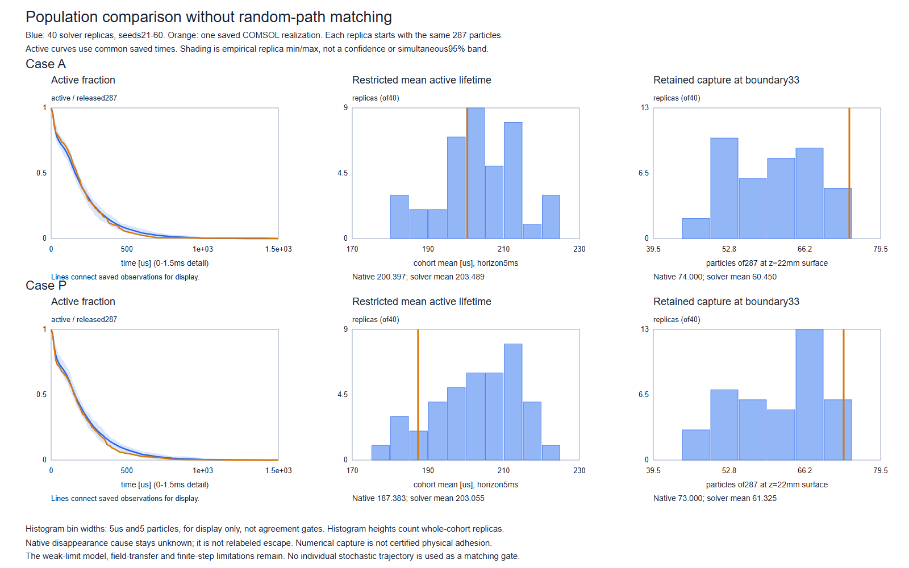
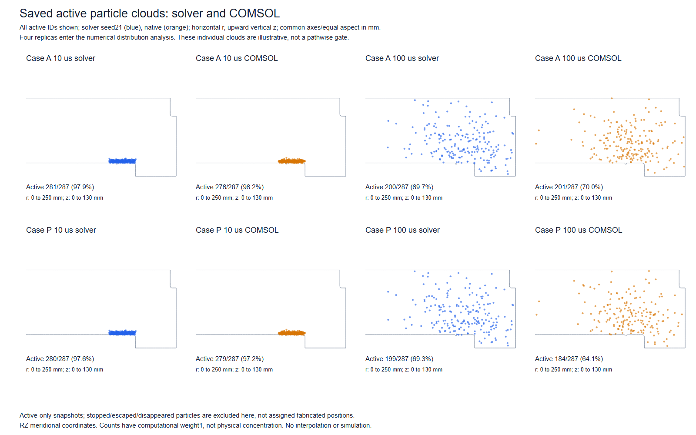

# A/P実用比較と再構成前後の科学的不変性

**今回のA/P各287粒子では、大局的な粒子輸送、総停止率、代表terminal時間、人口曲線は適切に対応する。** 新result4から再集計しても、従来の40実現評価の観測値と判断は変わらなかった。

同一candidate入力の再構成前後では、全80結果のfinal／release／boundary／failure／series／全frame／全probeがbitwise一致した。これはCOMSOLの乱数や同一ID軌道を一致させたという主張ではない。全結果でfailure0、元のcase SHA・seed・30 ms／5 ms窓・保存clockを保持し、COMSOLの新規solveは行っていない。[全80結果のcompact identity receipt](identity_receipt.json)

| 観測量 | A COMSOL | A候補40実現 | P COMSOL | P候補40実現 |
|---|---:|---:|---:|---:|
| 保持停止数 | 251 | 249.675 ± 6.014 | 254 | 251.775 ± 5.521 |
| 保持停止率 | 87.456% | 86.995% | 88.502% | 87.726% |
| 全粒子平均terminal時間 [µs] | 200.397 | 203.489 ± 10.751 | 187.383 | 203.055 ± 10.832 |
| 保持停止条件付きterminal中央値 [µs] | 153.670 | 150.717 ± 10.474 | 142.311 | 147.672 ± 10.504 |
| active曲線の参照対候補平均最大差 | — | 4.52 pp | — | 4.23 pp |

±は実現間のsample SDで、平均の信頼区間ではない。分母は全287 computational particles、model weightは全て1。全粒子が5 ms前にterminalとなり、5 ms restricted meanに右打切りはなかった。保持停止は数値的なterminal outcomeであり、実機の接着・flux・付着質量は認定しない。



候補はseed21–60の各40実現。最初の4実現は元の30 ms、残36実現は元の5 msを保持し、実用比較は共通0–5 ms／96保存時刻を使う。図の時間曲線は0–1.5 ms、青帯は経験的min–maxであり同時信頼帯ではない。A/Pの共通に近い乱数実現を独立な二回の証拠として数えず、80独立実現としてpoolしない。再生成は同じseedの確認であり、統計的な標本数の追加でもない。

局所量の留保も維持する。

| 観測量 | A native／候補平均 | P native／候補平均 |
|---|---:|---:|
| 境界33停止数 | 74／60.450（−4.72 pp） | 73／61.325（−4.07 pp） |
| 100 µs active速度中央値 [m/s] | 759.08／861.32（+13.5%） | 737.51／866.92（+17.5%） |

速度は各々のsurvivorに条件付いた量で、同一粒子の誤差ではない。これらは既存の差を見て選んだ探索的な観測であり、全表面・全時刻の精密一致やformal equivalenceを認定しない。COMSOL不明消失を候補escapeへ物理的に同一視していない。場転送・有限stepの確率過程・first-passage等の寄与は今回新たに分離しておらず、局所差をcharging／wallのbugや乱数だけに帰属しない。数値的なnative全方程式同等性と実機の物理的付着予測は別の未認定範囲である。



この空間図はseed21の例示、[100 µsの条件付きCDF](spatial_marginal_cdfs.png)と空間診断は元のseed21–24の4実現を使う。新result4のcontextからgeometryを読み、元field・初期source配列を再ロードしていない。4実現の空間図と40実現の集団評価を区別する。

同梱する数値と証拠は次の通り。

- [実用比較の実数とnative観測値15群](practical_summary.json)：counts／terminal／全停止面／時間曲線／early-active速度・電荷等。15群は整理単位で、独立15検定の意味ではない。繰返しの説明と多くのseed別scalar値を省略し、平均・SD・範囲・rank・全曲線を保持した。
- [新旧practical・空間観測値の一致](population_revalidation.json)：元assessmentと再集計したassessmentのSHA、および一致した観測量を記録。
- [全80結果のidentity](identity_receipt.json)：source SHA、case SHA、context logical/file SHA、結果manifest SHA、公開scientific digest、比較scope、実行資源を記録。入力・結果の実体を同梱したものではない。
- [図のSHAと表示条件](figures_receipt.json)：3枚のPNGは表示点検済み。図の標本数・分母・軸・min–max・条件付きCDFの意味を確認した。

**cloneだけで閲覧できるのは、このcompact数値・identity・図である。** 原MPH、native CSV、field／source HDF5、全result、baseline全digest packetは外部管理の`.artifacts/platform_restructure_20261123/`等にあり、このdirectoryには含めない。receipt内のpathは取得リンクではなく実行物のlocatorであり、SHAが同定の根拠になる。source-mapは実行時の未コミット再構成sourceの正確なidentityで、baseline commitだけから実行版を推定しない。

同梱JSONだけからsummary SVGを再生成する例。独立solver directoryから実行し、新しい出力先を使う。PNGも必要なら`--svg-only`を外し、必要に応じて`--browser`を指定する。

```powershell
uv run --locked python evidence/platform_restructure_2026_11_23/science/render_population.py --assessment evidence/platform_restructure_2026_11_23/science/practical_summary.json --output-directory NEW_FIGURE_DIRECTORY --svg-only
```

[recompute_population.py](recompute_population.py)はこのA/P287粒子・40 seed専用の保存データ再集計scriptで、production frameworkではない。再集計には外部の新result4集合、`ensemble/caseA|caseP/{results,plan,completion}.json`、それらの有効なcase／manifest path、native packetの`native/caseA|caseP_particles_long.csv`と各caseの`population_refined1_rk4_white_limit_s21.json`／`terminal_boundary_refined1_rk4_white_limit_s21.json`が必要である。cloneだけから欠落データを生成せず、COMSOL solveや旧result3 readerも追加しない。

```powershell
uv run --locked python evidence/platform_restructure_2026_11_23/science/recompute_population.py --assessment-root EXTERNAL_NEW_ASSESSMENT_ROOT --native-evidence-root EXTERNAL_NATIVE_EVIDENCE_ROOT --output NEW_METRIC_DIRECTORY
```

両scriptを実入力で確認し、15群の値とsummary SVGの一致を[再実行確認](reproduction_receipt.json)へ記録した。
